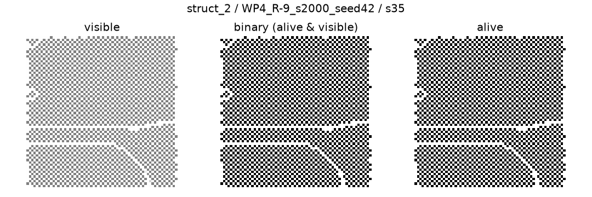
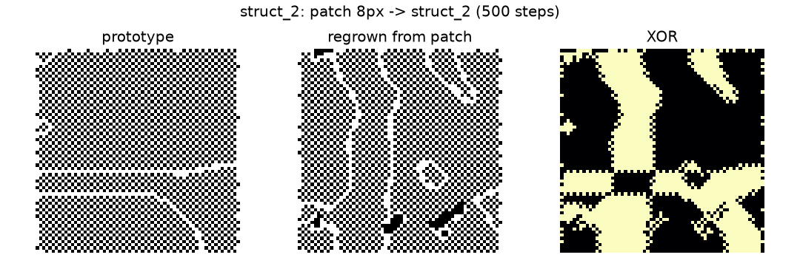
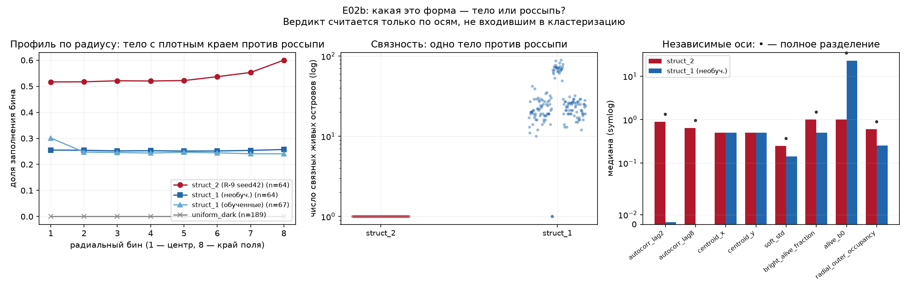

# 005: Что перепись нашла в морфопространстве

- **Тип:** исследовательская статья
- **Версия:** v1.6
- **Дата:** 2026-10-21
- **Статус:** стабильно
- **Автор:** Лаборатория Morphogenesis
- **Связанные отчёты:** [результаты E02b](../reports/2026-10-20-e02b-results.md),
  [план E02b](../reports/2026-10-20-e02b-plan.md),
  [E02: кольцо](../reports/2026-10-20-e02-pattern.md)
- **Связанные NEG:** NEG-30
- **Артефакты:** [`census.json`](../morphogenesis/experiments/E02b_morphospace/census.json),
  [`perturbations.json`](../morphogenesis/experiments/E02b_morphospace/perturbations.json),
  exploratory JSON и скрипты в
  [`E02b_morphospace`](../morphogenesis/experiments/E02b_morphospace/)

## Аннотация

E02b впервые измерил не одну форму, а всё морфопространство имеющихся чекпоинтов:
12 обученных моделей и контроль до обучения, по 64 шумовых старта, 2000 шагов без
градиента — 832 развёртки. Два класса воспроизводятся из всех 64 стартов: мелкая
спека `struct_1` и связная шахматная ткань `struct_2`. Предзарегистрированная H1
(есть нетривиальный воспроизводимый класс) и H2 (структура R-11 транзиентна)
поддержаны; H3 (после ампутации классы не восстанавливаются) опровергнута — оба
класса вернулись в 15/15 повторов. Формальный исход — `rich_map`. Но карта разрежена:
81% выученных прогонов уходят в смерть или однородность; `struct_1` воспроизводится
и без обучения, а `struct_2` найден только у одного тренировочного сида. На отложенных
сидах 64–127 оба класса повторились 64/64, а на 16 стартах `struct_2` удержался до
6000 шагов; то есть вывод не привязан к сидам переписи, горизонту 2000 или числу k
в диапазоне 3–8, но остаётся привязан к тренировочному сиду. Пересадка готовых
классов в R-9 seed42 даёт `struct_2` в 48/48 случаях, то есть у этой модели один
живой аттрактор, а пятиклассовая карта — межмодельная, а не набор бассейнов одного
чекпоинта. Обратная пересадка показывает, что это свойство конкретной модели: seed202
и seed303 переводят `struct_2` в свои классы, а seed101 — в смерть. Полная матрица
пересадок 12×12 (144 прогона) показывает, что ни у одной из 12 моделей нет двух
устойчивых живых форм одновременно: шесть моделей убивают всё живое, пять держат
ровно одну живую форму, и единственный нестабильный случай (R-11) разобран
отдельно — там структура переходная, а не вторая ловушка. Восстановление
оказывается ремонтом **класса текстуры**, а не побитовой реставрацией рисунка. Это
первый положительный структурный результат программы и одновременно точная граница
того, что он не доказывает.

**Ключевые слова:** NCA, морфопространство, аттрактор, регенерация, ампутация,
перепись, pre-registration.

## 1. Вопрос

E02 проверял одну заранее выбранную форму — кольцо — и закончился отрицательно:
кольцо не собиралось из шума, не удерживалось из цели, гейт слоя 1 дал 0/5
([отчёт E02](../reports/2026-10-20-e02-pattern.md)). Оставался вопрос шире: **какие
геометрии выученная динамика удерживает сама, если её не просить нарисовать
конкретную картинку?**

E02b сформулировал три проверяемых вопроса:

1. Есть ли среди выученных чекпоинтов класс, который возникает из шума, не является
   смертью или однородным полем, воспроизводится в ≥80% стартов и устойчив в
   последней четверти развёртки? (H1)
2. Транзиентна ли структура R-11, то есть уходит ли она к 2000 шагам в смерть или
   однородность? (H2)
3. Восстанавливается ли класс после ампутации 20% живых клеток? (H3)

Четвёртая гипотеза — о том, что вариант локального правила важнее тренировочного
сида, — была отложена как вторичная и в этой переписи не проверялась.

Ответ «да» на H1 означал бы, что морфопространство не пусто: у обученной динамики
есть собственные устойчивые формы. Ответ «нет» — что текущее правило и лосс
поддерживают только вырожденные состояния. Для H3 «да» означало бы отсутствие
ремонта; «нет» — что класс переживает повреждение, но ещё не говорит, **что именно**
восстанавливается.

Слово «аттрактор» здесь употребляется операционально: область начальных условий и
возмущений, из которой траектория возвращается в один и тот же класс дескрипторов.
Оно не означает математически доказанный аттрактор и тем более не означает «жизнь».

## 2. Контекст

Нейроклеточные автоматы (NCA) обучают локальное правило, которое разворачивается в
пространственную форму. В работах Mordvintsev и соавторов показано, что такие правила
способны выращивать заданный паттерн и восстанавливать его после повреждения
[Mordvintsev et al., 2020](https://distill.pub/2020/growing-ca). E02b не обучает
новую модель и не ставит новую цель: он берёт уже имеющиеся чекпоинты и смотрит,
какие морфологии они удерживают.

Концептуальная рамка — работы Michael Levin о «агентных материалах» и
морфологической памяти: ткань может решать задачу формы, а не просто исполнять
жёсткий план [Levin, 2022](https://www.frontiersin.org/articles/10.3389/fnsys.2022.768201/full);
[Levin, 2023](https://www.nature.com/articles/s44222-022-00001-9). Эта рамка задаёт
вопрос, но не является результатом. Наши данные могут сказать «класс формы
восстанавливается после удаления части клеток»; они не могут сказать «ткань помнит
план» без отдельного теста на восстановление глобальной конфигурации.

Предыдущие статьи лаборатории зафиксировали методические уроки: gated f1 может
показывать успех на почти однородном поле, hold = 1.0 получается по построению,
«met = true» означает наличие артефакта, а не научный результат
([004](004-lovushki-izmereniya-v-nca.md)). E02b проектировался с этими оговорками:
структура отделяется от яркости по `binary_fraction`, решение принимается по
воспроизводимости и устойчивости, а не по одному максимуму, а все 64 старта входят
в знаменатель.

## 3. Методы

### 3.1. Чекпоинты и развёртка

- 12 канонических файлов: H-A0 ×5 сидов, R-9 ×5, R-11 ×1, H-P1 ×1 (положительный
  контроль, стартующий из цели).
- Необученная модель той же архитектуры — runtime-контроль без файла весов.
- 64 детерминированных начальных состояния на чекпоинт (сиды 0…63), 2000 шагов,
  снимок каждые 50. Веса заморожены, градиента нет.
- Устройство — CUDA; полный прогон занял 5070.2 с. Пилот 8×500 использовался только
  для оценки времени.

### 3.2. Дескрипторы и классы

Каждый финал описывается 18 признаками: доля живых клеток, бинарная и яркая
плотность, средняя мягкая яркость, энтропия, число компонент и дырок (`b0`, `b1`),
эйлерова характеристика, заполнение bounding box, доля крупнейшей компоненты,
радиальный профиль и его дисперсия, симметрии, автокорреляции, доля краевых клеток.
Признаки z-нормируются; Ward строит классы, k выбирается по silhouette при
минимальном размере класса 5. DBSCAN используется как проверка согласия, а не как
источник классов. Контроли проецируются на центроиды выученных классов и не
участвуют в подгонке.

Семантика класса задана порогами: `death` при `alive_fraction < 0.01`,
`uniform_dark` при `binary_fraction < 0.01`, `uniform_bright` при
`binary_fraction > 0.95`, иначе `structured`.

### 3.3. Возмущения

Для каждого структурного класса выбраны 3 прототипа (по расстоянию до центроида),
по 5 повторов на каждое из шести возмущений: ампутация 10% и 20%, шум σ=0.1, разрез
половины поля, пересадка патча в мёртвое поле и мёртвое поле как контроль. Всего 180
исходов, по 30 на прототип. Восстановление — финальная точка снова назначена на класс
прототипа; время возврата — первый снимок (каждые 25 шагов), где класс совпал.

### 3.4. Что добавлено после переписи

Перепись оставила три пробела, которые закрывались отдельными exploratory-проверками,
явно не входящими в предзарегистрированные гипотезы:

- три **сидированные** инициализации необученной архитектуры (42/43/44), по 64 старта,
  и та же ампутация 20% — проверка архитектурного конфаунда `struct_1`;
- малые патчи 8×8, 16×16, 32×32 в нулевое поле, 30 развёрток по 500 шагов, затем
  длинная версия до 2000 шагов — проверка роста из фрагмента и идентичности рисунка;
- геометрические повреждения `struct_2`: половина поля и центральные квадраты 16/32,
  6 повреждений × 3 повтора × 2000 шагов — проверка сохранения глобальной фазы.

Позже, не меняя протокол, добавлены: отложенные сиды шума 64–127 (по 64 старта на
класс), горизонт 6000 шагов (16 стартов), проверка устойчивости самой кластеризации
(sweep k, bootstrap, jackknife признаков), пересадка готовых классов в R-9 seed42
(48 чужих пересадок + 16 самопересадок), обратная пересадка `struct_2` в
R-9 seed101/202/303 (48 пересадок), полная матрица пересадок между всеми 12
каноническими моделями (144 пересадки, по одному состоянию на источник и одному
сиду шума цели), повтор этой матрицы с 3 состояниями на источник и 3 сидами шума
цели (1296 пересадок, по 9 выборок на каждую пару) и отдельный разбор R-11
(16 своих стартов, 16 чужих пересадок, 4 возврата собственных финалов).
Последние отвечают на вопрос о бассейне аттрактора и о мультистабильности, а не
только о локальной устойчивости.

Правила всех этих проверок фиксировались **до** запуска и записывались в артефакт
вместе с результатом: в частности, живость исхода пересадки определяется по
`alive_fraction ≥ 0.05`, а не по метке класса (одно поле из 4096 живых клеток
получило метку `struct_2`), а устойчивость пары в повторной матрице требует
совпадения класса минимум в 8 из 9 выборок.

Две проверки, запущенные ночью, тоже не входят в предзарегистрированные
гипотезы, и их правила записаны заранее:

- **Повтор геометрической абляции** (`geometric_lesion_rep_exploratory.json`):
  те же 6 повреждений, но 12 повторов на повреждение вместо 3 и три модели вместо
  одной — R-9 seed42 (`struct_2`), R-9 seed101 (`struct_1`) и необученная архитектура
  (контроль: она тоже даёт `struct_1` 64/64). Цель — отделить свойство класса от
  свойства чекпоинта и от свойства самой архитектуры. Критерий асимметрии оси
  заранее: знак парной разности IoU одинаков минимум в 11 из 12 повторов
  (односторонний знаковый тест, p ≤ 0.00049) **и** модуль средней разности
  IoU ≥ 0.05. Всего 216 развёрток.
- **Нуклеогенез из живого очага** (`fragment_nucleogenesis_exploratory.json`):
  умеет ли ткань не только держать форму, но и вырастить её заново из крошечного
  живого очага. Из финального состояния прототипа оставляются k живых клеток
  (k = 1, 8, 32, 128, 512) двумя способами — случайно разбросанные
  (`scattered`) и пространственно компактные (`compact`: k ближайших к случайной
  опорной клетке живых клеток); всё остальное обнуляется по всем 16 каналам.
  Определение `compact` уточнено **до запуска**: связного (топологически)
  очага нужного размера у большинства прототипов просто не существует — у
  `struct_2` (R-9 seed42) живая маска распадается на 1745 компонент, крупнейшая
  — 164 клетки, у необученной архитектуры — 309 компонент, крупнейшая 217;
  при исходном определении («связный кусок») строки для k = 512 молча выпали бы
  из эксперимента, а для k = 128 результат зависел бы от того, повезло ли с
  крупнейшей компонентой. Сравнение с `scattered` сохраняет смысл: различаются
  только пространственная укладка и связность очага, число живых клеток то же.
  12 повторов на каждую ячейку, 2000 шагов, три модели (две обученные +
  необученная архитектура) плюс обязательный контроль k = 0 (полностью мёртвое
  поле) и перекрёстный блок (очаг чужого класса в чужую модель, k = 32).
  Критерии заранее: пробуждение засчитано, если в ≥ 11 из 12 повторов поле живо
  (`alive ≥ 0.05`), финальный класс совпадает с домашним классом модели и живая
  область выросла до ≥ 50 % прототипа; «тот же рисунок» — дополнительно бинарный
  IoU с прототипом ≥ 0.5; минимальный размер очага ищется по этому же порогу.
  Если в контроле k = 0 что-то прорастёт (≥ 11 из 12), блок помечается
  `control_failed` и выводы о пороге не делаются.
- **Память формы: видимое или скрытое** (`channel_memory_exploratory.json`):
  где лежит форма — в том, что видно (канал 0), или в скрытом состоянии клеток
  (каналы 2..15)? Это разные утверждения о «морфологической памяти», и до сих пор
  ни одно измерение их не разделяло. На финальном состоянии прототипа наносится
  одно из четырёх повреждений: `none` (контроль), `visible_zeroed` (канал 0
  обнулён, скрытое состояние цело), `hidden_zeroed` (каналы 2..15 обнулены,
  видимая текстура цела), `hidden_shuffled` (значения скрытых каналов переставлены
  по позициям: гистограмма сохранена, пространственная связь — нет). Канал
  живости (1) не обнуляется никогда: `alive` считается именно из него, иначе
  поле погибло бы тривиально и тест ничего бы не сказал. 12 повторов на
  условие, 2000 шагов, три модели (две обученные + необученная архитектура) —
  144 развёртки. Критерии заранее: класс восстановлен, если в ≥ 11 из 12
  повторов поле живо и финальный класс совпадает с домашним; «тот же рисунок» —
  бинарный IoU с прототипом ≥ 0.5; «та же фаза» — тот же порог при сдвиге до
  ±4 пикселей; «та же ориентация» — при повороте и отражении (группа D4).
  Интерпретация описательная: если `visible_zeroed` восстанавливает тот же
  рисунок, а `hidden_zeroed` — нет, память формы лежит в скрытом состоянии;
  если `hidden_zeroed` восстанавливает, форма выводится заново по видимой
  текстуре; если `hidden_shuffled` ломается там, где `none` держится, важна
  пространственная укладка скрытого состояния, а не только его наличие.
- **Транзиторные фазы на карте** (`transient_class_analysis_exploratory.json`) и
  **геометрия формы** (`geometry_of_form_exploratory.json`): два разбора, которые
  читают только каноническую перепись (`census.json`) и потому не требуют ни GPU,
  ни новых развёрток. Первый отвечает на вопрос, бывает ли `struct_2` проходной
  фазой у других моделей: класс «встречен в семействе», если он виден хотя бы
  в одном снимке траектории; семейство «только транзиторное», если класс в нём
  встречается, но ни один прогон в нём не заканчивается этим классом; класс
  «эксклюзивен», если он встречается ровно в одном семействе и нигде не только
  транзиторный; класс «универсален», если встречается в трёх и более семействах.
  Второй отвечает на вопрос, какая это форма: оси геометрии разбиты на три
  уровня зависимости от кластеризации, и **вердикт считается только по
  независимым осям** — тем, которых не было в 18-мерном векторе кластеризации.
  Ось разделена, если `max(A) < min(B)` или наоборот, без допусков; для
  векторной оси `radial_profile` — если каждый прогон ближе к среднему профилю
  своей группы, чем к чужому. Порог заранее: ≥3 разделённые оси — «геометрически
  различны», 1–2 — «частично», 0 — «не различны». Контрасты зафиксированы:
  `struct_2` против `struct_1`, `struct_2` против `uniform_dark`, `struct_1`
  необученной сети против `struct_1` выученных, `struct_2` против `struct_1`
  необученной сети.
- **Прочность тела** (`body_integrity_exploratory.json`): различие «тело против
  россыпи» пока внешнее — это два рисунка. Чтобы оно стало содержательным, у
  формы должна быть измеримая прочность: сколько живых клеток можно убить на
  месте, и ткань всё ещё удержит ту же форму. Три модели (R-9 seed42 —
  `struct_2`, R-9 seed101 — `struct_1`, необученная архитектура — контроль),
  семь долей p = 0, 0.1, 0.25, 0.5, 0.75, 0.9, 1.0 убитых живых клеток, 12
  повторов, 2000 шагов, 252 развёртки. Повреждение: у случайно выбранных живых
  клеток обнуляются каналы 0 (visible) и 1 (alive) — клетка убита на месте;
  скрытые каналы 2..15 не трогаются, внутреннее состояние клетки сохраняется.
  Правила заранее: выживание — поле живо (`alive ≥ 0.05`) и финальный класс
  совпадает с домашним; прочность на доле p установлена, если выживание в
  ≥ 11 из 12 повторов и медианная живая доля финала ≥ 0.5 × живой доли
  прототипа; прочность модели — наибольшая такая p; целостность тела —
  медианный `alive_b0` среди выживших; вердикт «превосходство struct_2» — её
  прочность строго больше прочности обоих конфаундов и тело при этом остаётся
  одним куском; вердикт «прочность архитектурная» — прочности совпадают.
  Отдельно считается индекс ремонта: медианный бинарный IoU финала с
  неповреждённым прототипом (выживание в классе и восстановление того же
  рисунка — не одно и то же).

### 3.5. Отклонения от протокола

- Ампутация обнуляет все 16 каналов, а не только `alive` и `visible`. Это сильнее
  записанного протокола и делает H3 консервативной.
- Протокольная пересадка оказалась вырожденной: bounding box обоих классов — всё
  поле, поэтому «патч» равнялся полю. Её результат не используется как свидетельство
  роста; вывод о малых патчах опирается только на exploratory.
- H4 не проверялась: для неё нужна отдельная сетка вариантов локального правила.
- Дефолты `config.py` не менялись, плечо не промотировалось, WP5 не открывался.

## 4. Результаты

### 4.1. Карта

Полный протокол: 13 семей × 64 старта = 832 развёртки, из них 704 выученных и 128
контрольных. 5 семейств H-A0 дают смерть во всех 64 стартах. R-9 расщепляется на
четыре режима: `struct_2` (seed42), `struct_1` (seed101), `uniform_dark`
(seed202 и seed404) и `uniform_bright` (seed303). R-11 в 61/64 финалов уходит в
`uniform_dark`, ещё 3 старта остаются `struct_1`. H-P1 в основном умирает: 35/64
`death`, 29/64 `struct_1`.

Ward даёт k=5, silhouette 0.8545. Размеры классов (все прогоны / выученные):
`[160/67, 355/320, 189/189, 64/64, 64/64]`. DBSCAN находит 7 кластеров, шум 4/704
(0.57%), ARI с Ward 0.9137 — разбиение не зависит от выбора алгоритма.

| Класс | Семантика | Выученных | Контролей | alive med | binary med | b0 med | b1 med |
| --- | --- | ---: | ---: | ---: | ---: | ---: | ---: |
| `struct_1` | structured | 67 | 93 | 0.7959 | 0.2561 | 382 | 2 |
| `death` | death | 320 | 35 | 0.0000 | 0.0000 | 0 | 0 |
| `uniform_dark` | uniform_dark | 189 | 0 | 1.0000 | 0.0000 | 0 | 0 |
| `uniform_bright` | uniform_bright | 64 | 0 | 1.0000 | 1.0000 | 1 | 0 |
| `struct_2` | structured | 64 | 0 | 0.5310 | 0.5310 | 1 | 1844.5 |


На карте первых двух главных компонент 18 дескрипторов (72.0% дисперсии) классы
образуют компактные области; контроли проецируются внутрь `struct_1` и `death`, не
образуя собственного класса. Это визуализация найденного разбиения, а не новый тест.

### 4.2. Две структуры, устроенные по-разному

`struct_2` — связная бинарная ткань с огромным числом дырок (`b1 ≈ 1844.5`) и
плотностью 0.531. На снимках это шахматный лабиринт с горизонтальной трещиной и
диагональной линией. `struct_1` — мелкая спека/перколяция: много отдельных компонент
(`b0 ≈ 382`), почти нет дырок, плотность 0.256.



`uniform_dark` — живые, но «молчащие» клетки (`alive=1`, `binary=0`);
`uniform_bright` — сплошная яркая заливка. Ни то, ни другое не является структурой:
это два разных способа потерять паттерн.

### 4.3. Гипотезы

**H1 — поддержана.** Оба кандидата воспроизводятся идеально: `struct_2` — 64/64
стартов R-9 seed42, `struct_1` — 64/64 стартов R-9 seed101; устойчивость в последней
четверти тоже 64/64. Доля смерти/однородности — 573/704 = 0.8139, ниже порога
опровержения 0.95. Максимальная доля структурного класса по семействам: 1.0, 1.0 и
0.0469 у R-11, то есть условие «все структурные < 0.5» не выполнено.

Оговорка: `struct_1` проходит пункт H1(б) с запасом всего 0.0046 — медиана
`alive_fraction` 0.7954 против потолка 0.80. Формально это не нарушение, но класс
стоит на самой границе критерия.

**Проверка на отложенных сидах.** Те же два чекпоинта прогнаны на сидах 64–127:
другие начальные поля и другая последовательность шагового шума, классы назначались
замороженными центроидами census. `struct_2` — 64/64, `struct_1` — 64/64, устойчивость
на последней четверти 1.00 у обоих; alive-медианы 0.5278 и 0.7944. Это exploratory-
проверка, а не расширение H1: она снимает возражение о конкретных сидах шума, но не
возражение о единственном тренировочном сиде.

**Горизонт.** 16 стартов R-9 seed42 прогнаны до 6000 шагов, втрое дольше протокола.
Класс `struct_2` сохраняется у 16/16 на шагах 2000, 4000 и 6000; устойчивость последней
четверти 1.00, alive med 0.5259, класс на 2000 совпал с census у 16/16. Это исключает
медленный уход в другой класс на этом горизонте, но не доказывает асимптотику.

**Устойчивость классов.** Полный пересчёт Ward воспроизводит канонические метки
704/704. В sweep k=2…10 класс `struct_2` сохраняется целиком (Jaccard 1.0) при k=3…8;
при k=4 сливаются `death` и `uniform_dark`, при k=2 `struct_2` сливается с соседом,
при k=9–10 делится надвое. Bootstrap 200 ресэмплов при k=5: ARI медиана 1.0, Jaccard
`struct_2` 1.0 и в медиане, и в 5-м процентиле; просадка ARI целиком на границе
`death`/`uniform_dark`. Jackknife: удаление `alive_fraction` или `soft_mean` роняет
общий ARI до 0.527, но `struct_2` остаётся целым; остальные 16 признаков дают ARI
≥ 0.993. Шум признаков до 10% не меняет метки. Оговорка: bootstrap выбора k в
диапазоне 3–7 даёт k=5 лишь в 52% (k=7 — 22%, k=4 — 21%), поэтому пятиклассовая
таксономия — описательная модель; устойчив прежде всего сам `struct_2`, а не вся карта.

**Бассейн.** Готовые финальные состояния `struct_1` (R-9 seed101), `uniform_dark`
(seed202) и `uniform_bright` (seed303), по 4 состояния на класс, поданы на вход
R-9 seed42 с четырьмя сидами шагового шума. Все 48/48 чужих пересадок и 16/16
самопересадок заканчиваются `struct_2`, устойчивость последней четверти 1.00.
Медиана шага возврата: `struct_1` — 50, `uniform_bright` — 100, `uniform_dark` — 150;
снимки идут каждые 50 шагов. Мёртвое поле остаётся мёртвым (H3). Значит, у этой
модели один живой аттрактор и одно мёртвое состояние: пять классов census — межмодельная
карта разных тренировочных сидов, а не пять сосуществующих бассейнов одного
чекпоинта. Оговорки: по 4 состояния на класс, один target; полная матрица
переходов разобрана ниже.

**Обратная пересадка.** Четыре готовых состояния `struct_2` поданы в R-9 seed101,
seed202 и seed303 (по 4 сида шума). seed202 переводит их в `uniform_dark` (16/16,
медиана 100 шагов), seed303 — в `uniform_bright` (16/16, 150 шагов), а seed101 —
в смерть (16/16). То есть способность принимать чужой живой класс не универсальна:
у seed42 бассейн широкий, у seed202/303 чужое состояние ассимилируется в собственный
класс, у seed101 — коллапс. Это также контроль классификатора: те же центроиды
уверенно называют другие классы, а не всегда `struct_2`.

**Матрица 12×12.** Одно финальное состояние каждой из 12 канонических моделей
(старт seed 0) подано в каждую из 12 моделей (шум цели seed 0): 144 пересадки.
Живых источников шесть (alive ≥ 0.5), остальные дают мёртвое поле либо остаток
в 83 живые клетки. Итог: **ни у одной модели нет двух устойчивых живых форм** —
кандидатов на мультистабильность ноль. Шесть моделей (пять H-A0 и H-P1) убивают
любое живое состояние, 6/6; пять моделей R-9 держат ровно одну живую форму:
seed42 перетягивает всех шестерых в `struct_2`, seed303 и seed404 — всех в свой
однородный класс, seed202 — пятерых из шести, а seed101 умирает на чужих живых
состояниях в 5 случаях из 6 и удерживает только своё. Мёртвое поле не воскресает
нигде: 60/60 пересадок из полностью мёртвых состояний заканчиваются смертью. Один
остаток в 83 живые клетки (H-P1) прорастает в трёх моделях, в том числе в
`struct_2` у seed42, — «почти мёртвое» работает как затравка. Оговорки: по одному
состоянию на источник и одному сиду шума цели; карта описательная. Отдельно замечен
конфликт «метка против alive»: поле с одной живой клеткой из 4096 получило метку
`struct_2`, поэтому вердикты считаются по alive (порог 0.05).

**R-11: структура переходная.** Единственная модель с нестабильной диагональю
разобрана отдельно: 16 своих стартов (16/16 `uniform_dark`, 16/16 совпали с census),
16 чужих пересадок (`uniform_dark` 7, `death` 8, `struct_1` 1) и 4 возврата собственных
финалов (2× `struct_1` с устойчивостью 0.20, 2× `uniform_dark`). Структура
встречается в траектории всех 16 стартов, но не удерживается ни в одном (0/16).
Вердикт: переходная фаза, а не вторая ловушка; у R-11 один аттрактор — однородное
тёмное поле.

**H2 — поддержана.** R-11: финальная точка — смерть или однородное поле у 61/64 =
0.9531; структура была хотя бы на одном снимке у 64/64; транзиентная структура с
последующим уходом — у 61/64. Последняя точка структурна лишь у 3/64 = 0.0469, то
есть опровергающий порог 0.80 не достигнут. Структура R-11 — короткая переходная
фаза, а не удерживаемый аттрактор.

**H3 — опровергнута.** После ампутации 20% живых клеток (все 16 каналов) оба класса
вернулись в свой класс 15/15; медиана шага возврата — 25, первый же снимок. Мёртвое
поле дало 0/15 и осталось точно нулевым — самовоспламенения нет, для восстановления
нужны живые соседи. H3 ожидала отсутствия ремонта и его не получила.

**H4 — не проверялась.** `status=not_run`; перепись её не подменяет.

### 4.4. Ремонт класса, а не восстановление рисунка

Все возмущения, кроме мёртвого контроля, вернули оба класса 15/15 с медианой 25
шагов. Но это совпадение **класса по 18 дескрипторам**, а не восстановление исходной
конфигурации клеток. Проверка идентичности это подтверждает.

**Малые патчи.** 30/30 патчей (2 класса × 3 размера × 5 позиций) выросли в свой
класс из нулевого поля. Патч занимал 1.56%, 6.25% и 25% поля; финальная бинарная
плотность — 25–26% у `struct_1` и 52–55% у `struct_2`, то есть рост в 16×/4.2×/1.0×
и 35×/8.8×/2.1× относительно площади затравки. `struct_1` вернулся за 25–50 шагов;
`struct_2` — за 25 шагов из 32×32, за 225 из 8×8 и за 275 из 16×16. Чем меньше
затравка, тем дольше организуется шахматная фаза.

**Идентичность.** IoU с прототипом у `struct_1` — 0.154–0.158, agreement 0.61–0.62
при плотности 0.25: agreement на уровне случайного, IoU чуть выше. У `struct_2` IoU
0.453/0.329/0.200 для 8/16/32 при 500 шагах и 0.468/0.158/0.208 при 2000. Случайный
baseline для независимых бернуллиевских полей плотности 0.53 — IoU = p/(2−p) ≈0.36
и agreement ≈0.50: только 8×8 выше случайного, 16 и 32 — ниже. К 2000 шагам
сходимости к прототипу нет.
`struct_2` из 8×8 сохраняет часть крупномасштабной структуры, но вырастает в
многодоменную шахматную текстуру с границами зёрен, а не в копию полосы и диагонали.



**Геометрические повреждения `struct_2`.** Все 18 прогонов остаются `struct_2` во
всех срезах, но fidelity рисунка различается:

| Повреждение | IoU median на 2000 | Разброс |
| --- | ---: | --- |
| центр 16×16 | 0.841 | 0.835–0.846 |
| центр 32×32 | 0.744 | 0.744–0.749 |
| стёрта правая половина (осталась левая) | 0.796 | 0.771–0.801 |
| стёрта верхняя половина (осталась нижняя) | 0.806 | 0.806–0.807 |
| стёрта нижняя половина (осталась верхняя) | 0.564 | 0.516–0.733 |
| стёрта левая половина (осталась правая) | 0.431 | 0.297–0.456 |

Локальная дыра 16×16 залечивается почти идеально: IoU 0.89 уже на 500 шагах и 0.84
к 2000. Для половин поля результат асимметричен: сохранение левой половины даёт
IoU ≈0.80, правой — 0.43, нижней — 0.56, верхней — 0.81. Это exploratory на одном
чекпоинте и трёх повторах; асимметрия — наблюдение, а не установленный закон.

### 4.5. Контроль архитектуры

- Канонический untrained-контроль (одна несидированная инициализация): `struct_1`
  64/64, alive 0.502, binary 0.252, b0 271.5, b1 14.
- H-P1: `death` 35/64, `struct_1` 29/64, alive med 0.017.
- Три сидированные инициализации (42/43/44): каждая 64/64 `struct_1`, alive med
  0.5018, binary 0.2520, b0 271.5, b1 14. После ампутации 20% — **45/45 возвратов**
  в `struct_1` на 25-м шаге.

Значит, `struct_1` — архитектурный аттрактор, а не выученная морфология: он
появляется без обучения и «ремонтируется» без обучения. `struct_2` не встречается
ни у одного контроля и ни у одного другого выученного чекпоинта — это самый сильный
кандидат на выученную организацию.

Совпадение меток — ещё не совпадение состояний, поэтому утверждение проверено
расстояниями в z-пространстве кластеризации
(`generic_class_distance_exploratory.json`):

| Что | Расстояние | Для сравнения |
| --- | ---: | --- |
| облако 64 прогонов необученной архитектуры → центроид `struct_1` | **1.93** | собственный разброс класса `struct_1` — 1.95 |
| то же → центроид `struct_2` | **8.00** | собственный разброс `struct_2` — 0.64 |
| облако `struct_1` → ближайший другой класс (`death`) | 5.55 | разброс облака необученной — 1.05 |

Необученная архитектура лежит **на** `struct_1` (расстояние совпадает с разбросом
самого класса) и в 2.9 раза ближе к нему, чем ко второму по близости классу; до
`struct_2` — в 12 раз дальше, чем её собственный разброс. Формально: из двух
структурных классов ровно один (`struct_1`) — свойство архитектуры, и ровно один
(`struct_2`) — выученный.

### 4.6. Форма не бывает транзиторной фазой

Проверка к сильному утверждению «`struct_2` — выученная морфология»: а не
проходят ли другие модели через эту форму по дороге — к своей смерти или к
однородному полю? Если бы проходили, `struct_2` была бы обычной фазой, а её
редкость объяснялась бы тем, что она быстро «уходит».

Перепись хранит траектории всех 832 развёрток (13 семейств × 64 старта ×
40 снимков), поэтому ответ считывается из канонического артефакта без новых
вычислений (`transient_class_analysis_exploratory.json`):

| Класс | Семейств, где встречается | Из них только транзиторные |
| --- | ---: | ---: |
| `struct_1` | 6 | 4 |
| `struct_2` | **1** | **0** |
| `uniform_dark` | 3 | 0 |
| `uniform_bright` | 1 | 0 |
| `death` | 6 | 0 |

`struct_2` встречается ровно в одном семействе — R-9 seed42, во всех 64 его
прогонах — и **ни в одном из 768 прогонов других моделей**, даже транзиторно.
`struct_1`, наоборот, универсален: кроме двух семейств, которые в нём
заканчиваются, он встречается только по дороге — H-P1 (11 прогонов), R-11
(61), R-9 seed202 (26), R-9 seed404 (21).

Это разделяет два класса по-разному, чем расстояния в z-пространстве: `struct_1`
— состояние, в которое ткань попадает почти у всех и из которого уходит;
`struct_2` — состояние, в которое попадает ровно одна модель и из которого
не выходит. Первое — свойство архитектуры, второе — кандидат на выученную
морфологию.

### 4.7. Геометрия: тело против россыпи

До сих пор форма описывалась меткой класса. Метка не говорит, *какая* это форма.
Перепись хранит полный дескриптор финального состояния каждой из 832 развёрток,
поэтому вопрос «в чём именно различие?» снимается чтением канонического артефакта
(`geometry_of_form_exploratory.json`).

Сначала — защита от тавтологии. Классы были разведены по 18-мерному вектору
признаков, и различие по признаку из этого вектора ничего не доказывает. Поэтому
оси разбиты на три уровня:

- **A, независимые** — признаки, которых в векторе кластеризации не было:
  `autocorr_lag2`, `autocorr_lag8`, `centroid_x`, `centroid_y`, `soft_std`,
  `bright_alive_fraction`, `alive_b0`;
- **B, частично зависимые** — та же вычислительная процедура, но сам признак в
  вектор не входил: `radial_outer_occupancy`, `radial_profile`;
- **C, круговые** — признаки из `CLUSTER_FEATURES`; в вердикт не входят.

Главный вердикт считается **только по уровню A**. Ось считается разделённой, если
`max(A) < min(B)` или наоборот — без допусков. Для векторной оси `radial_profile`
критерий строже: каждый прогон должен быть ближе к среднему профилю своей группы,
чем к среднему профилю чужой. Порог вердикта: ≥3 разделённые оси — «геометрически
различны».

Результат (`struct_2` против `struct_1` необученной архитектуры, 64 против 64
прогона):

| Признак | `struct_2` | `struct_1` (необуч.) | Разделение |
| --- | ---: | ---: | --- |
| `alive_b0` — число связных живых островов | **1** | **23** | полное |
| `radial_outer_occupancy` — плотность края | **0.599** | 0.255 | полное |
| `autocorr_lag8` — крупномасштабная связность | **0.642** | −0.000 | полное |
| `autocorr_lag2` — локальная связность | **0.891** | 0.002 | полное |
| `soft_std` — контраст текстуры | **0.246** | 0.142 | полное |
| `bright_alive_fraction` — доля яркого в живом | **1.000** | 0.502 | полное |

Пять независимых осей разделяют классы полностью, ни одна прогон не пересекает
границу. Вердикт: **геометрически различны**. Он не меняется, если из уровня A
убрать всё спорное (`alive_b0` делит процедуру с `log1p_b0`, `autocorr_lag2` — с
`autocorr_lag1`/`lag4`, `bright_alive_fraction` выводится из `bright_fraction` и
`alive_fraction`): остаются `autocorr_lag8`, `soft_std` и
`radial_outer_occupancy` — ровно три, и вердикт сохраняется.

Содержательно это различие между **телом** и **россыпью**:

- `struct_2` — одно связное тело, занимающее 53% поля
  (`largest_component_fraction = 0.531`), с плотным краем: профиль по радиусу
  почти плоский (0.52 в центре) и поднимается к 0.60 у самого края, пик в
  крайнем бине. Всё живое поле яркое (`bright_alive_fraction = 1.000`).
- `struct_1` — около 24 отдельных крошечных островков (`alive_b0 = 24`),
  крупнейший из которых занимает 0.7% поля, радиально плоский (профиль 0.21 во
  всех восьми бинах), текстурно несвязный (`autocorr_lag2 = 0.012`).



Контроль на то, что это не просто следствие кластеризации, сделан отдельным
контрастом: `struct_1` у **выученных** семейств против `struct_1` у
**необученной** архитектуры. Расхождений по строгому набору осей — ноль
(вердикт «не различны»): обучение меняет текстуру `struct_1`
(`autocorr_lag2` разделён полностью), но не его геометрию. Именно поэтому
`struct_1` и остаётся архитектурным конфаундом, а `struct_2` — единственный
класс, у которого есть собственная геометрия.

### 4.8. Формальный исход

По правилу плана исход — **`rich_map`**: два структурных класса, оба с
воспроизводимостью 1.0, хотя бы один с восстановлением ≥50% (фактически оба 100%).
Числа: `n_runs=704`, `n_structural_classes=2`, `n_structural_runs=131` (18.6%),
`death_or_uniform_fraction=0.8139`.

Это метка, а не оценка «живости». 81% выученных прогонов уходят в смерть или
однородность, а один из двух структурных классов оказался архитектурным конфаундом.

## 5. Обсуждение

### 5.1. Что установлено

У обученной модели R-9 seed42 есть устойчивый класс `struct_2`, который:

- возникает из всех 64 шумовых стартов;
- не появляется у контролей и у других выученных чекпоинтов;
- не встречается ни транзиторно ни в одном из 768 прогонов других моделей;
- имеет собственную геометрию: одно связное тело с плотным краем, а не россыпь
  островков, как у `struct_1` — различие держится на признаках, не входивших в
  кластеризацию;
- переживает удаление 20% клеток, разрез половины поля и геометрические повреждения;
- вырастает из патча 8×8 в нулевом поле.

В рамках этого протокола это устойчивый морфологический аттрактор с ремонтом на
уровне класса. Это первый положительный структурный результат программы после
отрицательного E02.

### 5.2. Что не установлено

Ремонт не является восстановлением информации. IoU патчей 0.15–0.47 и отсутствие
сходимости к 2000 шагам показывают: система восстанавливает **статистику ткани**, а
не конкретный глобальный рисунок. Для `struct_1` agreement вообще на уровне
случайного. Формулировка «ткань помнит форму» была бы сильнее данных.

Не установлена и выученность `struct_2`: он найден у одного тренировочного сида.
Перепись не различает «свойство обученной динамики» и «удачную траекторию одного
сида». Это главный вопрос, который она оставляет.

Наконец, протокол измеряет морфологию в фиксированных точках. Он не проверяет
адаптацию, цели, информацию или агентность. «Rich_map» — это карта того, что
удерживается, а не ответ на вопрос, является ли это «геометрией жизни».

### 5.3. Две конкурирующие интерпретации

**Фаза текстуры.** Локальное правило имеет устойчивую шахматную фазу; повреждение
сбивает фазу, но не уничтожает её; система залечивает границы и выбирает новую
глобальную ориентацию. Патчи и асимметрия половин поля это поддерживают: класс
устойчив, глобальный рисунок — нет.

**Выученная морфология с бассейном.** Обучение сформировало широкий бассейн
притяжения вокруг семейства шахматных конфигураций; `struct_2` — его типичный
представитель. Отсутствие `struct_2` у контролей и его 64/64 воспроизводимость это
поддерживают, но не доказывают, что бассейн возник именно из-за обучения, а не из-за
архитектуры плюс удачного сида.

Различить интерпретации можно тестом на **глобальную ориентацию**: повреждать поле
так, чтобы часть полосы и диагонали сохранялась, и измерять не класс, а
восстановление ориентации и фазы относительно уцелевшего фрагмента. Если класс
восстанавливается, а ориентация — нет, это фаза. Если ориентация восстанавливается
из частичного следа, это уже похоже на морфологическую память в операциональном
смысле.

### 5.4. Метафора и её граница

В рамках языка Levin можно сказать, что ткань «решает задачу формы», а не исполняет
план. Наши данные дают этой метафоре аккуратный якорь: после удаления части клеток
система возвращается к классу ткани, а не рассыпается. Но метафора не является
результатом. Проверяемое ядро — 18 дескрипторов, 64 старта, 15/15 возвратов и IoU
0.15–0.47; метафора — «морфологическая память». Между ними лежит эксперимент на
восстановление глобальной конфигурации, которого пока нет.

## 6. Ограничения

1. **Один сид на класс.** `struct_2` — только R-9 seed42, `struct_1` — только R-9
   seed101. Репликация обучения — отдельный тренировочный прогон и решение владельца.
2. **Архитектурный конфаунд `struct_1`.** Необученная архитектура 64/64 попадает в
   тот же класс, три сидированные инициализации дают 45/45 ремонт. H3 содержательно
   опровергнута прежде всего для `struct_2`.
3. **Граница H1(б).** `struct_1` проходит с запасом 0.0046 по `alive_fraction`.
4. **Ампутация сильнее протокола.** Обнуляются все 16 каналов, а не только alive и
   visible; это делает H3 консервативной, но не позволяет отделить вклад alpha от
   видимого состояния.
5. **Протокольная пересадка патча неинформативна.** Bbox = всё поле; вывод о росте
   опирается только на exploratory-патчи. Это не относится к пересадке готовых
   состояний между моделями в проверке бассейна.
6. **Метрика восстановления — класс, а не идентичность.** 25 шагов — первый снимок;
   реальное время может быть меньше. IoU 0.15–0.47 подтверждает, что это не
   побитовая реставрация.
7. **Канонический untrained-контроль несидирован.** Три сида exploratory закрывают
   пробел частично, но не дают распределения по инициализациям.
8. **k=5 и пороги семантики** выбраны по silhouette и правилам. Bootstrap выбора k
   даёт k=5 лишь 52%, а граница `death`/`uniform_dark` зависит от `alive_fraction` и
   `soft_mean`; при этом `struct_2` устойчив при k=3–8, к jackknife и шуму признаков.
   Пятиклассовая карта — описательная модель, не единственное разбиение.
9. **Геометрическая абляция — exploratory** на одном чекпоинте, 3 повтора; асимметрия
   половин поля статистически не установлена.
10. **H4 не проверена**, WP5 не открывался, дефолты `config.py` не менялись.
11. **Бассейн проверен частично.** Прямо: 3 класса × 4 состояния × 4 сида в один
    target. Обратно: `struct_2` → 101/202/303. Полная матрица переходов построена
    (12 × 12 = 144 пересадки), но по одному состоянию на источник и одному сиду
    шума цели, поэтому она показывает устойчивость *модели*, а не устойчивость
    *состояния*: устойчивое состояние и «удачный единичный прогон» в ней не
    разделены. Один живой аттрактор — свойство R-9 seed42; seed101 на чужом
    состоянии уходит в смерть.
12. **Матрица переходов — exploratory.** Её вердикты опираются на
    замороженные центроиды census и на `alive_fraction` для решения о живости;
    один конфликт (метка класса `struct_2` при alive 0.0002) разобран явно, но
    других неоднозначностей в 144 строках не осталось.
13. **R-11 разобран на 36 прогонах** (16 своих стартов, 16 чужих пересадок, 4
    возврата). «Структура — транзиентная фаза, а не второй аттрактор» — вывод
    про R-11; о её происхождении (почему структура возникает на 25–50 шагах) не
    сказано ничего сверх факта.

## 7. Что дальше

1. **Реплицировать обучение R-9 seed42** (минимум второй сид). Это прямой тест того,
   является ли `struct_2` свойством тренировочного сида. Решение о запуске — за
   владельцем спеки; без него следующий шаг остаётся открытым.
2. **Повторить геометрические повреждения на реплицированном чекпоинте** с большим
   числом повторов и фиксированной ориентацией полосы и диагонали. Критерий,
   который нужно зафиксировать до запуска: восстанавливается ли ориентация выше
   случайного уровня, а не только класс.
3. **Только после этого — H4** на малой сетке локальных правил (alive-policy,
   соседство). WP5 остаётся закрытым; дефолты `config.py` не меняются.
4. Если `struct_2` подтвердится на втором сиде, следующий содержательный вопрос —
   можно ли удерживать этот класс при обучении, не убивая остальные классы. Это уже
   новая серия, а не E02b.

## 8. Воспроизведение

```bash
# из корня репозитория
cd morphogenesis
../.venv/Scripts/python.exe e02b_morphospace.py --steps 2000 --seeds 0-63

# exploratory-проверки (пишут JSON в experiments/E02b_morphospace)
cd ..
.venv/Scripts/python.exe morphogenesis/experiments/E02b_morphospace/scripts/e02b_geometric_lesion.py
.venv/Scripts/python.exe morphogenesis/experiments/E02b_morphospace/scripts/e02b_patch_identity.py
.venv/Scripts/python.exe morphogenesis/experiments/E02b_morphospace/scripts/e02b_untrained_recovery.py
.venv/Scripts/python.exe morphogenesis/experiments/E02b_morphospace/scripts/e02b_heldout_seeds.py
.venv/Scripts/python.exe morphogenesis/experiments/E02b_morphospace/scripts/e02b_long_horizon.py
.venv/Scripts/python.exe morphogenesis/experiments/E02b_morphospace/scripts/e02b_morphospace_map.py
.venv/Scripts/python.exe morphogenesis/experiments/E02b_morphospace/scripts/e02b_cluster_robustness.py
.venv/Scripts/python.exe morphogenesis/experiments/E02b_morphospace/scripts/e02b_basin_crossinit.py
.venv/Scripts/python.exe morphogenesis/experiments/E02b_morphospace/scripts/e02b_basin_reverse.py
.venv/Scripts/python.exe morphogenesis/experiments/E02b_morphospace/scripts/e02b_transition_matrix.py
.venv/Scripts/python.exe morphogenesis/experiments/E02b_morphospace/scripts/e02b_r11_bistability.py

# проверка «generic vs learned» — только чтение census.json, секунды
.venv/Scripts/python.exe morphogenesis/experiments/E02b_morphospace/scripts/e02b_generic_class_distance.py

# разбор карты и геометрии формы — только чтение census.json, секунды
.venv/Scripts/python.exe morphogenesis/experiments/E02b_morphospace/scripts/e02b_transient_class_analysis.py
.venv/Scripts/python.exe morphogenesis/experiments/E02b_morphospace/scripts/e02b_geometry_of_form.py

# ночные повторы (долгие: считают на CUDA, часы)
.venv/Scripts/python.exe morphogenesis/experiments/E02b_morphospace/scripts/e02b_transition_matrix_rep.py
.venv/Scripts/python.exe morphogenesis/experiments/E02b_morphospace/scripts/e02b_geometric_lesion_rep.py
.venv/Scripts/python.exe morphogenesis/experiments/E02b_morphospace/scripts/e02b_fragment_nucleogenesis.py
.venv/Scripts/python.exe morphogenesis/experiments/E02b_morphospace/scripts/e02b_channel_memory.py

# независимая проверка census/perturbations
.venv/Scripts/python.exe morphogenesis/experiments/E02b_morphospace/scripts/e02b_verify.py

# независимая проверка всех exploratory-артефактов (не доверяет harness-полям)
.venv/Scripts/python.exe morphogenesis/experiments/E02b_morphospace/scripts/e02b_verify_exploratory.py
```

Основные артефакты: `census.json` (15.5 МБ), `perturbations.json` (1.9 МБ),
`pilot.json` (0.6 МБ) и двенадцать exploratory JSON. Поля, на которые опирается статья:
`clustering.silhouette`, `clustering.sizes`, `clustering.dbscan.ari`,
`hypotheses.H1/H2/H3`, `outcome.death_or_uniform_fraction`,
`outcome.n_structural_runs`, `h3.by_class.*.recovery_fraction`.

## Ссылки

1. [Результаты E02b](../reports/2026-10-20-e02b-results.md) — первичный отчёт и все
   числа этой статьи.
2. [План E02b](../reports/2026-10-20-e02b-plan.md) — предзарегистрированные гипотезы.
3. [E02: почему кольцо не стало аттрактором](../reports/2026-10-20-e02-pattern.md).
4. [004: ловушки измерения в NCA](004-lovushki-izmereniya-v-nca.md).
5. Mordvintsev A. и соавт. **Growing Neural Cellular Automata.** *Distill*, 2020.
   [distill.pub/2020/growing-ca](https://distill.pub/2020/growing-ca)
6. Levin M. **Technological Approach to Mind Everywhere.** *Frontiers in Systems
   Neuroscience*, 2022. [frontiersin.org](https://www.frontiersin.org/articles/10.3389/fnsys.2022.768201/full)
7. **Synthetic morphology with agential materials.** *Nature Reviews Bioengineering*,
   2023. [nature.com](https://www.nature.com/articles/s44222-022-00001-9)
8. [Спецификация Morphogenesis v5.6-EXP FINAL / Rev.11](../docs/spec/MORPHOGENESIS_v5.6_Rev11.md).

## Changelog

- **v1.0** (2026-10-21): первая версия по закрытому E02b; числа сверены с
  `census.json`, `perturbations.json` и exploratory-артефактами.
- **v1.1** (2026-10-21): отложенные сиды 64–127 (64/64 `struct_2` и `struct_1`),
  PCA-карта морфопространства; ограничение про один тренировочный сид сохранено.
- **v1.2** (2026-10-21): горизонт 6000 шагов на 16 стартах — `struct_2` 16/16,
  устойчивость 1.00; асимптотика по-прежнему не доказана.
- **v1.3** (2026-10-21): устойчивость кластеризации — `struct_2` цел при k=3–8,
  bootstrap и jackknife; k=5 выбран лишь в 52% bootstrap-выборок, граница
  `death`/`uniform_dark` менее устойчива. Вывод про один тренировочный сид не изменён.
- **v1.4** (2026-10-21): пересадка готовых классов в R-9 seed42 — 48/48 чужих и
  16/16 самопересадок дают `struct_2`; у модели один живой аттрактор, карта
  межмодельная. Репликация тренировочного сида по-прежнему не выполнена.
- **v1.5** (2026-10-21): обратная пересадка `struct_2` → 101/202/303: seed202 и
  seed303 ассимилируют его в свои классы (16/16), seed101 уходит в смерть (16/16).
  «Один живой аттрактор» — свойство конкретной модели, не универсальное правило.
- **v1.6** (2026-10-21): полная матрица пересадок 12 × 12 (144 прогона) — ни у одной
  из 12 моделей нет двух устойчивых живых форм одновременно: шесть убивают всё
  живое, пять держат ровно одну живую форму, R-11 разобран отдельно (структура
  транзиторная, 0/16 устойчивых). Добавлен независимый верификатор всех
  exploratory-артефактов: 0 ошибок, 0 предупреждений. Вывод про один тренировочный
  сид не изменён.
- **v1.7** (2026-10-21): разбор карты на транзиторные фазы — `struct_2` не
  встречается транзиторно ни в одном из 768 прогонов других моделей, `struct_1`
  универсален. Добавлена геометрия формы: `struct_2` — одно связное тело с
  плотным краем, `struct_1` — россыпь ~24 островков; различие держится на признаках,
  не входивших в кластеризацию (5 независимых осей, вердикт сохраняется и на
  строгом подмножестве). Вывод про один тренировочный сид не изменён.

## Проверка

- Числа сверены с: `census.json` (`clustering`, `hypotheses`, `outcome`),
  `perturbations.json` (`h3`), `patch_transplant_exploratory.json`,
  `patch_identity_exploratory.json`, `patch_identity_long_exploratory.json`,
  `geometric_lesion_exploratory.json`, `untrained_recovery_exploratory.json`,
  `heldout_seeds_exploratory.json`, `long_horizon_exploratory.json`,
  `cluster_robustness_exploratory.json`, `basin_crossinit_exploratory.json`,
  `basin_reverse_exploratory.json`, `transition_matrix_exploratory.json`,
  `r11_bistability_exploratory.json`, `transient_class_analysis_exploratory.json`,
  `geometry_of_form_exploratory.json` (2026-10-21).
- Ссылки проверены 2026-10-21.
- Независимый `e02b_verify.py` (не доверяет harness-полям) — 0 ошибок, 0 предупреждений.
- Независимый `e02b_verify_exploratory.py` (пересчитывает матрицу, бассейны,
  устойчивость кластеров, отложенные сиды и длинный горизонт по строкам
  артефактов) — 0 ошибок, 0 предупреждений.
- Отложенные сиды пересчитаны по строкам артефакта: 64+64, устойчивость 1.00,
  медианы 0.5278/0.7944; расхождений со сводкой нет.
- Длинный горизонт пересчитан по строкам: 16/16 `struct_2` на 2000/4000/6000,
  устойчивость 1.00, совпадение с census 16/16.
- Устойчивость кластеров пересчитана: полный пересчёт 704/704; `struct_2` Jaccard
  1.0 при k=3–8, bootstrap p05 1.0, jackknife min 1.0, шум 10% — 1.0; k=5 в 52/100
  bootstrap-выборок.
- Бассейн пересчитан: 48/48 чужих пересадок и 16/16 самопересадок дают `struct_2`,
  устойчивость 1.00; медианы возврата 50/100/150 шагов; alive 0.515–0.530.
- Обратная пересадка пересчитана: seed101 — 16/16 `death`, seed202 — 16/16
  `uniform_dark` (медиана 100), seed303 — 16/16 `uniform_bright` (150).
- Матрица переходов пересчитана по строкам: 144/144 уникальных пар, 12 диагоналей
  совпадают с домашним классом у 11 моделей и расходятся только у R-11;
  вердикты пересчитаны из строк — 6 killer, 5 single_live_attractor, 1
  diagonal_unstable, 0 multi_basin_candidate; конфликт «метка класса / живость»
  ровно один (alive 0.0002 при метке `struct_2`).
- Транзиторные фазы пересчитаны по `census.json`: `struct_2` — 1 семейство,
  0 только транзиторных; `struct_1` — 6 семейств, 4 только транзиторных.
- Геометрия формы пересчитана по `census.json`: `struct_2` против `struct_1`
  необученной сети — 5 разделённых независимых осей (из них 3 в строгом
  наборе), вердикт «геометрически различны»; `struct_1` выученных против
  необученной — 0 разделений в строгом наборе, вердикт «не различны».
- R-11 пересчитан по строкам: фаза A — 16/16 `uniform_dark`, `struct_1` во всех 16
  траекториях, 0 устойчивых; фаза B — 7 `uniform_dark` / 8 `death` / 1 `struct_1`,
  0 устойчивых `struct_1`; фаза C — 2 `struct_1` с устойчивостью 0.20 и 2
  `uniform_dark`. Вердикт `transient_only`.
- Повторный запуск `e02b_basin_crossinit.py` в новом процессе дал семантически
  идентичный JSON (расхождения только в `wall_seconds`).
- Повторный запуск `e02b_patch_identity.py` и `e02b_geometric_lesion.py` в новом
  процессе дал семантически идентичные JSON (расхождения только в `wall_seconds`
  и путях к фигурам).
- Второй проход на переоценку: autonomous-agent, 2026-10-21; отдельно проверено, что
  статья не называет `rich_map` жизнью и не приписывает `struct_1` обучение.
