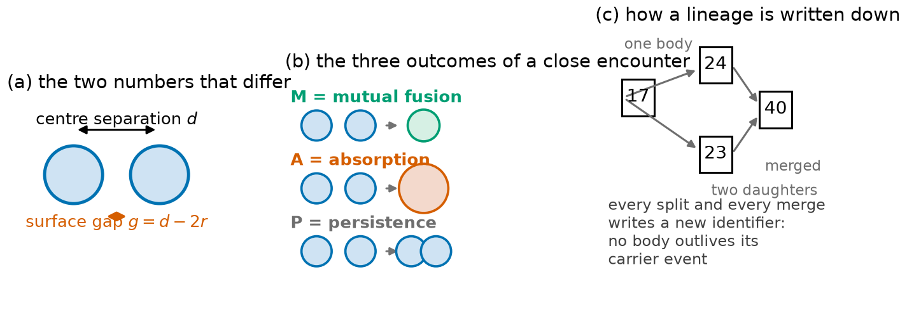
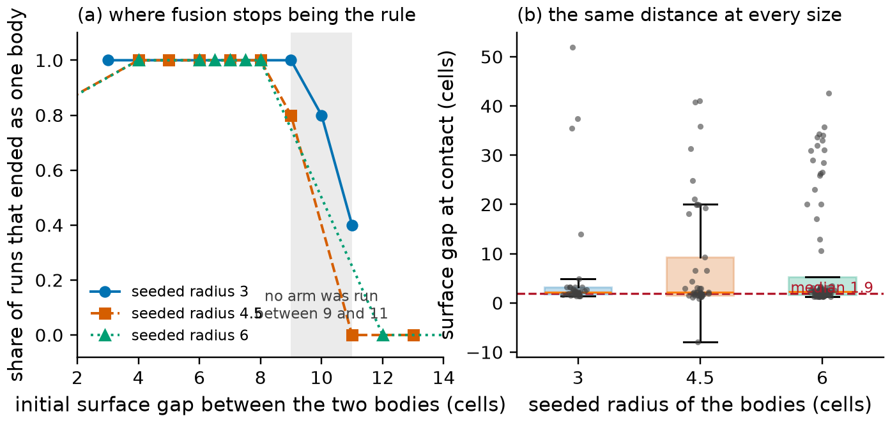
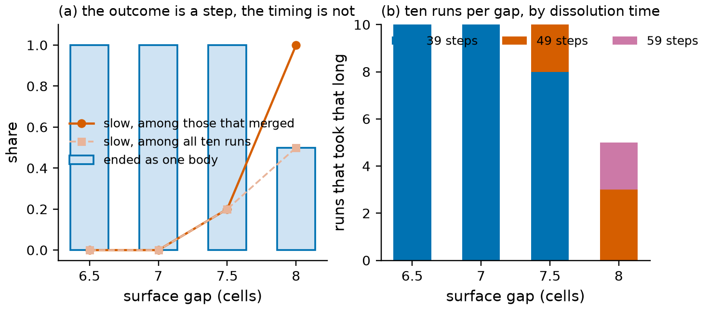
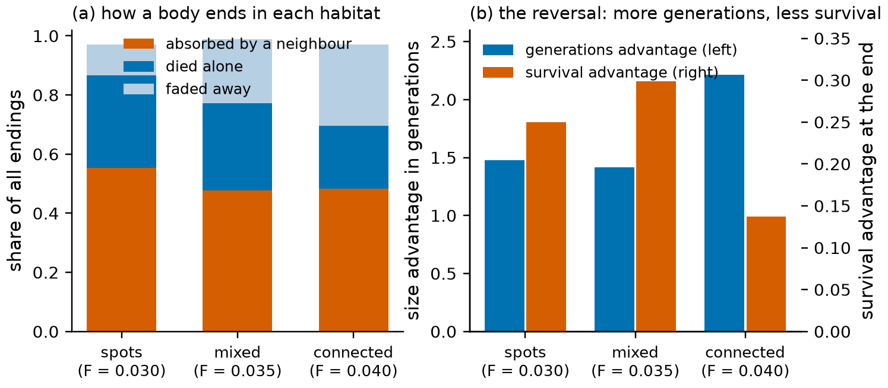
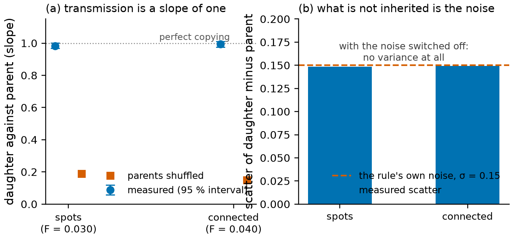
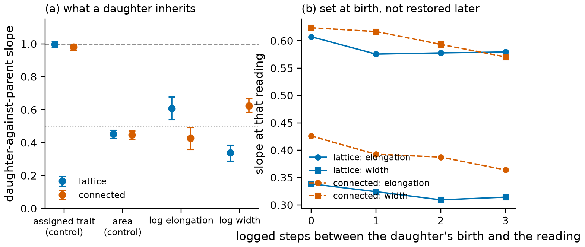

# How lineages begin and end in a pattern-forming chemical medium

- **Type:** research article (measurement and one negative result)
- **Version:** v2.0 — plain-language edition for an outside reader
- **Date:** 2026-11-04
- **Status:** v2.0, released as a preprint together with its data package
- **Figures:** [`029-figures/`](029-figures/)
- **Data behind every number:** [`029-figures/tables.json`](029-figures/tables.json)

## Abstract

A chemical medium that spontaneously forms patterns is often described as if it contained individuals that inherit,
compete and die. We test how much of that description survives measurement.

The medium is a thin layer of two reacting and diffusing chemicals, simulated on a 96 × 96 grid. Left alone it fills with
an irregular pattern; here the supply of fresh chemical is made uneven, in stripes, which produces three distinct
habitats: a lattice of separate spots, a maze, and a single connected mass. In all three, blobs of the pattern appear,
grow, split, merge and disappear.

We asked three plain questions. *Does anything pass from one blob to its descendants?* *How close can two lineages get
before the medium fuses them into one?* *What actually ends a lineage?*

Four answers. (i) The medium has a **mixing length**, and it is two numbers rather than one: two lineages become a single
blob when their surfaces are about **two cells apart at contact** (1.9 cells, median over 132 fusing runs, the same at
every body size), while whether they ever touch is set by the initial gap, which stops working somewhere between **eight
and eleven cells** — flat in the body's size instead of scaling with it, and not resolved more tightly than that band
because the arms between 9 and 11 were never run. (ii) A fusion is a **merger of two lineages, not a birth**: both lineages end on the same step and
one blob appears under a new name, which forces a three-way classification of close encounters (mutual fusion,
absorption, persistence). (iii) At the edge of the mixing length the **outcome switches abruptly while the timing spreads**:
at body radius 6 the share of runs that end as one blob reads 1.0 / 1.0 / 1.0 / 0.5 across surface gaps of
6.5 / 7 / 7.5 / 8 cells, while the share of slow fusions rises 0.0 / 0.0 / 0.2 / 1.0. (iv) Lineages mostly end by **losing
their name, not their cells**: about half of all endings are absorptions (55.3 / 47.8 / 48.4 % in the three habitats), the
absorber is a close relative in 87.2 % of the cases in the lattice and in 37.7 % in the connected mass, and — the result we
did not expect — **the habitat that produces the most generations is not the one in which a lineage is most likely to
still exist at the end**.

On inheritance: the blob-to-descendant slope of the tracked trait is 0.9837 [0.9680, 1.0002] and 0.9931 [0.9756, 1.0103],
the scatter around that line equals the model's own noise parameter to within one per cent (0.1487 and 0.1495 against
σ = 0.15), and with the noise switched off the trait has no variance at all. The trait is therefore transmitted perfectly
by the bookkeeping rule and not by the medium. We say this plainly rather than quoting a heritability number, because the
between-lineage variance we can also compute (0.082 in the lattice, 0.416 in the connected mass) counts lineages that
happen to still be present at the end, not a property of the trait. A second measurement, on a trait computed from the
field rather than written by the rule, changes the sentence by one clause: **shape is heritable at about half**, and the
habitat decides whether it is elongation or width that a daughter inherits (§4.8).

Finally, a negative result: adding a third, slowly diffusing chemical — the most natural way to give the pattern a
heritable scale — does not change the pattern's wavelength at all.

## 1. What this paper asks

Pattern-forming chemical systems are a standard testbed for questions about order, and they are routinely described in
the vocabulary of biology: "individuals", "reproduction", "inheritance", "selection". Each of those words is a claim. The
claim can be checked — not by looking at pictures, but by defining an event, counting it, and seeing which intervention
moves the count.

We concentrate on three claims that are usually left implicit.

First, **inheritance**. If a blob splits, does its daughter resemble it because something is transmitted, or because our
own analysis assigned the daughter a value? In this medium the honest answer turns out to be the second, and the useful
result is the precise form of the transmission: a slope of one with an error equal to the model's noise parameter.

Second, **identity**. Two blobs of a pattern are not like two animals: they can run into each other and become one. Where
the boundary of an individual lies is therefore an empirical question about the medium — the mixing length — and not a
matter of definition.

Third, **endings**. A structure can stop existing in several ways: it can be eaten by a neighbour, it can dissolve, or it
can be absorbed into a larger body. Which of these dominates decides what "a lineage" even means.

Each of the three is measured below, with an intervention where an intervention is possible (the mixing length) and with
pairs of closely related lineages where it is not (endings and inheritance).

## 2. The medium

Two chemicals, `u` and `v`, react and diffuse:

```
∂u/∂t = Du ∇²u − u v² + F (1 − u)
∂v/∂t = Dv ∇²v + u v² − (F + k) v
```

with `Du` = 0.16, `Dv` = 0.08, `k` = 0.06, integrated explicitly with `dt` = 1.0 on a 96 × 96 grid with periodic edges.
This is the standard Gray–Scott system, the workhorse of pattern-formation studies: for these parameters it sustains a
maze of bright ridges on a dark background, and a uniform `F` produces either spots or a connected labyrinth depending
on its value.

Our only modification is that the supply `F` is **uneven**: it is modulated by a fixed sinusoidal field of amplitude 0.5
and period **12 cells**, which is what makes the pattern's own wavelength 12 cells. Because the modulation is fixed in
space, a run does not drift into one global state; instead the same dish contains a whole range of local conditions. By
choosing three supply levels we obtain three habitats that differ only in that level, and that we can therefore compare
with every other condition held fixed:

| habitat | supply `F` | what it looks like |
|---|---|---|
| spots | 0.030 | a lattice of separate compact blobs on a dark background |
| mixed | 0.035 | spots and short ridges; the transition regime |
| connected | 0.040 | one percolating labyrinth, most "blobs" are parts of the same mass |

Each run lasts 6 000 integration steps. At every tenth step the analysis records, for each connected region of the
pattern above a brightness threshold (we call them **bodies**), its area, its position, and an identifier. Identifiers are
the core of the bookkeeping and the reason the results are trustworthy: when a body splits, **both** daughters get new
identifiers, and when two bodies merge, the merged body gets a new identifier as well. No identifier ever spans a
division or a fusion. A **lineage** is the tree of identifiers descended from one body, and a **generation** is one level
of that tree.

The one artificial ingredient is the **trait**. Each body is given a number `s` around 1.0 — a "composition" — which is
copied to its daughters with small random changes of standard deviation σ = 0.15, and which in turn nudges the local
supply `F`. This is a deliberate stand-in for a heritable character: it is the only thing in the model that is passed
from parent to offspring, and the medium itself has no notion of it. Everything in §4.6 follows from taking that
seriously.

> **Box 1 — the words we use.**
> **Body** — one connected region of the pattern above threshold.
> **Surface gap** — the distance between the two nearest surfaces of two bodies, `g = d − r₁ − r₂`, where `d` is the
> distance between their centres and `r₁`, `r₂` their effective radii. This is the quantity that matters for diffusion,
> as opposed to centre-to-centre distance, which grows with body size.
> **Generation (depth)** — how many levels of the identifier tree a lineage reaches before it ends.
> **Sister lineages** — two lineages born from the same parent at the same time and place; comparing them cancels
> everything the two share.
> **World** — one run of the model with one random seed. Ten to thirty worlds per condition are used below, and we
> report how many are needed.

## 3. How we measure

**Intervention where possible.** To measure the mixing length we do not watch a busy world and guess; we place exactly
**two bodies and nothing else** in an empty dish, at a chosen centre-to-centre distance, and vary the distance. Every
other condition — supply field, threshold, time step, integration length — is the production configuration, and a
control run confirms that adding the intervention does not change any other result.

**Counting where intervention is impossible.** Endings and inheritance cannot be randomised, so we use pairs: two
lineages born from one parent (sisters) differ in size but share place, time and habitat, which turns a comparison of
strangers into a within-family comparison. Intervals are 95 %, computed by resampling over parent lineages, never over
individual steps, so that a long-lived lineage counts once.

**Decision rules written down first.** Before each series we wrote the readout, the criterion and the rule for declaring
the series uninformative. That matters here because three earlier designs of the same question produced numbers that had
to be withdrawn: a rate with two defensible definitions differing sixfold, a "rate difference" that turned out to be a
sample filter, and a pairing statistic in which 22.2 % and 21.5 % of pairs are exact ties. All three are reported below
where they bear on a conclusion; the withdrawn values are cited only to show what they were, and with the tie rule
applied the paired fractions read 0.526 and 0.388.

## 4. Results

### 4.1 Fusion happens at contact, and the gap that stops it is ten cells at every size

Two numbers describe this, and the first version of this section reported one of them wrongly and the other as a single
figure rather than a bound. All three statements below are measured, and the corrections are recorded where they belong.

**What the medium sets — the distance at contact.** In 132 runs in which two seeded bodies became one, at the last logged
step before they were one the gap between their surfaces was **1.9 cells** (median; range 0.9 to 4.9) — about a sixth of
the pattern's 12-cell wavelength, a length belonging to the medium rather than to the pair. That figure came from a log
that samples every tenth integration step, and re-running five arms at **one-step resolution** (X166, 2 000 steps, five
fresh seeds each) shows what the coarse log had flattened: the typical gap is about one to two cells, but it is not the
same at every size — 1.27 at radius 3 at a gap of 8, 1.86 at radius 3 at a gap of 9, 1.07 at radius 5.2, 3.14 at radius 4.5 and 3.01 at radius 6 — and within each arm the widest value belongs to the slowest fusion (2.9 at step 85 against 1.7 at
step 60; 7.8 at step 108 against 3.0 at step 68). The one-step log also settles the resolution question: the residual
window shrinks from 1.3 cells to **0.06 cells**, twenty-three times smaller, while the spread stays at 2.07, so the
"about two cells" is a band by right and not because of our sampling. A pair that takes longer to merge does so from
further away, which is what one expects if the merge is driven by a field bridge that has time to build.

That 1.9 is an *upper bound*, not the threshold, and the difference matters at this resolution. The log samples every tenth
integration step and the bodies grow inside that quantum, so the pair is known to be two bodies at 1.9 cells and one body
ten steps later; the threshold itself lies inside the window the growth opens. Measured from the growth the log shows, the
window is **1.3 cells** wide: the threshold lies between **0.7 and 1.9 cells** at the median, its lower bound stays above
two cells in only **21 %** of runs, and at radius 4.5 the lower bound crosses zero. So the defensible sentence is "fusion
happens when the surfaces are within about two cells", not "at 1.9 cells" — and to turn the bound into a threshold needs a
one-step log, not more seeds.

**What the design sets — the gap at which fusion stops being the rule.** Two bodies were placed at a series of initial
separations and followed for six thousand steps; the outcome is the share of runs that ended as one body, with ten fresh
seeds (701-710) at every cell that had not been run before. The crossing — the first gap at which that share falls below
one half — is at **10 cells** for radii 3 and 4.5 and at **9 cells** for radius 6, i.e. **10 ± 1 cells**, flat in the seeded size to
within the one cell that ten seeds per arm can resolve.

| body radius | area (cells) | gap 8 | gap 9 | gap 10 | gap 11 |
|---|---|---|---|---|---|
| 3 | 29 | 5/5 | 5/5 | 7/15 | 2/15 |
| 4.5 | 64 | 5/5 | 4/5 | 2/10 | 0/15 |
| 6 | 113 | 10/10 | 3/10 | 0/10 | 0/10 |

Two features of that table are as informative as the crossing itself. The transition is **gradual over two cells**, not a
step: radius 6 goes 1.00 → 0.30 → 0.00 and radius 3 goes 1.00 → 0.47 → 0.13. And the larger bodies are **not** more
tolerant, which is what the withdrawn `2r + 9` rule predicted (it would have put the crossing at 9, 13.5 and 21 cells): a
body seeded at radius 6 crosses one cell *earlier*, not later.

**Why the boundary does not scale with the body.** Because the bodies grow, and grow to the same size. A body seeded at
radius 3 is 2.9 cells in effective radius at the first logged step and 5.8 at the step before it meets its partner; a body
seeded at 6 goes from 6.0 to 8.5. By the time two bodies touch they are all between 5.8 and 8.5 cells in radius, whatever
we started with, so the initial separation and not the initial size decides (Fig. 2).

The three outcomes of a close encounter are worth keeping in view here, because "one body" is not the same as "mutual
fusion": at radius 3 and a gap of 10 the runs that end as one body split into M 2/5 and A 2/5, with P 1/5; at a gap of 11
they are M 2/5, P 3/5, and the shares of M and A are what the crossing table counts together. ("M" is mutual fusion, "A"
absorption of one body by the other, "P" the two bodies persisting side by side; §4.2 explains why the three must be told
apart.)

**The correction, twice.** An earlier version of this paper put the crossing at "16 ± 1 cells" for radius 3 and the
conserved quantity at "9 ± 1 cells, the same for bodies of 29, 64 and 113 cells", with the rule `2r + 9`. An independent
review recomputed the arm counts from the raw worlds and was right on both points: the radius-3 row came from an older test
that counted a partner as present when its last known position was within two cells, which is why it read "two of five"
where the classification reads "four of five"; and the third row (`20 ± 2`) was a bound between two arms, not a measured
crossing. That correction produced the band "between 8 and 11 cells", which was honest but weak; the arms that could narrow
it were then run (§7), and the band became the crossing above. The second correction is the one in this section's first
paragraph: the 1.9 cells of the same review-corrected analysis turned out to be a bound set by our own sampling, and it is
now reported as a window. Both errors are of the same kind — a number read off a design rather than off the medium — which
is why they are stated here rather than in a footnote.

Two controls say what the length is *not*. It is not a size rule: among runs where both outcomes occur, the bodies that
divided are not the larger ones — median areas at fusion 267 / 268 and 297 / 287 cells, and where the pattern reverses,
242 / 290. And it is not simply the clock running out: at radius 6 the median time to a single body is 39 steps at gaps 6.5 to 7.5 and 49 steps at 8, while a lone body of the same size does not divide at all until a **median of 290 steps**; the
smaller sizes behave the same way — 180 and 190 steps for radii 3 and 4.5 — so the fusing pair is always faster than the
division time, at every size.



**Figure 1.** What is measured, drawn rather than photographed. (a) Two bodies of radius `r` at centre separation `d`
leave a surface gap `g = d − 2r`; the results are stated in the gap because that is the quantity diffusion sees.
(b) The three outcomes of a close encounter: mutual fusion (both lineages end, one new body appears), absorption (one
lineage ends inside the other) and persistence (both continue). (c) The identifier bookkeeping: every split gives both
daughters a new name, and every fusion gives the merged body a new name, so no name spans a division or a fusion.



**Figure 2.** The mixing length, in the two quantities that are measured. (a) Share of runs that end as a single body
against the **initial** surface gap, for three seeded sizes, with 95 % Wilson intervals; the crossing is where the curve
falls through one half, at 10 cells for radii 3 and 4.5 and at 9 for radius 6. (b) The same runs at the moment of contact:
the surface gap between the two bodies at the last logged step before they are one, per seeded size, with the median
reading of 1.9 cells and the window that the ten-step logging quantum opens beneath it — the reading bounds the threshold,
and the threshold lies inside the window.

### 4.2 A fusion is a merger, not a birth

Our first plan was to map a band of distances at which two bodies "annihilate". Reading the logs killed the word. At
separations 10 and 11 the two identifiers die on the **same** logged step, and on the next step there is **one** body
under a **new** identifier. Nothing is born: two lineages end together and a third thing starts. The old vocabulary had
looked like it was describing a birth only because the analysis counted a partner as present if its last known position
was within two cells.

That is why the results speak of M, A and P rather than of "coalescence". It is also why the mixing length is a property
of *lineages*: below the fusion boundary, two identities are extinguished at once. Whatever counts as an individual in
this medium, it cannot survive contact.

### 4.3 At the edge, the outcome switches and the timing spreads

At body radius 6, ten runs per gap, the two things separate cleanly (Fig. 3):

| surface gap (cells) | 6.5 | 7 | 7.5 | 8 |
|---|---|---|---|---|
| runs ending as one body | 1.0 | 1.0 | **1.0** | **0.5** |
| dissolution steps observed | 39 ×10 | 39 ×10 | 39 ×8, 49 ×2 | 49 ×3, 59 ×2 |
| slow, among runs that merged | 0.0 | 0.0 | **0.2** | **1.0** |
| slow, among all ten runs | 0.0 | 0.0 | 0.2 | 0.5 |

The share of runs that merge is a step between 7.5 and 8 cells. The share that merge *slowly* — one logged step later
than the rest — has already left zero at 7.5, and both denominators are quoted because at 8 only five of ten runs merge
at all: the strict figure is 1.0, the conservative one 0.5, and the conclusion (a spread that begins before the outcome
changes) holds under both.

One control failed and we keep it in the record: the half-cell arm at 7.5 also moved the drawn bodies by one cell each
(110 cells against 108 and 110), so that arm is a gap change *plus* about 2 % of area. The failure works against the
finding, not for it.



**Figure 3.** At the edge of the mixing length. (a) Ten runs per gap at body radius 6: the share ending as one body is a
step between 7.5 and 8 cells, while the share that merge slowly has already left zero at 7.5. (b) The same runs by
dissolution time; the arms are staircase-shaped rather than spread out.

### 4.4 Most lineages end by being absorbed by a relative

Classifying an ending is harder than it sounds, and two earlier attempts had to be withdrawn: the first offered a choice
between "lethal" and "homogenising", no registered outcome ever fired, and the second was voided by its own controls.
The version that works restricts an absorption to the dying body's own neighbourhood — a survivor within
`r_dead + r_survivor + 2` cells — and adds a category the lattice needs: a death with no living neighbour at all.

| habitat | endings | died alone | absorbed | faded away | absorber was a relative |
|---|---|---|---|---|---|
| spots | 524 | 31.3 % | **55.3 %** | 10.5 % | **87.2 %** |
| mixed | 844 | 29.4 % | 47.8 % | 21.7 % | 39.2 % |
| connected | 1 102 | 21.2 % | 48.4 % | **27.4 %** | **37.7 %** |

Absorption is the commonest single fate everywhere — about half of all endings — and the remaining two fates trade
places with the habitat: dying alone falls from 31.3 / 29.4 / 21.2 % while fading away rises 10.5 / 21.7 / 27.4 %.

The sharper result is *who* does the absorbing. In the lattice, 87.2 % of absorptions are by a close relative; in the
connected mass, only 37.7 %. We tried to control this for geometry and could not: every absorption with a partner happens
at contact, so matching on distance is degenerate — and the degeneracy is itself the finding. At the same contact
geometry, the single neighbour is a relative 87.2 % of the time in the lattice and a stranger 62 % of the time in the
connected mass. The lattice keeps families apart; the connected habitat mixes them.

Sisters rarely meet again: 18.4 / 8.6 / 17.4 % of sister pairs re-merge within a run (82 % are censored, i.e. the run
ends first), with medians of 80 / 120 / 60 steps after birth, and the distance at birth decides it by a factor of two.

### 4.5 More generations does not mean more survival

Size buys generations. Sisters that differ in size differ in how many generations their lineages reach — by
**+1.479 [1.289, 1.654]** and **+2.213 [1.962, 2.489]** generations in the two habitats where the comparison is defined —
and the readout is not a disguised lifetime: with lifetime held fixed the correlation is 0.459 / 0.340, and depth is
*negatively* correlated with lifetime itself (−0.185 / −0.070). The advantage survives a per-step rate, an equal time
window and a persistence readout; matching sisters on the number of daughters halves it (0.125 and 0.044 against
0.2496 / 0.1372 unmatched), and a two-term model puts area and daughter count in opposite directions, with age the one
confound we cannot remove.

Comparing the three habitats separates three things that the two-habitat design had merged (Fig. 4):

| habitat | lineages below the generation floor | generations advantage | generations per 1 000 steps | survival advantage |
|---|---|---|---|---|
| spots | 0.162 | 1.479 | 6.06 | 0.2496 |
| mixed | 0.302 | 1.416 | 9.01 | 0.2984 |
| connected | 0.466 | 2.213 | 18.96 | 0.1372 |

The generation clock is a gradient in supply (0.162 / 0.302 / 0.466 of lineages never reach the floor), depth is a
threshold that jumps only at percolation (1.479 / 1.416 / 2.213), the rate accelerates (6.06 / 9.01 / 18.96), and the
survival advantage **reverses**: 0.2496 / 0.2984 / 0.1372, the middle habitat sitting 5.99 standard errors above the
straight line between the outer two. The habitat that produces the most generations is the one in which a lineage is
least likely to be there at the end.

That reversal cost us a lesson in sample size. On ten worlds the paired survival difference was −0.077, interval
−0.166 … +0.012: unresolved, because the spread between worlds (sd 0.14) equalled the effect. A power calculation asked
for at least 26 worlds per habitat; at thirty the difference resolved at −0.1323 (−0.1819 … −0.0840), with the size
advantage at +1.8340, the share of lineages that fade away at +0.1419 and the share absorbed by relatives at −0.4164.
The ten-world estimate was not merely imprecise: it was biased low by about 40 %. Contrasts of this kind now cost
30–40 worlds, and we say so before quoting one.



**Figure 4.** Endings and the reversal. (a) Composition of endings in the three habitats: absorption dominates everywhere, while dying alone and fading away trade places as the habitat becomes more connected. (b) The size advantage in generations (blue, left axis) rises only at percolation, while the advantage a large sister has in still being present at the end (orange, right axis) peaks in the mixed habitat and collapses in the connected one.

### 4.6 What is inherited is copied by the bookkeeping, and we can show it

The trait `s` is copied from parent to daughter with noise. To measure the transmission we reconstruct parent–daughter
pairs from the logs. Because a split gives both daughters new identifiers, a parent and its daughter are never recorded
on the same step; the parent is read at its last recorded step before the daughter appears, and the daughter at her
first. The displacement is at most one logging step (ten integration steps), and the control that decides whether this
reconstruction is trustworthy is the artifact's own published correlation, compared per world rather than pooled:
0.9092 against 0.9092 and 0.8967 against 0.8989, over 2 164 of 2 211 and 1 779 of 1 951 pairs.

Then the transmission itself (Fig. 5):

| quantity | spots | connected |
|---|---|---|
| daughter against parent, slope (95 % interval) | **0.9837 [0.9680, 1.0002]** | **0.9931 [0.9756, 1.0103]** |
| the same, with division rate partialled out | 0.9837 | 0.9932 |
| parents shuffled (mean, one-sided p) | 0.19, **0.001** | 0.15, **0.001** |
| scatter of daughter minus parent | **0.1487** | **0.1495** |
| the model's own noise | σ = 0.15 | σ = 0.15 |
| share of variance between surviving lineages | 0.082 | 0.416 |

Three readings. The slope is one: daughters are their parents, up to noise. Partialling out how often a body divides does
not move it, so the apparent correlation between the trait and the division rate is one rule seen twice. And the part of
a daughter's value that does not come from its parent is exactly the model's noise, to one per cent.

The decisive test is the ablation. Two runs with the noise switched off (with a control run reproducing the reference
world step by step, so that the switch is the only difference) give a **constant trait**: `s` is 1.0 in every body at
every step, between-body sd 0.0, and 100 % of pairs exactly equal. With the copying rule's noise removed, the trait has
no variance at all — the degenerate limit of perfect transmission. Nothing in the chemistry contributes anything
transmissible: what passes from parent to daughter passes because the analysis wrote it there.

Which is why the last row of the table must not be read as a heritability. The share of trait variance that sits between
lineages at the end of a run is 0.082 in the lattice and 0.416 in the connected mass, but a world that happens to hold
ten lineages gives 0.30 where a world with two gives 0.00–0.02, and the connected habitat's horizon can be a handful of
bodies, so one surviving root can carry 0.93. That number counts **surviving lineages**; it is not a property of the
trait. Reporting it as a heritability would be the exact error this section exists to prevent.



**Figure 5.** Transmission and its error. (a) The measured daughter-against-parent slope with its 95 % interval, against the same slope when parents are shuffled; the dotted line is perfect copying. (b) The scatter of daughter minus parent, against the noise the copying rule itself adds (σ = 0.15): what is not inherited is exactly the noise, and with the noise switched off the trait has no variance at all.

### 4.7 Negative result: a third chemical does not set the pattern's scale

If the pattern's wavelength were inherited by the pattern from something in the medium, the obvious carrier would be a
third chemical that diffuses slowly and is advected by the pattern. We added one, with its diffusion rate raised to
**8 ×** that of `v`, and swept its coupling.

It does not work. The pattern's wavevector stays at **7–9** in all six living cells — the same value as without the third
chemical — while what does move is the *orientation* of the pattern, by a measure that runs between 0.636 and 0.837, and
that movement does not replicate: 2 of 6 cells show it, in opposite directions. The coupling constant of the added field
is 0.30 and the field survives in only 2 of 6 seeds. A third diffusing species, in short, is not a scale channel in this
medium, and the wavelength therefore is not inherited from any chemical the pattern carries.

### 4.8 Shape is inherited, at about half, and the habitat chooses which aspect

Everything above concerns `s`, a number the tracking rule writes into the daughter. That makes it a fair test of the
bookkeeping and a poor test of the medium. A shape measured *from the field* is the opposite kind of object: nobody
writes it, and a daughter that resembles her mother's shape is evidence that the medium, not the rule, carried it.

We measured two such traits for every body in twenty fresh worlds (ten in the lattice, ten in the connected mass, 4 111 parent–daughter pairs), from the second moments of each body's pixels: **elongation**, the square root of the ratio of
the principal axes (1 is round), and **width**, the minor-axis extent in cells. Both were read at every tenth step by an
observer that draws no random numbers — with the observer switched off, the same run is bit-identical, which is how we
know it cannot have perturbed the world.

The two controls came out where they should. The assigned trait is transmitted at **0.9959 [0.9790, 1.0126]** and
**0.9817 [0.9631, 1.0003]** in the two habitats, reproducing §4.6 in a different set of worlds; and area is transmitted at
**0.4514 [0.4264, 0.4771]** and **0.4481 [0.4193, 0.4723]**, within a hundredth of the geometric expectation of one half,
because a daughter is a part of her mother and not a copy of her.

Shape sits between the two, and it does not sit in the same place for both habitats:

| trait | lattice (`F` = 0.030) | connected (`F` = 0.040) |
|---|---|---|
| `s`, the assigned trait (control) | 0.9959 [0.9790, 1.0126] | 0.9817 [0.9631, 1.0003] |
| area (control) | 0.4514 [0.4264, 0.4771] | 0.4481 [0.4193, 0.4723] |
| **log elongation** | **0.6074 [0.5399, 0.6785]** | 0.4260 [0.3585, 0.4924] |
| **log width** | 0.3384 [0.2877, 0.3850] | **0.6238 [0.5846, 0.6672]** |

Four things follow.

**Shape is not free of heredity, and it is not the tracker's heredity either.** All four shape slopes lie between 0.29 and
0.68 with shuffled-parent nulls of −0.001 to +0.002 and p = 0.001, and the partial slope given log area stays between
0.26 and 0.65 — so this is not area in disguise. The gap between 0.98 and 0.5 is the gap between a number the bookkeeping
copies and a shape the medium has to reproduce.

**The habitat decides which aspect is transmitted.** In the lattice elongation is inherited better than width (0.6074 against 0.3384, intervals disjoint); in the connected mass width is inherited better than elongation (0.6238 against 0.4260, intervals disjoint), and the same trait differs between habitats by more than either interval allows. In a
lattice of round bodies the orientation of a ridge is the thing a division can pass on; in a connected labyrinth it is the
local width.

**Nothing relaxes on the timescale we can see.** Reading the daughter one, two and three logged steps after her first
appearance moves each slope by at most 0.05 (log elongation in the lattice 0.607 to 0.579; log width in the connected
mass 0.624 to 0.571). The value is set at birth rather than restored afterwards, which is what a copied quantity looks
like and not what a relaxing shape looks like.

**The level is about half.** Averaged over the two habitats, elongation 0.517 and width 0.481. A slope of 1 would make the
daughter a scaled copy of her mother; 0.5 makes her, on average, halfway between her mother and the habitat's typical
shape — which is also where the geometric control sits.

So the sentence from §4.6 needs one clause added: the only *perfectly* heritable character is the one the bookkeeping
writes; shape is heritable at about half, in a direction the habitat chooses. Both halves matter — the first is what a
reader of parent–daughter correlations needs to know, since a correlation of 1.0 can be bookkeeping; the second is what
makes these entities more than labels.



**Figure 6.** Shape, measured from the field. (a) The daughter-against-parent slope for four quantities in the same
worlds, with 95 % intervals: the assigned trait (near 1), the size a daughter must halve (near 0.5), and the two shape
traits, which swap places between the two habitats. (b) The same shape slopes when the daughter is read one, two or three
logged steps after birth: the lines are flat, so the shape is set at the division rather than relaxed towards a typical
value afterwards.

## 5. What it means

A pattern-forming medium produces entities that look individual and are not: they merge on contact at a length the medium
sets, they die mostly by being absorbed, and their only perfectly heritable character is one our own analysis writes into
them, with shape inherited at about half along a direction the habitat chooses. None of that makes the system
uninteresting — it makes the description precise. Four consequences for anyone using this kind of medium as a model of
individuality:

1. **"Inheritance" needs an ablation.** A parent–daughter correlation is not evidence of transmission, because the
   bookkeeping that names the daughter can create the correlation. The test is what happens when the copying rule's own
   noise is removed: if the trait becomes constant, the medium is not transmitting it.
2. **The mixing length is the boundary of the individual, and it is measured at contact.** Two bodies whose surfaces come
   within about two cells become one, whatever their size; whether they get that close is set by the initial gap, which
   stops working between eight and eleven cells. Any statement about a "population" of such bodies has to say what it does
   about contact.
3. **Survival and reproduction are different measurements and can point opposite ways.** In this medium the habitat that
   maximises generations is the one where a lineage is least likely to be present at the end. A study that reports only
   one of the two can be internally consistent and still tell a reader the wrong story.
4. **Heredity is a property of what you measure.** In the same worlds the trait the rule writes is copied at 0.98, the
   size at 0.45, and shape at 0.34 to 0.62 depending on which aspect and which habitat. A single "heritability" for a
   pattern-forming medium is therefore not a number but a list, ordered by how much of the trait the medium has to rebuild
   at each division.

The negative result closes the most plausible route by which the trait could have become a property of the medium: a
carrier chemical does not set the scale, so the scale belongs to the interaction of the two original chemicals with the
imposed supply pattern.

### 5.1 What to measure next

1. **A third habitat.** `F` = 0.035, between the lattice and the connected mass, twenty worlds: it decides whether the swap
   of §4.8 is a continuum or a switch.
2. **The fusion crossing inside the band.** Arms at gaps 9, 10 and 11 for radius 4.5 and radius 6, ten seeds each — the
   only way the "eight to eleven cells" of §4.1 becomes a crossing instead of a bound.
3. **The shape slopes at another threshold.** A body is the set of pixels above `v` = 0.2; at 0.1 and 0.3 the same
   analysis says whether the half-inheritance belongs to the field or to the mask.
4. **Selection on shape.** The heritable part of shape matters only if it changes a daughter's fate: the fate classes of
   §4.4 are recorded per body, so correlating a daughter's elongation with her ending needs no new simulation.

## 6. Limits

1. **One system.** A single grid size (96 × 96), one reaction rate `k` = 0.06, one threshold, one supply modulation. The
   mixing length is a length in *this* medium, stated in cells and in wavelengths; a different ratio of the diffusion
   rates could move it.
2. **The central chain is correlational.** Size is never randomised, so the size-to-generations result is a within-family
   comparison, not an intervention, and age remains an uncontrolled confound. What is causal here is the mixing length,
   which comes from placing bodies by hand.
3. **Time resolution is coarse.** The model is written every ten steps, so "slow" is a single bit and the width of the
   timing distribution is bracketed, not located.
4. **Lineage bookkeeping has no notion of fusion.** Our variance decomposition treats a merged body as a new root, which
   makes the between-lineage share an upper bound.
5. **Two runs per ablation arm.** Both are degenerate in the same way, which is strong evidence that the trait has no
   variance, but it is not a distribution; and the criterion for reading a degenerate arm was amended after seeing the
   data, which we state rather than hide.
6. **World counts.** Thirty per habitat were enough for the contrasts reported; they are the price of admission, not a
   surplus. The shape result of §4.8 rests on ten worlds per habitat, twenty in all.
7. **The fusion crossing is bounded, not located.** At radius 3 the last measured arm is a gap of 11 cells, where two runs
   of five still ended as one body, and for the two larger radii the arms between 9 and 11 were never run, so §4.1 states
   a band. The earlier claim of a single number for all three sizes was wrong and is corrected in place rather than
   quietly replaced: the arms in the old table were the design parameters, not measurements.
8. **Shape is a thresholded silhouette.** The shape traits are computed from the component above `v` = 0.2, and their
   primary statistic is a log slope chosen after the tails were seen. A different threshold or transform would move the
   levels; it is not obvious it would move the swap between elongation and width, which is the part with structure.
9. **Nothing here explains the shape inheritance.** A daughter could resemble her mother because she buds off the same
   ridge, or because the supply pattern is locally the same; the experiment that separates these — an imposed supply
   pattern with a fixed orientation — is not run.

## 7. Data and code

All data are public. The derived tables behind every figure and every number in this paper are
[`029-figures/tables.json`](029-figures/tables.json) (each entry names the aggregate it came from),
[`table-edge.csv`](029-figures/table-edge.csv), [`table-habitats.csv`](029-figures/table-habitats.csv),
[`table-heredity.csv`](029-figures/table-heredity.csv) and [`table-shape.csv`](029-figures/table-shape.csv). The aggregates themselves, with the command line of every run,
are in [`morphogenesis/experiments/E09_pond/`](../morphogenesis/experiments/E09_pond/) and the per-run artifacts in
[`morphogenesis/experiments/L1_field/`](../morphogenesis/experiments/L1_field/). The figures are produced by
[`scripts/make_article_029_figures.py`](../scripts/make_article_029_figures.py); a checker
([`scripts/check_article_029_numbers.py`](../scripts/check_article_029_numbers.py)) verifies that every number printed
above appears in the derived tables, and the tables are built from the aggregates, not typed by hand.

Two analyses behind §4.1 and §4.8 are new in this version and are reported separately, with their pre-registrations and
controls: the contact geometry of fusion ([`scripts/x157_gap_geometry.py`](../scripts/x157_gap_geometry.py),
[`reports/2026-11-04-x157-gap-geometry.md`](../reports/2026-11-04-x157-gap-geometry.md)) and the shape-heredity series
([`scripts/x156_series.py`](../scripts/x156_series.py), [`scripts/x156_analyse.py`](../scripts/x156_analyse.py),
[`reports/2026-11-04-x156-shape-heredity.md`](../reports/2026-11-04-x156-shape-heredity.md)). The numbers in §4.1 were
re-derived after an independent review recomputed them from the raw worlds
([`lab/reviews/2026-11-04-029-three-numbers.md`](../lab/reviews/2026-11-04-029-three-numbers.md)); that review is part of
the record, not a private correspondence. The whole computation is one consumer GPU: the ablation arm is 0.11
GPU-hours, the shape series 0.01, and the entire paper's series under 40.

## 8. Reproduction

```bash
python scripts/make_article_029_figures.py --write     # tables and all six figures, from the committed aggregates
python scripts/check_article_029_numbers.py --ci       # every number printed above, traced to its aggregate
python scripts/x156_analyse.py --write                 # the shape results of §4.8, from the twenty shape runs
python scripts/x157_gap_geometry.py --write            # the contact geometry of §4.1, from 171 two-body runs
```

The series behind the results are `scripts/x134_series.py` … `scripts/x154_series.py` (the two-body intervention and its
sweeps), `scripts/x108_series.py` (the dense logs), `scripts/x155_ablation.py` (the noise-off arm) and
`scripts/x155_analyse.py` (reconstruction and statistics). Each artifact records its own command, its seeds and its
pre-registered criterion.
