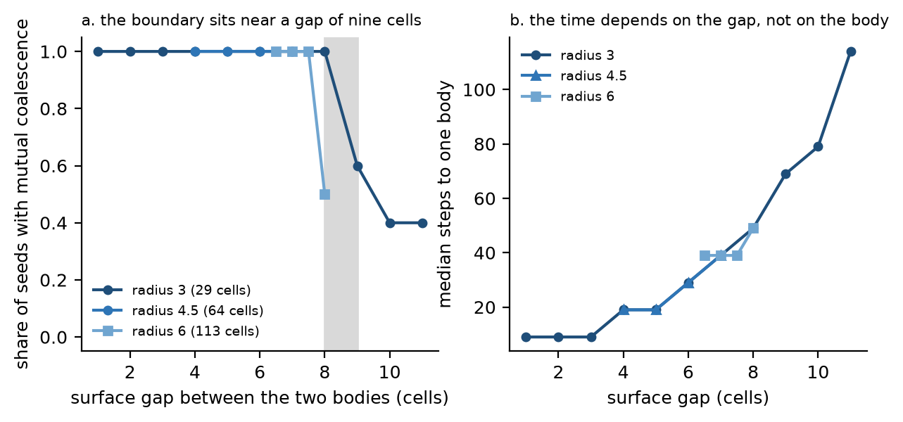
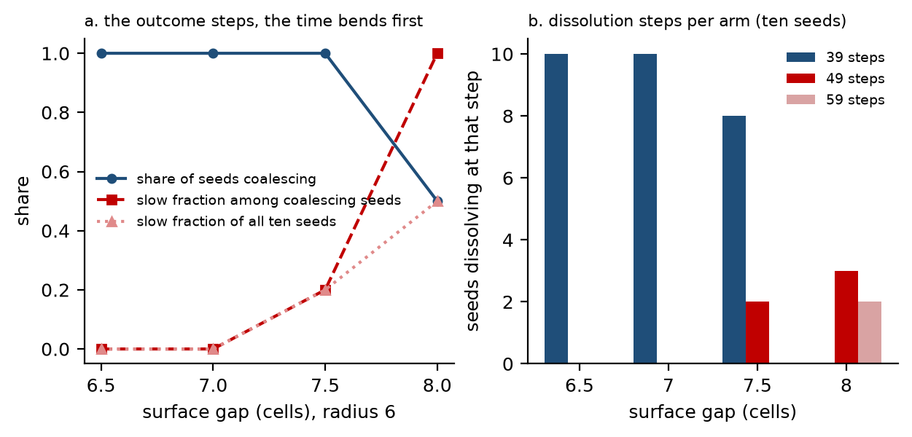
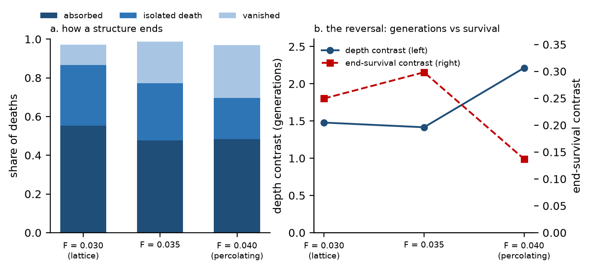
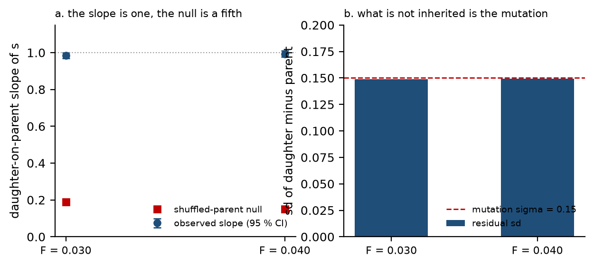

# 029: A mixing length, a merger and a heredity coefficient — what lineages do in a pattern-forming field

- **Type:** research article (measurement and negative result)
- **Version:** v1.0 (draft for owner review; not submitted)
- **Date:** 2026-11-04
- **Status:** draft, awaiting the owner's decision to publish
- **Author(s):** Morphogenesis laboratory
- **Related reports:** [`x155-heredity`](../reports/2026-11-03-x155-heredity.md) and the twenty-one reports of the
  coalescence and identity blocks, indexed in [`reports/README.md`](../reports/README.md)
- **Artifacts:** aggregates `l1_field_x113_depth.json` … `l1_field_x155_heredity.json` in
  [`morphogenesis/experiments/E09_pond/`](../morphogenesis/experiments/E09_pond/); every number printed here is listed
  with its aggregate in [`029-figures/tables.json`](029-figures/tables.json)
- **Figures:** [`029-figures/`](029-figures/)
- **Claims matrix:** rows §10ha–§10ho of [`manuscript/CLAIMS.md`](../manuscript/CLAIMS.md)

## Abstract

We measure what a lineage is in a pattern-forming medium that has no replicators: the Gray–Scott reaction–diffusion
system on a 96 × 96 lattice, held in three habitats by a heterogeneous inflow. Structures there divide, fragment, merge
and die, and the laboratory's earlier work had established that a structure's size is inherited with a coefficient of
about 0.5 while the inheritance itself is imposed by the tracking rule rather than produced by the medium. This paper
turns that reservation into measurements and adds the two questions the earlier work could not answer: how far apart two
lineages can be before the medium mixes them, and what ends a lineage.

Four results. (i) The medium has a **mixing length**: two lineages coalesce below a surface gap of 9 ± 1 cells
(0.75 of the medium's 12-cell pattern wavelength), independent of body size — the crossing is 16 ± 1, 18 ± 2 and 20 ± 2
cells for bodies of 29, 64 and 113 cells, so doubling the body moves the boundary by four cells rather than sixteen.
(ii) Coalescence is a **merger, not a birth**: both lineages end on the same step and one body appears under a new
identifier, which forced a three-class vocabulary (mutual coalescence, absorption, persistence) decided from lineage
subtrees rather than from the picture. (iii) The boundary is a **whole-cell step in the outcome** while the dissolution
**time spreads before it**: at radius 6 the coalescing share is 1.0 / 1.0 / 1.0 / 0.5 across surface gaps
6.5 / 7 / 7.5 / 8 cells, and the fraction of slow coalescences is 0.0 / 0.0 / 0.2 / 1.0. (iv) A lineage's end is mostly the
loss of its **name**, not of its cells — absorption is about half of all endings (55.3 / 47.8 / 48.4 % in the three
habitats) and the absorber is kin in 87.2 % of lattice absorptions against 37.7 % in the percolating body — and the
habitat that maximises generations is not the one where a lineage survives.

The heredity coefficient is measured rather than asserted: the daughter-on-parent slope is 0.9837 [0.9680, 1.0002] and
0.9931 [0.9756, 1.0103], the residual is the mutation rule's own σ to one per cent (0.1487 and 0.1495 against 0.15), and
with the mutation ablated the trait has no variance at all. Between-lineage variance (`H²` = 0.082 / 0.416) counts
surviving lineages rather than measuring a heritability of a trait, and we say so rather than quoting it as one.

**Keywords:** reaction–diffusion, lineage tracking, heredity, coalescence, identity, negative result

## 1. Question

Two things are routinely conflated when a pattern-forming medium is described in evolutionary language. The first is
**heredity**: does a structure's trait pass to its daughters, and is the transmission a property of the medium or of the
observer's book-keeping? The second is **identity**: where does one lineage end and a body begin? Both are measurable,
and neither requires a replicator, if the measurement is made on events rather than on pictures.

The earlier work in this line answered a version of the first question and left it hedged: in the neutral field the size
of a structure is inherited with a coefficient of about 0.5, the coefficient is specific (a nearest-neighbour surrogate
does not reproduce it), and yet the same reports showed that the mechanism is the tracking rule's own copying of a
trait column. That is a reservation about a number already published, which is the worst place for a reservation. This
paper asks what the number *is*, and it asks the second question in two parts: how far can two lineages be before the
medium mixes them, and what ends a lineage.

The paper is organised so that each answer is falsifiable on its own. §3.1 measures a length. §3.2 shows that the event
at that length is a merger and what a merger forces in the book-keeping. §3.3 measures where an ending sits. §3.4 asks
what a survival difference is worth when the habitat, not the trait, sets it. §3.5 measures the heredity coefficient and
its error. §3.6 reports a negative result: a third diffusing field does not carry a scale.

What would count as failure for each: a mixing length that tracked body size rather than the gap between surfaces; a
coalescence that turned out to be a division seen from the wrong side; an "end" that was not distinguishable from a
continuation; a heredity coefficient whose residual had no relation to the mutation parameter; and a third field that
did move the pattern's scale.

## 2. Model and definitions

**The medium.** Gray–Scott kinetics on a 96 × 96 lattice with periodic boundaries, `Du` = 0.16, `Dv` = 0.08, `k` = 0.06,
`dt` = 1.0, 6 000 steps, single precision on one GPU. The inflow `F` is heterogeneous: a sinusoidal field of amplitude
0.5 and period 12 cells modulates it, which turns the homogeneous maze into coexistence between a **lattice** of spots
(`F` = 0.030), a **percolating body** (`F` = 0.040) and a mixed world (`F` = 0.035). The heterogeneity is the only
difference between habitats; every run uses the same code path and the same seeds, so the three cells are paired.

**Structures and lineages.** Each connected component above a threshold of 0.20 carries a trait `s` (its composition) and
a unique identifier. A split creates two **new** identifiers, so a parent never survives its own division; a merge creates
a new identifier as well. Lineages are the trees of these identifiers, and a "generation" is one level of the tree. The
trait is inherited at a split with a mutation draw of σ = 0.15, and `s` feeds back into the local inflow, so the trait is
not inert. This is stated up front because it is the whole point of §3.5: the medium does not transmit `s`, the tracking
rule writes it into the daughters.

**Consequence readouts.** The currency is **depth** — how many generations a lineage reaches — rather than lifetime,
which is entangled with size and sits at the noise floor. Sister pairs (two lineages born from one parent at one place
and one moment) give the contrast; `ρ` values below are Spearman correlations over pairs, and every one names its
filter and denominator in the tables.

**Event classes.** A dissolution is classified from the uid subtrees, not from the image: **M** (mutual coalescence —
neither seed grew a daughter and both subtrees are gone), **A** (absorption — exactly one subtree is alive), **P**
(persistence — both alive). A local budget restricts an absorption's partner to the dead structure's own neighbourhood:
survivors within `r_dead + r_survivor + 2` cells, plus the category the lattice needs, a death with no live neighbour at
all (**isolated**).

**Statistics.** Sister contrasts carry bootstrap intervals over parent uids; habitat contrasts are paired by seed and
carry intervals over worlds. Where a contrast was underpowered we say so and then buy the worlds (§3.4). All intervals
are 95 %.

## 3. Results

### 3.1 The medium has a mixing length, and it is a gap, not a size

The intervention is the first of the line that adds an initial condition rather than reading one: **two discs and
nothing else**, radius 3 cells (29 cells of area, the lattice's median dead body) at a chosen centre separation, five
seeds. Everything else — flags, seeds, threshold — is the production configuration, and the anchor run reproduces the
old branch key-by-key with the flag absent.

The result is a boundary one cell wide, measured twice: five of five seeds coalesce at a centre separation of 15 cells,
two of five at 16, none at 17. The crossover is **16 ± 1 cells**, which is 1.3 pattern wavelengths, and the merge slows
as the pair approaches it (19, 39, 49 and 79 steps at separations 12, 14, 15 and 16): a race lost narrowly would show a
jump, not a deceleration.

The interesting part is what is invariant. Doubling the body from 29 to 113 cells moves the crossover from 16 to 20
cells — four cells, not sixteen — so neither the centre distance nor the body's size is conserved. The conserved quantity
is the distance between the two **surfaces**, and across three radii it is nearly constant:

| radius | body area (cells) | crossing (centre distance) | surface gap at the crossing |
|---|---|---|---|
| 3 | 29 | **16 ± 1** | **10** |
| 4.5 | 64 | **18 ± 2** | **9** |
| 6 | 113 | **20 ± 2** | **8** |

Radius 4.5 was a prediction rather than a fit: the rule `2r + 9` read off the first two radii put its crossing at 18
cells, and the measurement returned 18 ± 2 with the same coin at the boundary (two of five seeds still coalescing). The
mixing length of this medium is therefore a **gap of 9 ± 1 surface cells ≈ 0.75 wavelengths** — a property of the field,
not of the observer and not of the pair (Fig. 1).



**Figure 1.** The mixing length. (a) Share of seeds with mutual coalescence against the surface gap for three body
sizes; the boundary sits at 8–9 cells in all three, and the shaded band marks it. (b) Median steps to one body against
the same gap: the time follows the gap, not the body. Data: `l1_field_x142_coalescence.json`,
`l1_field_x147_radius45.json`, `l1_field_x150_radius6.json`, `l1_field_x154_mixing.json`;
`029-figures/table-width.csv`.

### 3.2 Coalescence is a merger, not a birth

Before the boundary could be read, the plan's vocabulary had to be repaired. The sweep was registered to map an
*annihilation band* — gaps at which two discs destroy each other — and reading the merge step killed the question: at
separations 10 and 11 the two seeded identifiers die on the **same** logged step and the next step holds **one**
component under a **new** identifier. Both arms are one event; the old labels differed only in whether a partner's last
position fell inside the analyser's two-cell reach tolerance. Hence M / A / P, and hence the sentence this subsection
exists for: **a coalescence has no parent and no daughter.** Both subtrees end on the same step.

With the class fixed, the boundary is clean. At radius 3, mutual coalescence holds in every seed from contact out to a
surface gap of 8 cells, breaks at 9 (M 3/5, A 2/5), and by 10 and 11 the pair is persistent more often than not. A lone
disc puts the clock in perspective: it first divides at a median of 180 steps for radius 3, and at 190 and 290 steps for
the two larger radii, whereas a pair at gaps 1–8 is one body within 50 steps. The simple story "they meet before either
can divide" is therefore not the mechanism at the boundary; the boundary is where the diffusive fronts stop bridging the
gap at all.

Two further measurements say what the boundary is *not*. It is not a size rule: within arms where both outcomes occur,
the seeds that divided are not the larger ones — medians 267 / 268, 297 / 287 and, at the one arm where the sign flips,
242 / 290 cells. And it is not purely a function of the gap either: at radius 4.5 a gap of 8 cells gives M 3/5, A 2/5,
where radius 3 is M 5/5, so the boundary belongs to the pair and the radius shifts it by about one cell — while the
dissolution **time** stays the gap's, identical at every gap measured on both radii.

### 3.3 Near the boundary the outcome steps and the time spreads

At radius 6, ten seeds per arm, the two quantities separate. The outcome is still a step between 7.5 and 8 cells; the
time has already begun to spread at 7.5, where two of ten seeds dissolve one logged step later than the rest:

| surface gap (cells) | 6.5 | 7 | 7.5 | 8 |
|---|---|---|---|---|
| seeds that coalesce | 1.0 | 1.0 | **1.0** | **0.5** |
| dissolution steps at 7.5 and 8 | — | — | 39 ×8, 49 ×2 | 49 ×3, 59 ×2 |
| slow fraction of coalescing seeds | 0.0 | 0.0 | **0.2** | **1.0** |
| slow fraction of all ten seeds | 0.0 | 0.0 | 0.2 | 0.5 |

Everything is monotone and the interior value is strictly between 0 and 1, so the transition is a measured width rather
than a threshold. Two honest qualifications. The registered denominator is *coalescing* seeds, and at a gap of 8 only
five of ten coalesce, which is why both denominators are quoted: the same rule over all ten seeds gives
0.0 / 0.0 / 0.2 / 0.5, the verdict survives either way but the magnitude halves, from 1.00 to 0.50. And the half-cell arm
at 7.5 also moved the rasterised discs by one cell each (110 against 108 and 110 cells), so that arm is a gap *plus* about
2 % of area — a failed control, recorded as one, in a direction that works against the finding rather than for it.

The reason this belongs next to identity is the class, not the number: a world where lineages merge as readily as they
divide does not hold a population of replicators. It holds bodies whose identities are dissolved by the medium, at a
length that can be measured.



**Figure 2.** The outcome steps, the time does not. (a) Radius 6, ten seeds per arm: the coalescing share stays at 1.0 up
to a gap of 7.5 cells and falls to 0.5 at 8, while the slow fraction has already left zero at 7.5. (b) Dissolution steps
per arm; the arms are staircase-shaped, not a binomial. Data: `l1_field_x154_mixing.json`,
`029-figures/table-width.csv`.

### 3.4 Where an ending sits: mostly the loss of a name

Asking what ends a structure turned out to require a budget rather than a dichotomy. The first attempt (X127) offered
"lethal" or "homogenising", no registered outcome fired, and its absorption share was withdrawn; the second (X128)
classified a local event with a world-level area budget and was voided by its own controls; the third restricted the
budget to the dying structure's neighbourhood, added the isolated-death class, and produced four fates:

| habitat | deaths | isolated | absorbed | vanished | absorber is kin |
|---|---|---|---|---|---|
| lattice, `F` = 0.030 | 524 | 31.3 % | **55.3 %** | 10.5 % | **87.2 %** |
| mixed, `F` = 0.035 | 844 | 29.4 % | 47.8 % | 21.7 % | 39.2 % |
| percolating, `F` = 0.040 | 1 102 | 21.2 % | 48.4 % | **27.4 %** | **37.7 %** |

Absorption is the commonest single fate — about half of all endings, not the three quarters the earlier world-level
book-keeping reported — and the absorber changes family with the habitat: kin in 87.2 % of lattice absorptions, in 37.7 %
in the percolating body. The two remaining fates move in opposite directions with the inflow: isolated deaths fall from
31.3 / 29.4 / 21.2 % of all deaths while vanishings rise 10.5 / 21.7 / 27.4 %, so the percolating habitat does not merely
absorb more, it also destroys without a partner. The same holds spatially: matching absorptions on contact distance
degenerates, because every partnered absorption is a contact event, and the degeneracy is the finding — at identical
geometry the single neighbour is a sibling 87.2 % of the time in the lattice and a stranger 62 % of the time in the body.
The lattice segregates lineages; percolation mixes them. Sisters rarely merge back: 18.4 / 8.6 / 17.4 % of pairs re-merge
inside a run, 82 % censored, with medians of 80 / 120 / 60 steps, and the birth separation decides it by a factor of two.

### 3.5 The habitat sets the consequence, and it reverses

A size advantage is worth what the habitat makes it worth. Sisters differing in size differ in depth — the number of
generations reached — by **+1.479 [1.289, 1.654]** and **+2.213 [1.962, 2.489]** generations, with the partial given
lifetime at 0.459 / 0.340 and depth **negatively** correlated with lifetime (−0.185 / −0.070), so the readout is doing
different work. The advantage survives a rate, an equal window and a persistence readout; matching sisters on the number
of daughters halves it (0.125 and 0.044 against 0.2496 / 0.1372 unmatched), and a two-term model puts area and daughters
in opposite directions, with age the uncontrolled confound.

Three habitats separate three things the two-cell design had merged: the generation clock is a **gradient** in inflow
(share of lineages below the generation floor 0.162 / 0.302 / 0.466), depth is a **threshold** with a jump only at
percolation (1.479 / 1.416 / 2.213), the rate accelerates (6.06 / 9.01 / 18.96), and end-survival **reverses**
(0.2496 / 0.2984 / 0.1372), the middle cell sitting 5.99 standard errors above the chord. Hence the sentence: **the
habitat that maximises generations is not the one where a lineage survives** (Fig. 3).



**Figure 3.** What an end is, and what the habitat does to it. (a) Composition of deaths in the three habitats:
absorption dominates everywhere, and the remaining fates trade places with the inflow. (b) The reversal: depth contrast
rises only at percolation (left axis) while the end-survival contrast peaks in the mixed world and falls in the body
(right axis). Data: `l1_field_x126_third_cell.json`, `l1_field_x128b_local.json`; `029-figures/table-identity.csv`.

That reversal is worth nothing without the world count behind it. On ten worlds the paired end-survival difference was
−0.077, interval −0.166 … +0.012 — unresolved, because the spread between worlds (sd 0.14) was as large as the effect. A
power calculation asked for at least 26 worlds per cell; thirty per cell resolved every contrast, and the ten-world
estimate was not merely imprecise but biased **low** by about 40 %: the survival difference is
**−0.1323 (−0.1819 … −0.0840)**, depth +1.8340, vanished share +0.1419, kin share −0.4164. The price of such contrasts
from now on is quoted at 30–40 worlds.

A caveat that belongs with the numbers rather than after them: three of this block's statistics were withdrawn for
definitional reasons and are part of the record — the rate had two definitions differing sixfold, the rate gap turned out
to be a sample filter (both generation times ≥ 50 steps) rather than a weighting, and 22.2 % and 21.5 % of pairs are
**ties**. With the tie rule the fractions are 0.526 and 0.388, and the withdrawn values sit inside both intervals.

### 3.6 The heredity coefficient is the copying rule, measured

Here the reservation is cashed. Pairs of parent and daughter are reconstructed from the logs: because a split creates new
identifiers, parent and daughter are never logged on the same step, so the parent is read at its last logged step before
the daughter appears and the daughter at her first — a displacement of at most one 10-step quantum. The control that
decides whether this is a measurement is the artifact's own published coefficient, compared per world, and it passes:
0.9092 against 0.9092 and 0.8967 against 0.8989 (2 164 of 2 211 and 1 779 of 1 951 pairs).

Then the quantity:

| readout | `F` = 0.030 | `F` = 0.040 |
|---|---|---|
| daughter-on-parent slope of `s`, 95 % CI | **0.9837 [0.9680, 1.0002]** | **0.9931 [0.9756, 1.0103]** |
| same, partialled on the parent's daughter count | 0.9837 | 0.9932 |
| shuffled-parent null (mean, one-sided p) | 0.19, **0.001** | 0.15, **0.001** |
| residual sd of daughter minus parent | **0.1487** | **0.1495** |
| the mutation rule's σ | 0.15 | 0.15 |
| `H²` between lineages at the horizon | 0.082 | 0.416 |

Three statements. The slope is one within the interval. Partialling on division rate does not move it, so the coefficient's
correlation with the rate is two effects of one rule. And the part of a daughter's value that does not come from its
parent is the mutation, to one per cent: 0.1487 and 0.1495 against σ = 0.15.

The ablation settles provenance. Two runs with the mutation ablated (the anchor reproducing the reference world key-by-key,
so the flag is the only difference) give a **constant trait**: `s` = 1.0 in every component at every step, between-component
sd 0.0, 100 % of pairs exactly equal. With the rule's noise removed there is no trait variance at all, so `r` and the slope
are undefined — the degenerate limit of perfect transmission. Nothing in the medium contributes a transmissible component.

One number must not be read as a heritability. The broad-sense share of `s` variance between lineages at the horizon is
0.082 in the lattice and 0.416 in the percolating body, but a world with ten lineages gives 0.30 where a world with two
gives 0.00–0.02, and the maze's horizon holds only a handful of bodies, so a single root can carry 0.93. This `H²` counts
**surviving lineages**; it is not a property of the trait (Fig. 4).



**Figure 4.** The heredity coefficient is the copying rule. (a) Daughter-on-parent slope with its 95 % interval in two
habitats, against the shuffled-parent null; the dashed line is one. (b) The residual of the daughter-minus-parent
difference against the mutation rule's own σ: what is not inherited is the mutation. Data:
`l1_field_x155_heredity.json`; `029-figures/table-heredity.csv`.

### 3.7 Negative result: a third diffusing field carries no scale

The natural proposal is that a slowly diffusing third species, which would be the obvious carrier of a trait in the
medium, should set the pattern's scale. It does not. With `Dw` raised to 8 × `Dv`, the pattern's wavevector `q'` stays
at 7–9 in all six living cells, what moves is the orientation of the pattern (a measure between 0.636 and 0.837), and that
movement does not replicate — two of six cells show it, in opposite directions. The coupling constant `gamma_cell` is
0.30, and the field lives at two of six seeds. So the third field is not a scale channel in this medium: whatever sets
the wavelength, it is not the diffusion of an added species.

## 4. Discussion

The four results fit together as a mechanics rather than as a story about evolution. A lineage in this medium is a name
with a lifetime; the medium has a length below which two names become one body; the end of a name is usually absorption
by a relative; and the trait a name carries is written by the tracking rule, with an error the mutation parameter
explains. None of this requires a replicator, and none of it produces one: there is no selection response in the data,
no reproduction without an identifier rewrite, and no transmission channel in the medium.

Two consequences for how such media should be described. First, "heredity" measured in a pattern-forming system is
usually a property of the measurement apparatus (here: the tracker), and the honest report is the slope plus the residual
plus an ablation, not a coefficient in the abstract. Second, the question "does a lineage survive?" and the question "does
the habitat produce generations?" can have opposite answers, and a study that reports only one of them can be perfectly
consistent and still misleading.

The negative result of §3.7 closes the most plausible route by which the trait could have become a property of the medium
rather than of the rule.

## 5. Limitations

1. **One grid, one `k`, one threshold, one model.** 96 × 96, `k` = 0.06, threshold 0.20, Gray–Scott kinetics. The mixing
   length is quoted in cells and in wavelengths of *this* medium; a different `k` or `Du`/`Dv` ratio could move it.
2. **Correlational core.** The size-advantage chain is correlational: size is never randomised, and age is the
   uncontrolled confound (§3.5). What is causal is the coalescence boundary, which comes from an intervention.
3. **Logging quantum.** Times are multiples of 10 steps, so "slow" is a single bit and the width of the dissolution
   distribution is bracketed rather than located.
4. **Lineage book-keeping.** The union-find used for `H²` has no notion of coalescence, so a merged body is a new root;
   this makes `H²` an upper bound on the between-lineage share.
5. **Ablation scope.** Two mutation-off worlds are few, though both are degenerate in the same way; and the criterion
   for reading that degenerate arm was amended after the data, which the reports state explicitly.
6. **World count.** Thirty worlds per cell were enough for the contrasts reported, but they are the price of admission,
   not a surplus.

## 6. Data and code availability

Everything is in the public repository. Aggregates with the exact numbers of every table and figure are in
[`morphogenesis/experiments/E09_pond/`](../morphogenesis/experiments/E09_pond/); the derived tables are
[`029-figures/table-width.csv`](029-figures/table-width.csv), [`table-identity.csv`](029-figures/table-identity.csv) and
[`table-heredity.csv`](029-figures/table-heredity.csv); the figure script is
[`scripts/make_article_029_figures.py`](../scripts/make_article_029_figures.py) and the checker that ties every printed
number to an aggregate is [`scripts/check_article_029_numbers.py`](../scripts/check_article_029_numbers.py). The
per-run artifacts of the coalescence series are in the same directory and in
[`morphogenesis/experiments/L1_field/`](../morphogenesis/experiments/L1_field/). The harness runs on one consumer GPU;
the ablation arm is 0.11 GPU-hours, the whole paper's series under 40.

## 7. What next

1. **A trait the medium could transmit.** A trait measured from the field (excursion width, local wavelength) rather than
   written by the tracker is the only route by which this medium could show positive heredity; it needs a new observable,
   not a new run.
2. **`H²` as a calibration.** Predicting between-lineage variance from lineage count alone across the five existing cells
   turns the category error of §3.6 into a measurement.
3. **The open questions of the coalescence block:** the outcome step at a radius between the three already measured
   (radius 3.75), and the shape of the fusion product, which is the remaining candidate mechanism for why a division
   intervenes where coalescence stops.

## 8. Reproduction

```bash
# figures and the derived tables, from the committed aggregates
python scripts/make_article_029_figures.py --write
# every number printed above, checked against its aggregate
python scripts/check_article_029_numbers.py --ci
```

The series themselves: `scripts/x134_series.py` … `scripts/x154_series.py` (coalescence, five to ten seeds per arm),
`scripts/x108_series.py` (dense logs), `scripts/x155_ablation.py` (mutation-off arm) and `scripts/x155_analyse.py`
(reconstruction and statistics). The command line of every run is recorded in its artifact's `command` field.
