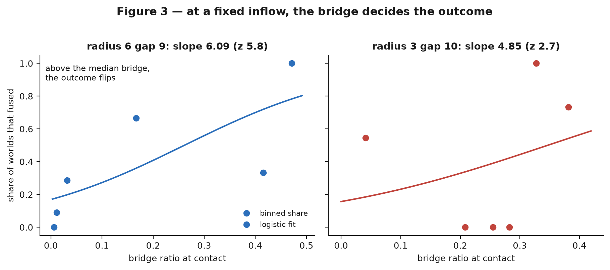

# The gap between surfaces, not the body size, switches fusion in a pattern-forming chemical medium

- **Type:** research article (measurement, one correction, one methodological result)
- **Version:** v1.0 — first edition, written for a reader who does not know this line of work
- **Date:** 2026-11-04
- **Status:** draft, prepared for submission; NOT yet submitted, deposited or published anywhere
- **Authors:** Morphogenesis Laboratory (author list to be confirmed by the owner)
- **Figures:** [`030-figures/`](030-figures/)
- **Data behind every number:** [`030-figures/tables.json`](030-figures/tables.json)
- **Primary artifacts:** `morphogenesis/experiments/E09_pond/l1_field_x1{84,86,90,91,92,93,94,95,96,97}*.json`,
  `morphogenesis/experiments/L1_field/x19*.compact.json`
- **Reports (pre-registrations and results):** [`../reports/2026-11-04-x19*.md`](../reports/)

## Abstract

A chemical medium that forms patterns by itself looks, at a glance, as if it were full of objects that appear, grow, split
and merge. We ask what actually decides whether two such objects fuse into one.

We simulate a thin layer of two reacting and diffusing chemicals on a 96 × 96 grid, with the supply of fresh chemical made
uneven in stripes. Two blobs of pattern are placed at chosen positions and followed for 400 steps; the outcome we measure is
whether the two become one. The positions matter because the stripes have a period of 12 cells, so a blob's local supply
depends on where it sits within the stripe, and only **nine** distinct local supplies exist across all positions.

Holding the local supply fixed, the outcome is decided by the **bridge** of chemical between the blobs: across 144 positions
at one supply, the bridge ratio spans 0.006 to 0.454 and the logistic slope of fusion on that ratio is 6.09 (z = 5.8); at a
smaller body size the same census gives 4.85 (z = 2.7) with the **opposite** sign of the association between supply and
fusion. What switches fusion on and off, however, is the **gap between the surfaces** and not the body size: ordered by the
gap, the fusion share runs 0.00, 0.19, 0.40, 0.83, 0.96 as the surfaces come from 12 cells apart to 8, at two different body
sizes, while ordered by size the same five arms are not monotone. A size effect exists — at a matched gap of 8 the smaller
body fuses 0.96 against 0.83 — but it shifts the outcome rather than switching it.

The third result is a warning about method. Pooling many simulation runs into one number assumes the runs are independent
replicates. We measure how many independent worlds a pool of 757 runs actually contains: 633, with 549 of them used once. For
an association measured by rank (AUC 0.652 → 0.660) the difference is negligible; for a likelihood-based deviance the same
pooling moves the effect size from 20.7 to 14.3, from above the test's own bar of 20 to below it. Whether a result depends on
the unit of observation has to be checked **per statistic**, not once per paper.

**Keywords:** reaction–diffusion, neural cellular automata, pattern formation, coalescence, bridge, stripe heterogeneity,
unit of observation, pre-registration

## 1. The question

Two blobs of a self-organised pattern sit a few cells apart. Over time the medium between them either thickens into a neck
that pulls them together, or stays empty and keeps them apart. Which is it, and what decides?

The everyday answer is "distance": things that are further apart do not touch. Our first measurement says the answer is not
distance alone but **distance divided by the pattern's own scale** — the medium's supply varies in stripes, so a blob's
behaviour depends on where it sits inside a stripe, not only on how far its neighbour is. The second measurement says that
at equal distance the outcome still differs from place to place, and the thing that decides it is the amount of chemical in
the narrow space between the two blobs. The third says that once both are held fixed, fusion is switched by the width of that
narrow space.

Three concrete questions, each with a way to lose:

1. **Does the local supply decide fusion?** Answer "yes" means: at the same nominal supply, blobs placed at different
   positions within the stripe stripe fuse at different rates, and the rate follows the local supply. The claim dies if the
   rates are all the same, or if they follow the nominal supply just as well.
2. **At a fixed supply, does the bridge decide the outcome?** Answer "yes" means: within one supply value, the worlds whose
   bridge is thicker fuse more often. The claim dies if the outcome does not follow the bridge within a value, or if the
   bridge is simply a restatement of the supply.
3. **What switches fusion — the body size or the gap between surfaces?** The claim "the gap switches it" dies if closing the
   gap does not turn fusion on, or if the same gap at different sizes behaves differently by more than a shift.

Nothing in this article depends on a trained network or a learned rule; the medium is the classical two-species system. What
is new here is the measurement design: we enumerate **all** positions modulo the stripe period instead of sampling them, and
we count how many independent replicates a pool of runs really holds.

## 2. What is already known, and what this adds

Spontaneous pattern formation in a two-component reaction–diffusion system was described by Turing [4], and the two-species
system we use is the standard Gray–Scott kinetics [5, 6]. Learned local update rules — neural cellular automata [1, 2, 3] — are a
modern addition to the same family and are the reason the line of work this article belongs to exists at all: a local rule
trained on a pattern-forming medium reproduces much of its phenomenology [2, 3]. In all of these, the objects one sees —
spots, blobs, "individuals" — are local maxima of a continuous field, not entities, and their merge is a topological event:
two connected components of a level set become one.

The merger of two such objects has been studied mostly in droplets and bubbles, where coalescence is controlled by the
distance between surfaces, the curvature of the necks and the drainage of the film between them [12, 9, 10]. In
reaction–diffusion, the distance at which two spots merge has been treated as a property of the pattern's wavelength [11] and
as a boundary in the parameters of the reaction, and our own earlier work located the transition at about 10 cells from the
seed side [A1].

What is missing, and what this article supplies, is the **conditional** question. "How far apart can two spots be before
they merge?" averages over where the spots sit. If the medium's supply is uneven, the position is a hidden variable: two
pairs at the same distance can differ in whether the space between them fills with chemical at all. We treat that space as
the measured state — the *bridge* — and ask whether the bridge, not the distance, decides the outcome. The answer is that
the bridge does decide, and that the geometric variable that switches fusion is the surface-to-surface gap, with the body
size acting as a small shift on top of it. Spatially varying media have been analysed before [7, 8]; what is new here is
turning the position into a *measured* state rather than a nuisance.

The methodological part belongs to a different literature. Pooling runs as if each were independent is pseudo-replication
[17]; when observations are clustered, a cluster bootstrap gives the honest interval [16]; and the general lesson that a
statistic's value depends on the unit of observation is standard in ecology and epidemiology [16, 17]. We measure the size of
that dependence in our own pool and find that it is not uniform across statistics. Pre-registration and multiplicity control
are the other half of the method [18, 19].

## 3. The medium and the measurement

**The medium.** Two chemicals, *u* and *v*, react and diffuse on a 96 × 96 grid with periodic borders, integrated with an
explicit step (parameters in `morphogenesis/config.py`; the exact configuration of every run is in the run's manifest). Left
alone it fills with an irregular pattern of spots. The supply of *u* is made uneven in vertical stripes of period 12 cells:
the nominal supply `F` is multiplied by `1 + 0.5·(2G − 1)` where `G = (sin(2πy/12)·cos(2πx/12) + 1)/2`, so the local supply
runs from 0.5·F to 1.5·F depending on position (Figure 1a). This is the *only* inhomogeneity in the medium.

**A world.** A "world" is one run with a specified geometry and seed. We build a world by seeding two small discs of pattern
— "bodies" — at chosen positions, separated by a chosen distance. The bodies are rings, not filled discs: their mass sits at
a radius of about 3, 4 or 6 cells, and the centre of a ring is empty, which matters for what we measure (Figure 1a).

**Outcome.** We follow the run for 400 steps, recording the number of connected components of the field every 10 steps. The
outcome is `fused = 1` if at any recorded step the two bodies are exactly one component, and `0` otherwise. Later, secondary
spots may appear from the medium itself; those are not the outcome but they are why the component count at the end of a run
is not a clean readout of the event.

**Bridge.** At the moment of closest approach (the last recorded step at which exactly two components exist and the field is
strong enough), we measure the field value at the midpoint between the two centres, divided by the strongest field value
within a radius of 10 cells around that midpoint (Figure 1b). The ratio is near 1 when the neck between the bodies is as
strong as the bodies themselves, and near 0 when the space between them is empty but for a trace. We call it the bridge
ratio; a value above about 0.4 means a neck is present.

**Everything is one number, and the lattice matters.** The measured ratio is a rasterised quantity: the grid is 96 × 96, the
bodies are discs rasterised on it, and a "gap" of 8 cells is 8 cells as the raster sees them, not as a continuum would. On a
discrete lattice the *existence* of a pattern can depend on the discretisation alone [13], the integration step is a
consequential parameter rather than a resolution knob [14], and rounding error in a simulated physical quantity leaks into
whatever statistic is computed from it [15]. Whenever we compare arms, the comparison is between measured radii and measured
gaps.


## 4. Methods: the census, and the two kinds of replication

**Nine supplies, 144 positions.** Because the supply term has period 12 in both directions, the local supply of a body pair
takes only nine distinct values. Enumerating the positions of a pair with a fixed centre separation modulo that period gives
**144 phase classes** (a "phase" is the pair of positions modulo 12). We run **one world per class** — the whole population
of positions, not a sample — at a fixed separation and body size. This is what makes the conditional question answerable: at
each of the nine supply values we have between 4 and 26 worlds, all at nominally identical settings, differing only in the
hidden phase (Figure 2a).

**Pre-registration.** Every arm of this line was pre-registered before its run, with its positive control, its readout, its
sensitivity arithmetic and its refusal rule written into `reports/*-plan.md` and into the plan sections of
`docs/plan/10d-field-metrics-and-form.md`. A criterion that could not be tested is recorded as untestable, with the count
that shows why; it is not recorded as failed.

**Two kinds of replication, and they are not the same.** A run is one execution. A **world** is a pair of positions modulo
the stripe period (a phase) together with the arm's geometry — radius, gap, supply, length. Many runs can share a world: we
found that seeds placed at the same position produce identical outcomes (within-site spread exactly 0.0000), and that five
distinct jitters inside one phase produce the same bridge ratio (0.39916 five times, spread 0.0). In other words a run
repeated at one position is a **clone**; only the phase carries new information. The question "how many independent
observations does a pool hold?" therefore has a measurable answer, and we compute it by collapsing the pool into worlds.

**Statistics.** All tests are named where used: a one-sided Fisher exact test for a 2 × 2 contrast, Spearman's rank
correlation over classes and over the means of the nine supply values, an iteratively reweighted logistic fit of fusion on
the bridge ratio (slope with standard error and z), a binomial deviance for the predictive comparison, the area under the
ROC curve for the association between local supply and fusion, and a bootstrap over runs and over worlds for the intervals.
Where an outcome has no variation in an arm, no contrast or fit is reported: the criterion is marked untestable.

**The arithmetic of sensitivity.** Before each arm we wrote down what difference the manipulation could make: the supply band
(0.5·F to 1.5·F), the measured spread of the bridge ratio at one supply (0.14 to 0.45 across arms), the number of worlds per
value, and the bar each criterion had to beat. Arm-level decisions (which value counts as "crowded", how many worlds have to
reach contact) were fixed in the pre-registration, not after the numbers.

## 5. Results

### 5.1 The supply that matters is the local one, and it decides fusion ([A2], [A3])

In a purpose-built arm where the nominal supply was held fixed and the position varied, the local supply at the seeded
positions separated the outcomes completely: worlds whose local supply was below the arm's median fused 0.00 of the time and
those above it fused 1.00, with a rank association of 0.982 and z = +4.64 (one-sided p = 1.7 × 10⁻⁶). This is the
construction that licenses calling the local quantity the driver; it was measured on an arm designed for it, not on the
pooled natural data.

Over the natural pool, the same comparison was made with a binomial deviance: predicting the outcome from the nominal supply
gives a deviance of 464.5, from the local supply 436.5, a drop of 28.0 ([A2]). That number is one of the three headline
numbers of this line; §5.4 shows what happens to it when the unit of observation is changed.

### 5.2 At a fixed supply, the phase decides the bridge — and the sign of the supply's effect depends on size ([A4], [A5])

Two censuses were run, one at a body radius of 6 with a gap of 9, one at a radius of 3 with a gap of 10. Each is 144 worlds:
the full population of positions at that geometry.

**The bridge is not a restatement of the supply.** At the most crowded supply value in the radius-6 census — 26 of the 144
phases share it — the bridge ratio spans 0.0056 to 0.4535, a spread of **0.448** (Figure 2b). Since the supply is identical
by construction, that spread is the phase's own doing.

**The outcome follows the bridge.** Among those same 26 worlds, the 8 whose bridge is above the value's median fused
**1.00** of the time and the 18 below it fused **0.111**; the difference is 0.889 with a one-sided Fisher p < 0.001. Over all
144 worlds the logistic slope of fusion on the bridge ratio is **6.09** (se 1.06, z = 5.8) — a steep dependence: a bridge
ratio moving from about 0.1 to about 0.5 takes the fusion probability from nearly 0 to nearly 1 (Figure 3, left).

**The same census at a smaller body carries the opposite sign.** At radius 3, the crowded value holds 44 classes with a
bridge spread of **0.401**, the above/below-median contrast is **0.5** (Fisher p = 0.0001), and the logistic slope is
**4.85** (se 1.79, z = 2.7). But the *association between supply and fusion* runs the other way: over classes, Spearman's
rank correlation between bridge ratio and local supply is **−0.378** at radius 6 and **+0.413** at radius 3 (−0.833 and
+0.515 over the nine value means). The bridge explains the outcome in both; what the supply does to the bridge flips with the
size of the bodies (Figure 3, right; Figure 2b).




### 5.3 The gap between surfaces switches fusion; the body size shifts it ([A6])

The two censuses above sit at different sizes *and* different separations, so the sign reversal cannot be attributed to one
of them. Two further arms closed that gap — radius 4 gap 12 and radius 5 gap 10, both with a centre separation of 20 cells —
and produced a surprise: **not one of their 288 worlds fused**, although every one kept a measurable bridge (spreads 0.139
and 0.180). Read naively, that is a window of body sizes in which fusion never happens.

The window moves when the gap is varied instead. The next experiment changed the surface-to-surface gap at two sizes: radius
4 with the gap closed from 12 to 10 and to 8, and radius 6 at the very centre separation of 20 where radius 4 fuses nothing
— which for radius 6 is a gap of 8. The result (Figure 4) is a monotone table in the gap and a non-monotone table in the
radius:

| radius | gap (cells) | centre separation | worlds | fused | fusion share |
|---:|---:|---:|---:|---:|---:|
| 4 | 12 | 20 | 144 | 0 | **0.00** |
| 4 | 10 | 18 | 144 | 34 | **0.19** |
| 6 | 9 | 21 | 144 | 58 | **0.40** |
| 6 | 8 | 20 | 144 | 126 | **0.83** |
| 4 | 8 | 16 | 144 | 138 | **0.96** |

The share column is the **mean over the nine supply values** of the per-value fusion share (the arms differ in how the 144
classes distribute over those values), not the raw fraction of fused worlds; the fused column gives that raw count on the
same rows (34/144 = 0.24 and 126/144 = 0.88 for the two arms where the two differ most), and the two orderings agree.


Radius 4 fuses nothing at a separation of 20 and 0.96 when the surfaces come to 8 cells apart; radius 6 fuses 0.83 at the
*same* separation of 20 where radius 4 fuses nothing, because its gap there is 8 rather than 12. Ordered by gap the share
rises monotonically as the surfaces approach, at both sizes. The size is not absent — at a matched gap of 8 the smaller body
fuses 0.96 and the larger 0.83 — but it shifts the outcome by about a tenth while the gap switches it. This agrees with the
earlier seed-side boundary work, which placed the transition at about 10 cells [A1]. All three pre-registered criteria of the
gap experiment passed, and the earlier reading of the fusion-free arms as a *size* window is withdrawn in favour of the gap
reading (see the Changelog).

### 5.4 The unit of observation, and a published effect that does not survive it ([A8], [A9])

The line's pools mix runs, and runs are not independent: seeds at one position are clones, and so are jitters inside one
phase [A10]. We counted the independent units in the largest natural pool — the runs accumulated for the deviance comparison of
§5.1, none of them laid out to study a chosen phase. The 757 runs collapse to **633 worlds**: the largest world holds 5 runs,
549 of them hold exactly one run, and only 2 worlds contain both outcomes. Replacing runs by worlds
therefore should barely change a pooled statistic — and for one statistic it does not:

| statistic | per run | per world |
|---|---:|---:|
| AUC of the local-supply → fusion association | 0.6517 | 0.6596 |
| bootstrap sd of that AUC | 0.0207 | 0.0219 |
| binomial deviance drop (nominal → local supply) | **20.7** | **14.3** |
| share of bootstrap resamples with drop above 20 | **0.517** | **0.208** |

For the rank statistic the intervals differ by 6 % (0.0207 → 0.0219; the pre-registered refusal was a ratio of 1.3). For the
deviance — the statistic behind §5.1's headline drop — the same regrouping moves the number from 20.7 to 14.3, from **above**
the test's own bar of 20 to **below** it, and the phase-clustered bootstrap clears that bar in only 21 % of resamples against
52 % for runs (Figure 5). The pool here is not identical to the one the published 28.0 came from (later arms selected on
supply are excluded), so the like-for-like comparison is the pair in the table above; even so, the conclusion is that the
deviance drop is carried partly by repeated runs.


This is not a contradiction of the local-supply law. That law rests on the designed arm of §5.1 (0.00 → 1.00 by
construction) and on the two windows of the censuses, not on this deviance. What it shows is that a pooled effect can be
inflated by the unit of observation — and that the size of the inflation depends on the statistic.

## 6. What this does not show

- **No analytics.** Nothing here is derived from the reaction–diffusion equations. The statements are about measured
  outcomes in a rasterised medium at one grid, one integration step and one horizon of 400 steps.
- **One world per phase.** The population of phases is complete (144 of 144), but each phase is measured once. The claim
  that a phase is a unit rests on the measured zero spread within a site and within a phase, not on replicates of the whole
  census.
- **Geometry is moved by moving the bodies**, which changes which cells they occupy; the gap table is therefore a statement
  about this band of geometries, not a continuous law of separation. The two sizes are not compared at one matched gap for
  every phase, so the size shift is a difference between two samples of phases.
- **The bridge is one scalar.** It is the value at the midpoint over the strongest value within 10 cells, at one recorded
  step; other neck measures (width, curvature, flux) were not tried.
- **One nominal supply per arm** (F = 0.03 for the censuses) with logging every 10 steps, so the contact moment is known to
  within 10 steps.
- **The deviance comparison is within our own pool**, with the test's own bar of 20 kept for comparability rather than
  re-derived.
- **The bridge ratios cannot be re-derived from the committed tree.** An independent reviewer recomputed every per-world
  outcome and ratio from the raw field arrays and matched all 1008 of them, but those arrays are not committed (the compact
  slices carry only the component list: step, id, area, centre). A reader outside this machine can verify the outcomes and the
  tables, not the bridge itself. Fixing that requires the contact-step field (or the contact ratio) to travel with the
  aggregate, which the next census will do.

## 7. What would change the answer

1. **A controlled size contrast at one fixed gap.** Run the census at radii 3, 4, 6 with the gap held at 8 cells for every
   phase class. If the size shift is not of the order of a tenth, §5.3's second half is wrong.
2. **The gap boundary on a finer grid over all classes.** Gaps of 9, 10, 11, 12 at one radius, every phase: a step at 10
   cells confirms the boundary reading; a smooth curve replaces "boundary" with a rate.
3. **A two-seed census.** Two seeds per phase class prices the class unit directly instead of inferring it from clones; if
   within-phase spread is not zero, §5.4's unit count is wrong.
4. **A world random effect.** Refit the deviance with a random effect for world (a mixed model over cells). If the drop
   returns above the bar, the inflation in §5.4 is an artefact of collapsing rather than a property of the unit.
5. **A different neck observable.** Replace the midpoint ratio with a flux through the neck. If the supply–fusion sign
   reversal at small bodies disappears, the bridge is not the deciding variable.

## 8. Reproducibility

Every number in this article is written into `030-figures/tables.json` by `scripts/make_article_030_figures.py`, which reads
only committed artifacts. The figures are rebuilt by the same script:

```bash
python scripts/make_article_030_figures.py     # writes 030-figures/fig1..fig5 and tables.json
python scripts/check_article_030_numbers.py    # re-derives every number and checks it against the article text
```

The censuses and their analyses are produced by `scripts/x192_phase_census.py`, `scripts/x193_phase_census_r3.py`,
`scripts/x194_phase_clusters.py`, `scripts/x195_sign_sweep.py`, `scripts/x196_gap_or_size.py` (each with a `_analyse`
companion) and `scripts/x197_deviance_worlds.py`. Each run writes a manifest under `lab/runs/` and a row in the canonical
journal; each arm has a pre-registration under `reports/` dated before its run. Raw per-world slices are committed as
compacted JSON under `morphogenesis/experiments/L1_field/`.

## References

**External literature.** Numbering follows the verified list in [`030-references.md`](030-references.md), which records for
each entry the command or manifest key by which its existence was checked; entries that could not be verified there are not
cited here. Two entries rest on corpus documents at manifest status `partial` (not read end to end): [3] and [20].

1. A. Mordvintsev, E. Randazzo, E. Niklasson, M. Levin. "Growing Neural Cellular Automata". *Distill*, 2020. DOI: 10.23915/distill.00023.
2. W. Gilpin. "Cellular automata as convolutional neural networks". *Physical Review E*, 2019. DOI: 10.1103/PhysRevE.100.032402.
3. H. Kojima, T. Ikegami. "Implementation of Lenia as a Reaction-Diffusion System". *The 2023 Conference on Artificial Life*, 2023. DOI: 10.1162/isal_a_00638.
4. A. M. Turing. "The chemical basis of morphogenesis". *Philosophical Transactions of the Royal Society B*, 1952. DOI: 10.1098/rstb.1952.0012.
5. P. Gray, S. K. Scott. "Autocatalytic reactions in the isothermal, continuous stirred tank reactor". *Chemical Engineering Science*, 1984. DOI: 10.1016/0009-2509(84)87017-7.
6. J. E. Pearson. "Complex Patterns in a Simple System". *Science*, 1993. DOI: 10.1126/science.261.5118.189.
7. D. L. Benson, P. K. Maini, J. A. Sherratt. "Unravelling the Turing bifurcation using spatially varying diffusion coefficients". *Journal of Mathematical Biology*, 1998. DOI: 10.1007/s002850050135.
8. T. Biancalani, D. Fanelli, F. Di Patti. "Stochastic Turing patterns in the Brusselator model". *Physical Review E*, 2010. DOI: 10.1103/PhysRevE.81.046215.
9. H.-G. Purwins, H. U. Bödeker, Sh. Amiranashvili. "Dissipative solitons". *Advances in Physics*, 2010. DOI: 10.1080/00018732.2010.498228.
10. H. U. Bödeker, A. W. Liehr, T. D. Frank, R. Friedrich, et al. "Measuring the interaction law of dissipative solitons". *New Journal of Physics*, 2004. DOI: 10.1088/1367-2630/6/1/062.
11. W. N. Reynolds, S. Ponce-Dawson, J. E. Pearson. "Self-replicating spots in reaction-diffusion systems". *Physical Review E*, 1997. DOI: 10.1103/PhysRevE.56.185.
12. J. Eggers, J. R. Lister, H. A. Stone. "Coalescence of liquid drops". *Journal of Fluid Mechanics*, 1999. DOI: 10.1017/S002211209900662X.
13. Q. T. Davis. "Discretization-Dependent Dissolution of Gliders in (Dis)Continuous Systems: Non-Platonic Self-Organization in Complex Systems". *Innovations in Machine Intelligence*, 2023. DOI: 10.54854/imi2023.01.
14. Q. T. Davis, J. Bongard. "Step Size is a Consequential Parameter in Continuous Cellular Automata". *The 2022 Conference on Artificial Life*, 2022. DOI: 10.1162/isal_a_00526.
15. M. L. Pilat, R. Suzuki, T. Arita. "Dealing with rounding error problems in evolutionary physical simulation". *Artificial Life and Robotics*, 2012. DOI: 10.1007/s10015-012-0038-0.
16. A. C. Cameron, J. B. Gelbach, D. L. Miller. "Bootstrap-Based Improvements for Inference with Clustered Errors". *Review of Economics and Statistics*, 2008. DOI: 10.1162/rest.90.3.414.
17. S. H. Hurlbert. "Pseudoreplication and the Design of Ecological Field Experiments". *Ecological Monographs*, 1984. DOI: 10.2307/1942661.
18. B. A. Nosek, C. R. Ebersole, A. C. DeHaven, D. T. Mellor, et al. "The preregistration revolution". *Proceedings of the National Academy of Sciences*, 2018. DOI: 10.1073/pnas.1708274114.
19. Y. Benjamini, Y. Hochberg. "Controlling the False Discovery Rate: A Practical and Powerful Approach to Multiple Testing". *Journal of the Royal Statistical Society B*, 1995. DOI: 10.1111/j.2517-6161.1995.tb02031.x.
20. G. K. Sandve, A. Nekrutenko, J. Taylor, E. Hovig, et al. "Ten Simple Rules for Reproducible Computational Research". *PLoS Computational Biology*, 2013. DOI: 10.1371/journal.pcbi.1003285.

**This line's own artifacts** (each with its pre-registration and its aggregate; see the reports for the numbers).

- **[A1]** X158 boundary measurement: `reports/2026-11-04-x158-crossing.md` (a gap of about 10 cells at radii 3, 4.5 and 6).
- **[A2]** X184, X186: `morphogenesis/experiments/E09_pond/l1_field_x184_*.json`, `l1_field_x186_*.json`; reports `reports/2026-11-04-x18{4,6}-*.md`.
- **[A3]** X185: `reports/2026-11-04-x185-*.md` (one law, two windows).
- **[A4]** X192: `l1_field_x192_phase_census.json`; report `reports/2026-11-04-x192-phase-census.md`.
- **[A5]** X193: `l1_field_x193_phase_census_r3.json`; report `reports/2026-11-04-x193-phase-census-r3.md`.
- **[A6]** X195, X196: `l1_field_x195_sign_sweep.json`, `l1_field_x196_gap_or_size.json`; reports `reports/2026-11-04-x195-sign-sweep.md`, `reports/2026-11-04-x196-gap-or-size.md`.
- **[A7]** X187 (the arm-held grouping used in §5.4): report `reports/2026-11-04-x187-*.md`.
- **[A8]** X194: `l1_field_x194_phase_clusters.json`; report `reports/2026-11-04-x194-phase-clusters.md`.
- **[A9]** X197: `l1_field_x197_deviance_worlds.json`; report `reports/2026-11-04-x197-deviance-worlds.md`.
- **[A10]** X190, X191 (the clone and phase spreads behind the world unit): reports `reports/2026-11-04-x19{0,1}-*.md`.

## Changelog

- **v1.0** (2026-11-04): first edition. Consolidates the phase-census line X184–X197 for an outside reader. Includes the
  correction of the "size window" reading (X195) to a **gap** reading (X196), and the unit-of-observation result (X194,
  X197) including the fact that the published deviance drop falls from 20.7 to 14.3 when the world replaces the run.

## Verification

- **Numbers.** Every number quoted above is re-derived from committed artifacts by
  `python scripts/check_article_030_numbers.py` (run before submission); the table behind them is
  [`030-figures/tables.json`](030-figures/tables.json).
- **References.** Existence of every reference is checked in [`030-references.md`](030-references.md) via the corpus
  manifest or Crossref/DataCite; entries that could not be verified are marked there and are not cited here.
- **Independent review.** `lab/reviews/2026-11-04-030-numbers.md` — an independent recomputation of the headline numbers by
  the reviewer role, including the two statistics whose intervals depend on the unit (date of review in that file).
- **Not published.** No part of this article has been submitted, deposited or posted anywhere. Submission requires the
  owner's explicit approval, and the author list is not yet fixed.
