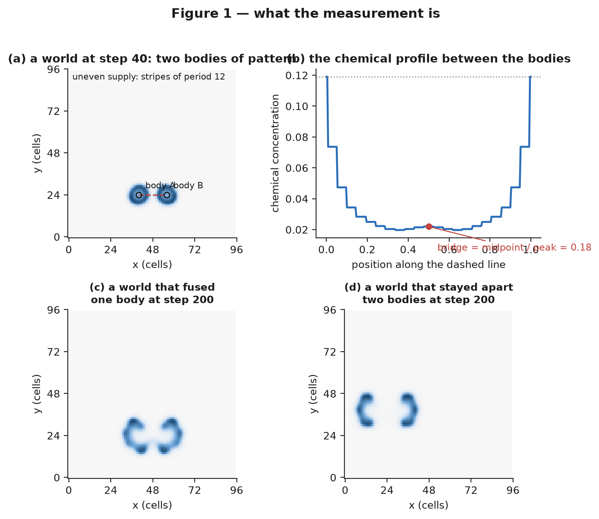
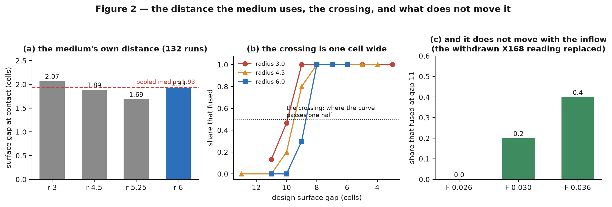
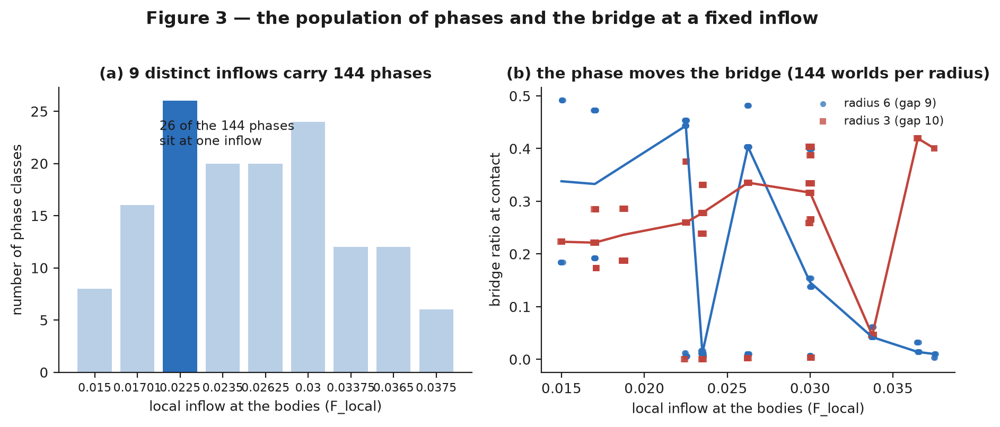
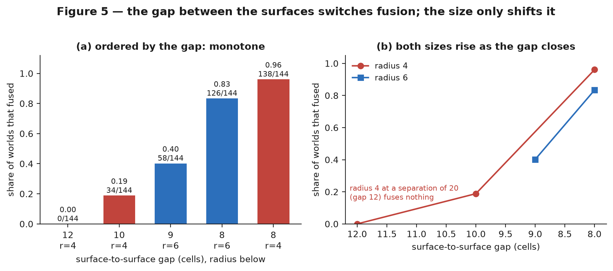
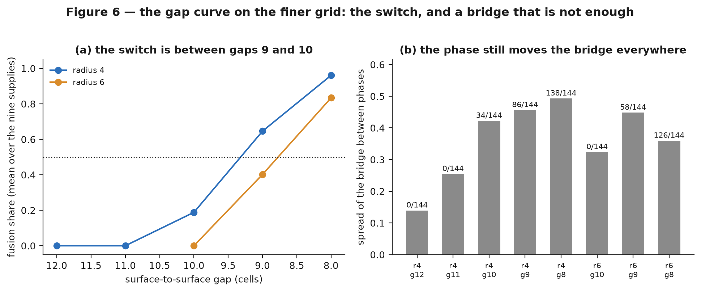
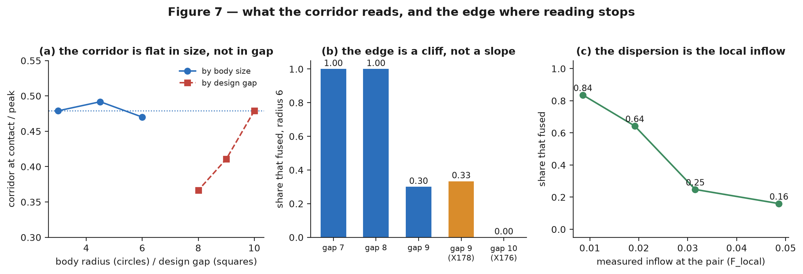
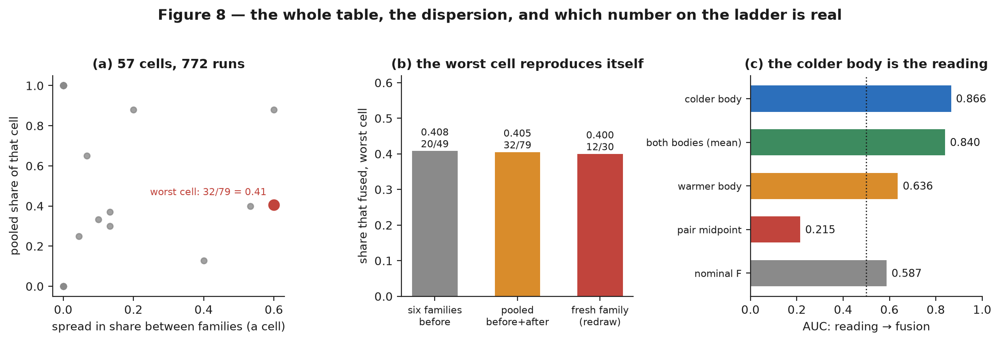
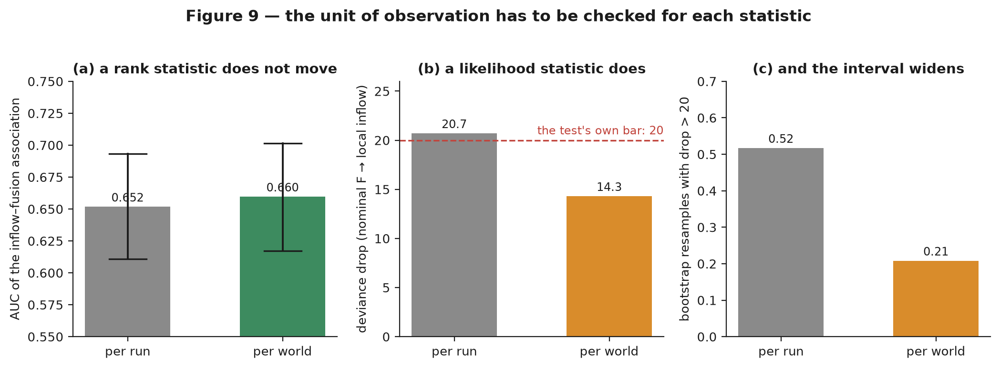

# The gap between surfaces, not the body size, switches fusion in a pattern-forming chemical medium

- **Type:** research article (measurement, one correction, one methodological result)
- **Version:** v2.1 — one article for the whole path taken after the published previous article (DOI 10.5281/zenodo.23933440,
  whose archive carries aggregates up to X155): the crossing and its geometry, what a daughter keeps and whether a merge comes
  apart, the local supply, the bridge, the gap that switches fusion, what the corridor forecasts, the full crossing table with
  the dispersion it hides, and the unit of observation. It follows the sequence's shape: last time we found this and decided to
  check that; here are the results; here is where we move next. v1.0–v1.2 described only the census line
- **Date:** 2026-11-05
- **Status:** draft, prepared for submission; NOT yet submitted, deposited or published anywhere
- **Authors:** Ilya Vladimirov
- **Figures:** [`030-figures/`](030-figures/)
- **Data behind every number:** [`030-figures/tables.json`](030-figures/tables.json)
- **Primary artifacts:** `morphogenesis/experiments/E09_pond/l1_field_x1*.json` (X156–X198; the exact file and JSON path for
  every added number is in the aggregate named by the corresponding [A12]–[A25] entry),
  `morphogenesis/experiments/L1_field/x19*.compact.json`
- **Reports (pre-registrations and results):** [`../reports/2026-11-04-x1*.md`](../reports/)

## Abstract

A chemical medium that forms patterns by itself looks, at a glance, as if it were full of objects that appear, grow, split
and merge. We ask what actually decides whether two such objects fuse into one, and what survives when they do.

We simulate a thin layer of two reacting and diffusing chemicals on a 96 × 96 grid, with the supply of fresh chemical made
uneven in stripes. Two blobs of pattern are placed at chosen positions and followed for 400 steps; the outcome we measure is
whether the two become one. The positions matter because the stripes have a period of 12 cells, so a blob's local supply
depends on where it sits within the stripe, and only **nine** distinct local supplies exist across all positions.

**What the distance means.** The design places bodies at a chosen distance between their centres, but the medium does not use
that number: from 132 merging runs, the two **surfaces** touch at a median distance of **1.93 cells** (range 0.94 to 4.87), the
same at every body size, and because the field is logged every ten steps that reading is an upper bound which bounds the true
threshold down to a median of **0.7 cells** — a window about one to five cells wide, not a point. The crossing itself is one
number per size: fusion falls below one half at gaps 10, 10 and 9 for body radii 3, 4.5 and 6, it does not move with the size
ratio (a (3, 6) pair crosses between 8 and 10 cells), and it does not move with the inflow rate over three rates tested. One
earlier reading of the crossing — five of five fusions at "gap 11" — is **withdrawn** as a units artefact and replaced.

**What a daughter keeps.** Shape is inherited about half: the daughter-on-parent slope is **0.5167** for elongation and
**0.4811** for width. The discrete state of a body is **re-drawn at every division**, not inherited. The medium adds no length
of its own: the distance to the k-th neighbour is set by the body's inherited radius. A merge comes apart again — a merged body
that divides gives two bodies whose combined area is 0.867 of the parents' — and it divides after 25 steps against a single
body's 40.

**What decides fusion.** Holding the local supply fixed, the outcome is decided by the **bridge** of chemical between the
blobs: across 144 positions at one supply, the bridge ratio spans 0.006 to 0.454 and the logistic slope of fusion on that
ratio is 6.09 (z = 5.8); at a smaller body size the same census gives 4.85 (z = 2.7) with the **opposite** sign of the
association between supply and fusion. What switches fusion on and off, however, is the **gap between the surfaces** and not
the body size: ordered by the gap, the fusion share runs 0.00, 0.19, 0.40, 0.83, 0.96 as the surfaces come from 12 cells apart
to 8, at two different body sizes, while ordered by size the same five arms are not monotone. A size effect exists — at a
matched gap of 8 the smaller body fuses 0.96 against 0.83 — but it shifts the outcome rather than switching it. The edge is a
cliff, not a slope: at radius 6, moving the gap by one cell takes the share from a third to zero.

**What can be read before it happens.** The corridor — the concentration on the line joining the bodies, in units of their own
peak — is a size-independent criterion (0.48, 0.49, 0.47 at three sizes) but it is largely a readout of how close to the
crossing the pair is, and where a single curve made a sharp prediction it failed: an interior cell landed in its registered
corridor interval and missed its registered share interval. The number that organises the rate ladder is the measured inflow at
the **colder** of the two bodies (AUC 0.866), not the nominal rate the experiment set (0.587) and not the pair's midpoint
(0.215, anti-predictive). A full enumeration of the series — 57 two-body cells, 772 runs — shows why cells disagree with
themselves: it is the phase of the medium where the pair sits, and the worst cell is reproducible by a fresh draw (12 of 30
against 20 of 49 before) because the dispersion is between-family noise rather than a second mechanism.

**And a warning about method.** Pooling many simulation runs into one number assumes the runs are independent replicates. We
measure how many independent worlds a pool of 757 runs actually contains: 633, with 549 of them used once. For an association
measured by rank (AUC 0.652 → 0.660) the difference is negligible; for a likelihood-based deviance the same pooling moves the
effect size from 20.7 to 14.3, from above the test's own bar of 20 to below it. Whether a result depends on the unit of
observation has to be checked **per statistic**, not once per paper.

**Keywords:** reaction–diffusion, neural cellular automata, pattern formation, coalescence, bridge, stripe heterogeneity,
inheritance, reversibility, pre-registration, unit of observation

## The line this article continues

**Last time.** In the previous article of this series — *How lineages begin and end in a pattern-forming chemical medium*
(Zenodo, DOI 10.5281/zenodo.23933440) — we followed bodies of pattern in the same medium and measured four things: the medium
has a **mixing length**, two bodies merge when their surfaces come within about 9 ± 1 cells whatever their size; a fusion is a
**merger**, both bodies ending on the same step with one body left under a new name; a lineage usually ends by **losing its
name** rather than its cells; and the habit that maximises generations is not the one in which a lineage survives. That work
treated the medium as uniform and asked how far apart two bodies can be before they merge.

**Everything it left open, and what we decided to check.** The published article closed with a list of questions, and this
article is the attempt to answer them in one place rather than in fragments. Four groups of checks:

1. **The distance it measured was a design label, not a physical distance.** We decided to re-measure the contact itself, on
   a finer log, and to ask whether the crossing moves with the body-size ratio or with the inflow rate (§5.1).
2. **What a lineage actually copies.** The published article measured one quantitative trait. We decided to ask the same
   question of **shape**, of a **discrete** state, and of whether the medium supplies a length of its own — and to test whether
   a merge can be undone (§5.2).
3. **The medium is not uniform.** Since our supply varies in stripes, "how far apart" is an average over positions, and two
   pairs at the same distance may sit in different local supplies. We decided to check whether the outcome at a fixed distance
   is decided by the **local supply where the bodies sit** rather than by the nominal one, and then what decides fusion once
   the supply is held fixed: the **bridge of chemical** between the bodies, or the geometry of the pair (§5.3–§5.5).
4. **Whether any of it can be read before it happens, and whether the pool of runs is what it looks like.** We decided to
   enumerate every two-body cell instead of sampling them, to forecast the outcome at an unrun supply, and to measure how many
   independent worlds a pool of runs really contains (§5.6–§5.9).

**What follows.** Section 2 places the checks against what is known; sections 3 and 4 define the medium, the outcome and the
census; **section 5 gives the results of the checks**, in the order of the four groups above — the crossing and its geometry,
what a daughter keeps, the local supply, the bridge, the gap that switches fusion, what the corridor forecasts, the full
crossing table with the dispersion it hides, and the unit of observation; sections 6 and 7 are the limits and what would
overturn the answers; and **section 8 says where we try to move next**.

## 1. The question

Two blobs of a self-organised pattern sit a few cells apart. Over time the medium between them either thickens into a neck
that pulls them together, or stays empty and keeps them apart. Which is it, and what decides?

The everyday answer is "distance": things that are further apart do not touch. Our first measurement says the answer is not
distance alone but **distance divided by the pattern's own scale** — the medium's supply varies in stripes, so a blob's
behaviour depends on where it sits inside a stripe, not only on how far its neighbour is. The second measurement says that
at equal distance the outcome still differs from place to place, and the thing that decides it is the amount of chemical in
the narrow space between the two blobs. The third says that once both are held fixed, fusion is switched by the width of that
narrow space.

Six concrete questions, each with a way to lose:

1. **Does the local supply decide fusion?** Answer "yes" means: at the same nominal supply, blobs placed at different
   positions within the stripe fuse at different rates, and the rate follows the local supply. The claim dies if the
   rates are all the same, or if they follow the nominal supply just as well.
2. **At a fixed supply, does the bridge decide the outcome?** Answer "yes" means: within one supply value, the worlds whose
   bridge is thicker fuse more often. The claim dies if the outcome does not follow the bridge within a value, or if the
   bridge is simply a restatement of the supply.
3. **What switches fusion — the body size or the gap between surfaces?** The claim "the gap switches it" dies if closing the
   gap does not turn fusion on, or if the same gap at different sizes behaves differently by more than a shift.
4. **How close do the surfaces actually come, and does that move?** The mixing length of the earlier work was stated as a
   centre-to-centre number. The claim "the medium uses a surface gap" dies if the measured contact distance scales with the
   body size, or if the crossing moves with the size ratio or with the inflow rate.
5. **What does a daughter keep?** "Shape is partly inherited" dies if the daughter-on-parent slope is near zero or near one;
   "the discrete state is inherited" dies unless it survives its shuffled-parent null; and "the medium supplies a ruler" dies
   if the neighbour-order slope is set by the body's own inherited radius instead.
6. **Can the outcome be read before it happens, and is a pool of runs what it looks like?** "The corridor predicts" dies if a
   single curve through the measured arms misses a cell placed between them, or if the share does not follow it at an unrun
   supply; and "the pool is independent replicates" dies if regrouping the runs into worlds moves a statistic across its own
   bar.

Nothing in this article depends on a trained network or a learned rule; the medium is the classical two-species system. What
is new here is the measurement design: we enumerate **all** positions modulo the stripe period instead of sampling them, we
check every closure against the medium's own arithmetic, and we count how many independent replicates a pool of runs really
holds.

## 2. What is already known, and what this adds

Spontaneous pattern formation in a two-component reaction–diffusion system was described by Turing [4], and the two-species
system we use is the standard Gray–Scott kinetics [5, 6]. Learned local update rules — neural cellular automata [1, 2, 3] — are a
modern addition to the same family and are the reason the line of work this article belongs to exists at all: a local rule
trained on a pattern-forming medium reproduces much of its phenomenology [2, 3]. In all of these, the objects one sees —
spots, blobs, "individuals" — are local maxima of a continuous field, not entities, and their merge is a topological event:
two connected components of a level set become one.

The merger of two such objects has been studied mostly in droplets and bubbles, where coalescence is controlled by the
distance between surfaces, the curvature of the necks and the drainage of the film between them [12, 9, 10]. In
reaction–diffusion, the distance at which two spots merge has been treated as a property of the pattern's wavelength [11] and
as a boundary in the parameters of the reaction, and our own earlier work located the transition at about 10 cells from the
seed side [A1].

What is missing, and what this article supplies, is the **conditional** question. "How far apart can two spots be before
they merge?" averages over where the spots sit. If the medium's supply is uneven, the position is a hidden variable: two
pairs at the same distance can differ in whether the space between them fills with chemical at all. We treat that space as
the measured state — the *bridge* — and ask whether the bridge, not the distance, decides the outcome. The answer is that
the bridge does decide, and that the geometric variable that switches fusion is the surface-to-surface gap, with the body
size acting as a small shift on top of it. Spatially varying media have been analysed before [7, 8]; what is new here is
turning the position into a *measured* state rather than a nuisance.

The methodological part belongs to a different literature. Pooling runs as if each were independent is pseudo-replication
[17]; when observations are clustered, a cluster bootstrap gives the honest interval [16]; and the general lesson that a
statistic's value depends on the unit of observation is standard in ecology and epidemiology [16, 17]. We measure the size of
that dependence in our own pool and find that it is not uniform across statistics. Pre-registration and multiplicity control
are the other half of the method [18, 19].

Two further literatures are touched, and neither is claimed as new. **Inheritance of a shape between division events** is the
question of whether a local rule that copies a scalar trait also copies a form; our system copies it about half, which is
neither of the two textbook answers, and the discrete state is not copied at all. **Reversibility of coalescence** is the
classical question of whether two droplets that merged can be separated again [12, 9, 10]; in our medium the material returns
to two bodies when the merged body divides, but the lineages do not resume — the distinction between the material and the
identity, which the previous article made its central point, is what separates our case from the droplet literature.

## 3. The medium and the measurement

**The medium.** Two chemicals, *u* and *v*, react and diffuse on a 96 × 96 grid with periodic borders, integrated with an
explicit step (parameters in `morphogenesis/config.py`; the exact configuration of every run is in the run's manifest). Left
alone it fills with an irregular pattern of spots. The supply of *u* is made uneven in vertical stripes of period 12 cells:
the nominal supply `F` is multiplied by `1 + 0.5·(2G − 1)` where `G = (sin(2πy/12)·cos(2πx/12) + 1)/2`, so the local supply
runs from 0.5·F to 1.5·F depending on position (Figure 1a). This is the *only* inhomogeneity in the medium.

**A world.** A "world" is one run with a specified geometry and seed. We build a world by seeding two small discs of pattern
— "bodies" — at chosen positions, separated by a chosen distance. The bodies are rings, not filled discs: their mass sits at
a radius of about 3, 4 or 6 cells, and the centre of a ring is empty, which matters for what we measure (Figure 1a).

**Outcome.** We follow the run for 400 steps, recording the number of connected components of the field every 10 steps. The
outcome is `fused = 1` if at any recorded step the two bodies are exactly one component, and `0` otherwise. Later, secondary
spots may appear from the medium itself; those are not the outcome but they are why the component count at the end of a run
is not a clean readout of the event.

**Bridge.** At the moment of closest approach (the last recorded step at which exactly two components exist and the field is
strong enough), we measure the field value at the midpoint between the two centres, divided by the strongest field value
within a radius of 10 cells around that midpoint (Figure 1b). The ratio is near 1 when the neck between the bodies is as
strong as the bodies themselves, and near 0 when the space between them is empty but for a trace. We call it the bridge
ratio; a value above about 0.4 means a neck is present.

**Everything is one number, and the lattice matters.** The measured ratio is a rasterised quantity: the grid is 96 × 96, the
bodies are discs rasterised on it, and a "gap" of 8 cells is 8 cells as the raster sees them, not as a continuum would. On a
discrete lattice the *existence* of a pattern can depend on the discretisation alone [13], the integration step is a
consequential parameter rather than a resolution knob [14], and rounding error in a simulated physical quantity leaks into
whatever statistic is computed from it [15]. Whenever we compare arms, the comparison is between measured radii and measured
gaps.



**Figure 1.** What the article measures: two ring-shaped bodies of pattern on the striped supply, the gap between their surfaces, and the bridge ratio read at the midpoint between them.

**The words of this article, in one place.** A *world* is one run with a given geometry and seed; a *phase class* is a pair of
seeded positions counted modulo the stripe period of 12 cells; the *local supply* is the value of the striped supply function at
the seeded positions; the *nominal supply* `F` is its average over the whole field, the number an experimenter sets; the *gap* is
the shortest distance between the two bodies' surfaces, which differs from the distance between their centres by twice the body
radius; *fused* is 1 when the two bodies are exactly one connected component at any recorded step and 0 otherwise; and the
*bridge ratio* is the field value at the midpoint between the bodies divided by the strongest value within 10 cells of that
midpoint, read at the last step before they touch. Later sections use short experiment names like "X184" or "radius 4, gap 8";
those are identifiers of runs in the project's own records, listed in the references, and nothing in the argument depends on
knowing them in advance.

## 4. Methods: the census, and the two kinds of replication

**Nine supplies, 144 positions.** Because the supply term has period 12 in both directions, the local supply of a body pair
takes only nine distinct values. Enumerating the positions of a pair with a fixed centre separation modulo that period gives
**144 phase classes** (a "phase" is the pair of positions modulo 12). We run **one world per class** — the whole population
of positions, not a sample — at a fixed separation and body size. This is what makes the conditional question answerable: at
each of the nine supply values we have between 4 and 26 worlds, all at nominally identical settings, differing only in the
hidden phase (Figure 3a).

**Pre-registration.** Every arm of this line was pre-registered before its run, with its positive control, its readout, its
sensitivity arithmetic and its refusal rule written into `reports/*-plan.md` and into the plan sections of
`docs/plan/10d-field-metrics-and-form.md`. A criterion that could not be tested is recorded as untestable, with the count
that shows why; it is not recorded as failed.

**Two kinds of replication, and they are not the same.** A run is one execution. A **world** is a pair of positions modulo
the stripe period (a phase) together with the arm's geometry — radius, gap, supply, length. Many runs can share a world: we
found that seeds placed at the same position produce identical outcomes (within-site spread exactly 0.0000), and that five
distinct jitters inside one phase produce the same bridge ratio (0.39916 five times, spread 0.0). In other words a run
repeated at one position is a **clone**; only the phase carries new information. The question "how many independent
observations does a pool hold?" therefore has a measurable answer, and we compute it by collapsing the pool into worlds.

**Statistics.** All tests are named where used: a one-sided Fisher exact test for a 2 × 2 contrast, Spearman's rank
correlation over classes and over the means of the nine supply values, an iteratively reweighted logistic fit of fusion on
the bridge ratio (slope with standard error and z), a binomial deviance for the predictive comparison, the area under the
ROC curve for the association between local supply and fusion, and a bootstrap over runs and over worlds for the intervals.
Where an outcome has no variation in an arm, no contrast or fit is reported: the criterion is marked untestable.

**The arithmetic of sensitivity.** Before each arm we wrote down what difference the manipulation could make: the supply band
(0.5·F to 1.5·F), the measured spread of the bridge ratio at one supply (0.14 to 0.45 across arms), the number of worlds per
value, and the bar each criterion had to beat. Arm-level decisions (which value counts as "crowded", how many worlds have to
reach contact) were fixed in the pre-registration, not after the numbers.

## 5. Results

### 5.1 How close do two surfaces have to come? The crossing and its own geometry ([A12]–[A16])

The previous article measured the **mixing length** — the distance at which two bodies merge — as "about 9 ± 1 cells",
using the distance between body **centres** as the design variable and the surfaces as the reading. The first thing this
article did was to check that reading against the medium itself, and the medium disagreed with it in an instructive way.

**The gap the medium uses is not the gap the design names.** From 132 fusing runs, the median distance between the two
**surfaces** at the moment they touch is **1.93 cells**, with a range of 0.94 to 4.87 ([A12]). At the four nominal radii the
per-radius medians are 2.07, 1.89, 1.69 and 1.93 cells, so the contact geometry has the same shape at every size: bodies
merge when the thin dark layer between them collapses, not when their centres reach a particular number. The nominal "gap 10"
of the design is therefore a label for a pair of positions, not a physical distance; it is the reason this article reports
the **surface gap** wherever it can and says so when it cannot.

**That reading is an upper bound, and it is a window rather than a point.** Only one field snapshot every ten steps is kept,
so a pair that touched and merged between two snapshots shows a gap that is too wide. X159 ([A13]) bounded the effect: the
unlogged growth widens the threshold downward by a median of **1.32 cells** (90th percentile 2.34), which places the true
threshold's lower bound at a median of **0.7 cells** and turns "the contact gap" into a **window** roughly one to five cells
wide rather than a single number. Both values are reported as bounds; neither is treated as the mechanism.

**The crossing itself is one number per size, and it is flat in the design's other axis.** On the crossing arms ([A14]) the
fusion share falls below one half first at gaps 10, 10 and 9 cells for radii 3, 4.5 and 6; at radius 3 and gap 10 the share is
**0.467 (7 of 15)** — the half-way point that the previous article's table and this article's §5.5 both lean on. Asymmetric
pairs do not move it: a pair with sizes (3, 6) crosses between 8 and 10 cells ([A15]), with the surface gap at contact
rising from 2.60 cells at gap 8 to 4.38 at gap 10, inside the symmetric 10 ± 1 band, so
the law is about surfaces and not about matched sizes. Three bodies behave like pairs: a three-body row at gap 8 coalesces in 100 % of runs, at gap 10 in 20 %, at gap 12 in 0 %
([A15]) — and the gap-10 share is close to the **square** of the pairwise 0.467 measured at that gap (0.467² = 0.22), not to
0.467 itself, as a many-body extension of the pairwise law would predict.



**Figure 2.** The distance the medium actually uses: the gap at contact for each body size, the crossing it produces, and the inflow that does not move it.

**A band, not a threshold, once the observation is finer.** X166 ([A16]) repeated the contact probe on a one-step log rather
than a ten-step grid. Per-arm medians then differ by **2.07 cells** and the within-arm scatter is **0.44 cells**, so the
"threshold" is a band of about that width at this resolution, and a single number for it would be false precision.

**One reading was withdrawn here, and the correction is part of the result.** X168 asked whether the crossing moves with the
inflow rate, and its aggregate still reports five fusions out of five at "gap 11". The report withdraws the whole item as a
**units artefact**: a surface gap was passed where a centre separation was expected, so those runs were really at a surface
gap of 5. The corrected series ([A17]) runs gap 11 at three rates with five seeds per cell and finds shares of **0.0, 0.2 and
0.4** at F = 0.026, 0.030 and 0.036 — no dependence detected — and its companion at ten seeds per cell ([A17]) gives 0.0, 0.1 and 0.3,
with a Fisher p of **0.21053** on the extreme pair and a power of only **15 %** for a 0.3 difference. The honest reading is
therefore *no trend detected, and this design could not have found a small one*; the old five-of-five number is not quoted in
this article without that sentence.

### 5.2 What a daughter keeps, and whether a merge can be undone ([A18]–[A21])

If the medium has a mixing length, then a lineage is a chain of bodies that were once one body, and the interesting question
is what survives the copying. The previous article measured one quantitative trait — the daughter-on-parent slope, 0.9837
over its own range — and this article asked the same question of **shape**, of a **discrete** state, and of the **medium's own
length**.

**Shape is inherited about half, and the two habitats exchange which aspect survives.** X156 ([A18]) regressed each
daughter's profile on its parent's for two traits in two habitats: the mean slope is **0.5167** for elongation and
**0.4811** for width, but the habitats do not agree — elongation 0.6074 against 0.4260 and width 0.3384 against 0.6238,
with disjoint intervals. The mean is therefore a summary of two opposite trades rather than a rate-invariant value, and a
slope near one half says the daughter is pulled half-way back towards its population's shape at each division: neither a
copy nor a fresh draw.

**The discrete state is not inherited at all.** X161 ([A18]) asked whether the *class* of a body — its integer-valued state,
not its shape — passes from parent to daughter. Division order and lifespan sit inside their shuffled-parent nulls, and the
only trait that reproduces the earlier value is peak area, which is continuous. The conclusion is deliberately narrow: the
discrete state is **re-drawn at every division**, and fertility cannot be tested from lineage trees by construction, because
every lineage in the sample was traced backwards from a division.

**The medium adds no length of its own.** X162b ([A18]) measured how a body's neighbourhood orders with distance, and the
slope of neighbour order rises monotonically (0.205, 0.236, 0.408, 0.568) because the distance to the *k*-th neighbour is set
by the body's own inherited radius. The medium is not supplying a second, hidden ruler: the ruler is the body. A companion
probe of the spacing in a maze habitat had too little spread to read at all, and is recorded as **not reportable** rather than
as a null result.

**A merge comes apart, and the daughters look like the parents.** X167 ([A19]) followed every merged body that divided again:
each divides into two bodies whose combined area is **0.867** of the parents' area, near the parents' old positions — so the
operation is reversible in the weak sense that the material returns to two bodies, not in the sense that the two original
lineages resume. Its control ([A19]) compares a merged body with a single body: the merged one divides after **25 steps**
against the single one's **40** (1.12 standard deviations apart; both are two to four logged steps on a ten-step grid), a
difference in *when*, not in *whether*. The seam a merge might leave behind was probed by X169 ([A20]); its registered
bimodality index fails its own control and the item is recorded as **not reportable**, with one auxiliary measurement kept
because it is visible in the pictures: the merged body's waist ratio is **0.357** (median over steps 50–120), a dumbbell while
the field lasts.

**And the corridor depends on where the pair sits.** X170 ([A21]) repeated the corridor measurement at three inflow rates and
found the normalised concentration at contact to be **0.52, 0.48 and 0.39** at F = 0.026, 0.030 and 0.036 — a difference of
**0.12** against a within-group standard deviation of **0.04**. The corridor at contact is therefore a property of the pair's
position as well as of the pair, which is exactly the question the next section takes up in the census.

### 5.3 The supply that matters is the local one, and it decides fusion ([A2], [A3])

In a purpose-built arm where the nominal supply was held fixed and the position varied, the local supply at the seeded
positions separated the outcomes completely: worlds whose local supply was below the arm's median fused 0.00 of the time and
those above it fused 1.00, with a rank association of 0.982 and z = +4.64 (one-sided p = 1.7 × 10⁻⁶). This is the
construction that licenses calling the local quantity the driver; it was measured on an arm designed for it, not on the
pooled natural data.

Over the natural pool, the same comparison was made with a binomial deviance: predicting the outcome from the nominal supply
gives a deviance of 464.5, from the local supply 436.5, a drop of 28.0 ([A2]). That number is one of the three headline
numbers of this line; §5.9 shows what happens to it when the unit of observation is changed.

### 5.4 At a fixed supply, the phase decides the bridge — and the sign of the supply's effect depends on size ([A4], [A5])

Two censuses were run, one at a body radius of 6 with a gap of 9, one at a radius of 3 with a gap of 10. Each is 144 worlds:
the full population of positions at that geometry.

**The bridge is not a restatement of the supply.** At the most crowded supply value in the radius-6 census — 26 of the 144
phases share it — the bridge ratio spans 0.0056 to 0.4535, a spread of **0.448** (Figure 3b). Since the supply is identical
by construction, that spread is the phase's own doing.

**The outcome follows the bridge.** Among those same 26 worlds, the 8 whose bridge is above the value's median fused
**1.00** of the time and the 18 below it fused **0.111**; the difference is 0.889 with a one-sided Fisher p < 0.001. Over all
144 worlds the logistic slope of fusion on the bridge ratio is **6.09** (se 1.06, z = 5.8) — a steep dependence: a bridge
ratio moving from about 0.1 to about 0.5 takes the fusion probability from nearly 0 to nearly 1 (Figure 4, left).

**The same census at a smaller body carries the opposite sign.** At radius 3, the crowded value holds 44 classes with a
bridge spread of **0.401**, the above/below-median contrast is **0.5** (Fisher p = 0.0001), and the logistic slope is
**4.85** (se 1.79, z = 2.7). But the *association between supply and fusion* runs the other way: over classes, Spearman's
rank correlation between bridge ratio and local supply is **−0.378** at radius 6 and **+0.413** at radius 3 (−0.833 and
+0.515 over the nine value means). The bridge explains the outcome in both; what the supply does to the bridge flips with the
size of the bodies (Figure 4, right; Figure 3b).



**Figure 3.** The population of phases at a fixed inflow, and how the phase moves the bridge ratio that decides the outcome.


**Figure 4.** At a fixed inflow, the bridge ratio at contact predicts fusion: near 1 the bodies meet through a neck, near 0 they meet across an empty stretch.

### 5.5 The gap between surfaces switches fusion; the body size shifts it ([A6])

The two censuses above sit at different sizes *and* different separations, so the sign reversal cannot be attributed to one
of them. Two further arms closed that gap — radius 4 gap 12 and radius 5 gap 10, both with a centre separation of 20 cells —
and produced a surprise: **not one of their 288 worlds fused**, although every one kept a measurable bridge (spreads 0.139
and 0.180). Read naively, that is a window of body sizes in which fusion never happens.

The window moves when the gap is varied instead. The next experiment changed the surface-to-surface gap at two sizes: radius
4 with the gap closed from 12 to 10 and to 8, and radius 6 at the very centre separation of 20 where radius 4 fuses nothing
— which for radius 6 is a gap of 8. The result (Figure 5) is a monotone table in the gap and a non-monotone table in the
radius:

| radius | gap (cells) | centre separation | worlds | fused | fusion share |
|---:|---:|---:|---:|---:|---:|
| 4 | 12 | 20 | 144 | 0 | **0.00** |
| 4 | 10 | 18 | 144 | 34 | **0.19** |
| 6 | 9 | 21 | 144 | 58 | **0.40** |
| 6 | 8 | 20 | 144 | 126 | **0.83** |
| 4 | 8 | 16 | 144 | 138 | **0.96** |

The share column is the **mean over the nine supply values** of the per-value fusion share (the arms differ in how the 144
classes distribute over those values), not the raw fraction of fused worlds; the fused column gives that raw count on the
same rows (34/144 = 0.24 and 126/144 = 0.88 for the two arms where the two differ most), and the two orderings agree.



**Figure 5.** Ordered by the gap between surfaces the fusion share falls monotonically; ordered by separation it does not, because the body size shifts the same curve.

Radius 4 fuses nothing at a separation of 20 and 0.96 when the surfaces come to 8 cells apart; radius 6 fuses 0.83 at the
*same* separation of 20 where radius 4 fuses nothing, because its gap there is 8 rather than 12. Ordered by gap the share
rises monotonically as the surfaces approach, at both sizes. The size is not absent — at a matched gap of 8 the smaller body
fuses 0.96 and the larger 0.83 — but it shifts the outcome by about a tenth while the gap switches it. This agrees with the
earlier seed-side boundary work, which placed the transition at about 10 cells [A1]. All three pre-registered criteria of the
gap experiment passed, and the earlier reading of the fusion-free arms as a *size* window is withdrawn in favour of the gap
reading (see the Changelog).

**The same axis measured again on a finer grid, and the switch is between gaps 9 and 10.** X198 ([A27]) repeated the gap axis
over every phase class — 5 gaps at radius 4 (12, 11, 10, 9, 8) and 3 at radius 6 (10, 9, 8), **1152 worlds** — with its
criteria registered before it ran. The share is monotone in the gap at both sizes, and the finer grid places the crossing of
one half between gaps 9 and 10 rather than holding the earlier "somewhere between 9 and 8":

| radius | gap (cells) | centre separation | worlds | fused | fusion share |
|---:|---:|---:|---:|---:|---:|
| 4 | 12 | 20 | 144 | 0 | **0.00** |
| 4 | 11 | 19 | 144 | 0 | **0.00** |
| 4 | 10 | 18 | 144 | 34 | **0.1883** |
| 4 | 9 | 17 | 144 | 86 | **0.646** |
| 4 | 8 | 16 | 144 | 138 | **0.9607** |
| 6 | 10 | 22 | 144 | 0 | **0.00** |
| 6 | 9 | 21 | 144 | 58 | **0.402** |
| 6 | 8 | 20 | 144 | 126 | **0.8338** |

The share column is the mean over the nine supply values, as in the five-arm table above. The four arms that repeat an earlier
cell land on it exactly (0.1883, 0.9607, 0.402, 0.8338), so the curve is a replication and not a new measurement in disguise,
and all **3 of 3** pre-registered criteria pass. The phase spreads separate the mechanism from the outcome: at gaps 11 and 12 of
radius 4 the bridge still varies with phase (spreads 0.254 and 0.139) and **no world fuses**, so a bridge is necessary and not
sufficient; at radius 6, gap 10 the same holds. What the finer grid adds is the shape of the switch — a fall from 0.96 to 0.19
across two cells of gap — and the two empty cells that were previously inferred.



**Figure 6.** The gap curve on the finer grid: the switch sits between gaps 9 and 10, and the bridge keeps varying where nothing fuses.

### 5.6 The corridor at contact, and what it does and does not forecast ([A22])

Everything above measured fusion **after** it happened. The corridor is an attempt to read the outcome **before** it happens:
the concentration along the line joining the two bodies, divided by the peak concentration of the bodies themselves, at the
last logged step before they touch. If the corridor at contact is a fixed fraction of the peak, then a run's fate can be read
off a single number.

**The corridor is a size-independent criterion.** X171 ([A22]) measured it at three radii and found medians of **0.479**,
**0.4918** and **0.4701** (radius 3, 4.5, 6) with spreads of 0.036, 0.0216 and 0.0261. The largest size-to-size difference is
**0.0217**, inside the pooled within-group spread of **0.036**, so a merge happens at a roughly constant fraction of the body
peak whatever the body's size — a geometric criterion, not a size-specific one. (A caveat carried in the open: the artifact
stores 0.036 for that pooled spread while the report and the plan prose say 0.040; the stored field is what is quoted here,
and the discrepancy is listed in the verification section rather than smoothed over.)



**Figure 7.** What the corridor at contact forecasts, the edge where the forecast stops, and the local inflow that explains the dispersion between phases.

**But the criterion depends on the initial gap, and the two axes are the same variable.** X174 ([A22]) fixed the size and
varied the initial gap: the corridor medians are **0.3666**, **0.4107** and **0.479** at gaps 8, 9 and 10, a difference of
**0.1124** against a pooled within-gap spread of **0.0595** — the largest difference in this block, and outside the spread.
The fusion shares on the same three arms are 1.0, 0.8 and 0.467. Across the eight arm-cells the corridor and the share move
together (Pearson **−0.9492**, Spearman **−0.881**), which says the corridor is largely a **readout of how close to the
crossing the arm is**, not an independent predictor. One defect is recorded rather than hidden: two of those 8 entries are
the same arm (radius 3, gap 10, F = 0.03) entered twice, so the correlations rest on 7 distinct cells and the eighth
repeats one of them.

**Where a single curve makes a sharp prediction, it fails.** X175 ([A22]) took the interior cell that sits between the
measured arms: the corridor landed at **0.4373** inside its registered interval [0.42, 0.46], but the share came out **0.2667
(4 of 15)** against a registered interval of [0.45, 0.72]. Worse for the single-curve reading, three arms at the *same* share
of 0.27 have corridors of 0.437, 0.492 and 0.516. A monotone curve through the arms cannot pass through those three points, so
the corridor is not a sufficient statistic for the share.

**The forecast itself is partial.** X172 ([A22]) predicted the outcome at an unrun supply from the fitted relation: the
corridor was predicted at 0.436 ± 0.08 and observed at **0.442**, a hit, but only **8 of 20** pairs fused against a predicted
9–15. The corridor interpolates; the share does not.

**And two probes came back empty in a way that confirms the premise.** X176 ([A22]) ran the cell one gap past radius 6's
crossing and found **0 of 15** contact events (0 of 25 pooled with the earlier arm), and X177 ([A22]) ran one gap past radius
4.5's crossing and found **0 of 20** (0 of 35 pooled). In both the corridor field is not measurable because nothing touched:
the "marginal but alive" cell the band's upper edge would need does not exist at one cell past the crossing. The edge is a
cliff, not a slope: at radius 6 and gap 9 the share is **10 of 30 = 0.3333** with a Wilson interval of [0.1923, 0.5122],
against 3 of 10 in the earlier arm at the same cell and 0 of 15 at gap 10. A change of one cell in the gap takes the share
from a third to zero.

**The best single threshold on the bridge misclassifies a quarter of the runs.** X173 ([A22]) asked whether the bridge's
maximum, read before contact, can separate fusing from non-fusing pairs. Its best threshold, 0.4284, misclassifies **7 of 30**
runs. The item's own registration declines to call this decidable, because the world's proliferation closes the window in
which the seeded pair is identifiable: the pair can be followed for only 10–27 of 301 sampled steps, up to step 90–260 of
3000.

**Finally, the rate ladder — and which number on it is the real one.** The nominal supply F is what the experiment sets; the
census gives every body a measured local supply. X183 ([A22]) put 5 candidate readings of "the rate this run had" against
the outcome over 139 ladder runs. The nominal rate gives an AUC of **0.5874** (indistinguishable from chance within a level,
mean within-level AUC **0.5**, deviance **185.0**); the inflow at the **colder** of the two bodies gives **0.8656** (within
levels 0.8951, deviance **129.3**); the inflow at the warmer body gives 0.6359; the mean of the two sites gives 0.8396; and the
**midpoint** of the pair gives **0.2149** — anti-predictive, because the midpoint of a pair seeded across a stripe often sits
*off* the bodies' own phase. X182 ([A22]) confirmed the midpoint reading with a design that chose the phase in advance: the
share falls from 1.0 at local G 0.0863 to 0.0 at local G 0.8943, Cochran–Armitage z = **−4.446**. So the single number that
organises the ladder is the inflow **at the colder body**, not the number the experiment set, and not the pair's midpoint —
the same conclusion §5.3 reached from the other direction.

### 5.7 The full crossing table, and the dispersion it hides ([A23], [A24])

The arms above are single cells of a larger object, and the last block of this article enumerated it rather than sampling it.

**The table.** X179 ([A23]) aggregated every projection in the series and kept the cells that seeded exactly two bodies:
**57 cells, 772 runs**, 18 further cells with one or three components (263 runs) listed separately. Each cell carries its
radius, gap, rate, fused and total runs, share, a Wilson interval, and the spread **between families** at that cell. Three
cells are flagged **heterogeneous**, meaning their families disagree by more than 0.4 in share: (radius 3, gap 10),
(4.7, gap 9) and (5.9, gap 7). The control cells behave as the earlier arms did: (radius 3, gap 8) fuses **48 of 48 = 1.00**,
(radius 6, gap 10) fuses **0 of 24 = 0.00**. Two honest notes belong with the table. First, the file scan behind it is a
compatibility count: the artifact's `files_scanned` is **1119** and its two-body run total **772**, while the report and the
plan document say 985 and 722; the artifact is authoritative and both are recorded, because a reader who checks the report's
sentence will find the other number. Second, the radii the census *measures* are 2.9, 3.0, 4.4, 4.7, 5.3, 5.9 and 6.0, so the
nominally identical "radius 4.5" arms split into two rows — the size axis is slightly finer than the design's labels.



**Figure 8.** The whole crossing table over many bodies, the dispersion between phase families, and which number on the rate ladder is the informative one.

**Why 57 cells disagree with themselves.** X180 ([A24]) asked what varies *within* a cell. In the 17 cells where both outcomes
occur, over **316 runs**, the phase of the **midpoint** between the bodies is anti-predictive of fusion: the mean point-biserial
correlation is **−0.552** (pooled **−0.527** over the 321 non-saturated runs), only **1 of 17** cells has its fusing runs at the
higher midpoint G, and the two-proportion z between the bottom and top midpoint-G quartiles is **−7.807**. Sorted by the
measured local inflow instead, the same runs order cleanly: **0.836** (46 of 55) in the lowest band, 0.643, 0.248, and **0.16**
(13 of 81) in the highest. The dispersion between families in a cell is therefore not a hidden law of the pair — it is the
phase of the medium where the pair happens to sit, and the informative site is the colder body, exactly as §5.6 found.

**And the worst cell is reproducible by a fresh draw.** X181 ([A24]) re-ran the cell with the largest family disagreement
(radius 3, gap 10, F = 0.03) with thirty fresh runs: **12 of 30 = 0.40**, Wilson [0.2459, 0.5768], inside its registered band
of [0.23, 0.59] and inside the six earlier families' span of 0.20 to 0.80. Pooled before the redraw the cell read **20 of 49 =
0.4082**, after it **32 of 79 = 0.4051**. A cell whose families ranged from 0.20 to 0.80 has a pooled value stable to two
thousandths under a fresh family, which is the strongest statement in this block that the dispersion is between-family noise
rather than a second mechanism.

### 5.8 The bridge measured a second way: what held, and what was withdrawn ([A25])

The bridge entered this article twice. In §5.4 it is the mid-line concentration between two bodies at a **fixed** supply. Here
it is measured from the census instead — each body's own local inflow, warm against cold — because §5.3 and §5.6 both say the
local supply is the variable that matters.

**The registered reading holds in direction, and refutes its own second half.** X189 ([A25]) compared the tightest bridge
ratio between the two bodies in a warm and a cold version of the same pair. At radius 6 the warm bridge sits **−0.08655** below
the cold one, past the 0.05 bar; at radius 3 the difference is **+0.00387**, i.e. nothing. The direction therefore holds at the
larger body and fails at the smaller one, and the number that carries the headline — **−0.20158** at contact — is an
unregistered secondary readout. Two further caveats are recorded rather than argued away: 9 of the twelve runs have their
tightest saved slice at step 40, so the reading is contaminated by the initial condition, and each level is effectively **one
or two distinct lattice sites** (radius 6: two cold, one warm; radius 3: two cold, one warm), so the "warm versus cold" contrast
is site versus site at n = 3.

**The nucleation reading was withdrawn outright.** X188 ([A25]) asked the same question of a different observable — how much
material accumulates near a body — with a registered window. Its registered value gives warm minus cold of **+0.234** at
radius 6 against a refusal bar of 0.5, i.e. a refusal; but its own free parameters move the same estimate from **−0.781** to
**+0.394** and flip its sign, and the readout is positive in all 24 runs regardless of outcome. The claim "warm carries more"
is therefore **withdrawn**, and the item is kept in the record as a design lesson: the observable was not a function of the
thing it was supposed to measure.

### 5.9 The unit of observation, and a published effect that does not survive it ([A8], [A9])

The line's pools mix runs, and runs are not independent: seeds at one position are clones, and so are jitters inside one
phase [A10]. We counted the independent units in the largest natural pool — the runs accumulated for the deviance comparison of
§5.3, none of them laid out to study a chosen phase. The 757 runs collapse to **633 worlds**: the largest world holds 5 runs,
549 of them hold exactly one run, and only 2 worlds contain both outcomes. Replacing runs by worlds
therefore should barely change a pooled statistic — and for one statistic it does not:

| statistic | per run | per world |
|---|---:|---:|
| AUC of the local-supply → fusion association | 0.6517 | 0.6596 |
| bootstrap sd of that AUC | 0.0207 | 0.0219 |
| binomial deviance drop (nominal → local supply) | **20.7** | **14.3** |
| share of bootstrap resamples with drop above 20 | **0.517** | **0.208** |

For the rank statistic the intervals differ by 6 % (0.0207 → 0.0219; the pre-registered refusal was a ratio of 1.3). For the
deviance — the statistic behind §5.3's headline drop — the same regrouping moves the number from 20.7 to 14.3, from **above**
the test's own bar of 20 to **below** it, and the phase-clustered bootstrap clears that bar in only 21 % of resamples against
52 % for runs (Figure 9). The pool here is not identical to the one the published 28.0 came from (later arms selected on
supply are excluded), so the like-for-like comparison is the pair in the table above; even so, the conclusion is that the
deviance drop is carried partly by repeated runs.



**Figure 9.** The unit of observation: a rank statistic stays put when the world replaces the run, a likelihood statistic does not, and its interval widens.

This is not a contradiction of the local-supply law. That law rests on the designed arm of §5.3 (0.00 → 1.00 by
construction) and on the two windows of the censuses, not on this deviance. What it shows is that a pooled effect can be
inflated by the unit of observation — and that the size of the inflation depends on the statistic.

## 6. What this does not show

- **No analytics.** Nothing here is derived from the reaction–diffusion equations. The statements are about measured
  outcomes in a rasterised medium at one grid, one integration step and one horizon of 400 steps.
- **One world per phase.** The population of phases is complete (144 of 144), but each phase is measured once. The claim
  that a phase is a unit rests on the measured zero spread within a site and within a phase, not on replicates of the whole
  census.
- **Geometry is moved by moving the bodies**, which changes which cells they occupy; the gap table is therefore a statement
  about this band of geometries, not a continuous law of separation. The two sizes are not compared at one matched gap for
  every phase, so the size shift is a difference between two samples of phases.
- **The bridge is one scalar.** It is the value at the midpoint over the strongest value within 10 cells, at one recorded
  step; other neck measures (width, curvature, flux) were not tried.
- **One nominal supply per arm** (F = 0.03 for the censuses) with logging every 10 steps, so the contact moment is known to
  within 10 steps.
- **The deviance comparison is within our own pool**, with the test's own bar of 20 kept for comparability rather than
  re-derived.
- **The bridge ratios cannot be re-derived from the committed tree.** An independent reviewer recomputed every per-world
  outcome and ratio from the raw field arrays and matched all 1008 of them, but those arrays are not committed (the compact
  slices carry only the component list: step, id, area, centre). A reader outside this machine can verify the outcomes and the
  tables, not the bridge itself. Fixing that requires the contact-step field (or the contact ratio) to travel with the
  aggregate, which the next census will do.
- **The contact distance is an upper bound.** With one snapshot every ten steps, a pair that touched between snapshots shows a
  gap that is too wide; §5.1 quotes the bound and the window it produces, not a threshold. A one-step snapshot at contact would
  pin the window, and that run has not been done.
- **One reading was withdrawn and one is not reportable.** X168's dependence of the crossing on the inflow rate is a units
  artefact and is replaced by X168c/X168d, whose own design could detect only a large difference (power 15 % for 0.3). X169's
  seam and X162's maze spacing failed their own controls and are recorded as not reportable rather than as null results.
- **The crossing table's counts come from a scan, not from a re-run.** Its aggregate stores 1119 files scanned and 772
  two-body runs, while the report and the plan say 985 and 722; the stored fields are quoted here and the discrepancy is
  recorded. Its radii are measured (2.9–6.0), so nominally identical arms appear as separate rows.
- **The dispersion block excludes 84 runs** whose seeds were chosen by phase in other items, and the between-family spread is
  bounded from a redraw of one cell (thirty runs bound it to about ±0.18), not from a redraw of every heterogeneous cell.
- **The bridge against the local inflow rests on one or two lattice sites per level** (X189: two cold and one warm at radius 6,
  two and one at radius 3), with nine of twelve tightest slices taken at step 40, and its contact-moment number is an
  unregistered readout. X188's nucleation observable is withdrawn because its own free parameters flip the sign.

## 7. What would change the answer

1. **A controlled size contrast at one fixed gap.** Run the census at radii 3, 4, 6 with the gap held at 8 cells for every
   phase class. If the size shift is not of the order of a tenth, §5.5's second half is wrong.
2. **The gap boundary on a finer grid over all classes.** Gaps of 9, 10, 11, 12 at one radius, every phase: a step at 10
   cells confirms the boundary reading; a smooth curve replaces "boundary" with a rate.
3. **A two-seed census.** Two seeds per phase class prices the class unit directly instead of inferring it from clones; if
   within-phase spread is not zero, §5.9's unit count is wrong.
4. **A world random effect.** Refit the deviance with a random effect for world (a mixed model over cells). If the drop
   returns above the bar, the inflation in §5.9 is an artefact of collapsing rather than a property of the unit.
5. **A different neck observable.** Replace the midpoint ratio with a flux through the neck. If the supply–fusion sign
   reversal at small bodies disappears, the bridge is not the deciding variable.
6. **A one-step snapshot at the contact moment.** If the true surface gap at contact has a median below 0.5 or above 4 cells,
   the window of §5.1 is wrong and the "mixing length" of the earlier article needs restating in surface units.
7. **Shape heredity at a third rate and on other traits.** If the slope moves with the inflow rate, or if it is 0.5 only for
   elongation and width and not for other forms, §5.2's "about half" is a property of two traits rather than of copying.
8. **The corridor on an unrun size and gap.** Fit the corridor relation without one cell and predict that cell's share; if the
   share misses its interval, the corridor is a readout of position and not a predictor, which is what §5.6 already suspects.
9. **A mixed model for the between-family dispersion.** If a cell's families stop disagreeing once the site is treated as a
   random effect, §5.7's "between-family noise" is the whole story; if they still disagree, there is a site-quality variable
   that this article has not measured.
10. **A nucleation observable that is a function of the outcome.** X188's withdrawal is a statement about the observable, not
    about nucleation: an observable that separates fusing from non-fusing runs by construction would settle it.

## 8. Where we move next, and the article after this one

This article is one step of a sequence, and the sequence is the point: each step is a set of runs, a pre-registered question, a
result written down whether or not it is convenient, and a new question that the result creates. The steps leave a trail in the
project's own records — every arm has a dated plan written before its run — and the whole sequence is mapped in `docs/series.md`,
with the published and un-deposited steps distinguished. This step's trail is §5; the step before it is the article of the
previous section, whose published version is the DOI quoted there.

**The question §7 registered first has now been answered.** The finer gap grid (item 2) ran five gaps at radius 4 and three
at radius 6 over every phase class — 1152 worlds — and its curve is §5.5: the five-row table became eight rows, the switch of
the fusion share across one half sits between gaps 9 and 10 (0.646 against 0.1883), and the four arms that repeat an earlier
cell reproduce it exactly. The measurement also confirms that a bridge is not sufficient: at gaps 11 and 12 the phase still
moves the bridge and no world fuses. Its result card is §10jg of `docs/plan/10d-field-metrics-and-form.md`; its
pre-registration is `reports/2026-11-05-x198-gap-curve-plan.md`.

**What the next article will be.** The result that reorders the work is the one in §5.7 and §5.8: the outcome at a site is
decided by the *inflow at the colder body*, and everything else about that site — the midpoint phase, the family a run belongs
to — is a way of averaging that number badly. The next step is therefore to make the local reading **predictive rather than
descriptive**: fit the corridor and the colder-body inflow on part of the table and forecast the outcome on cells that were not
used to fit it, at a size and a gap the fit has never seen. If the forecast lands, this line has a measurable local variable
with a fixed relation to the outcome, which is a different kind of claim from everything in this article. Alongside it, the two
questions that need runs rather than refitting — the two-seed census and the one-step contact snapshot (items 3 and 6) — price
the two units the whole article rests on.

## 9. Reproducibility

Every number in this article is written into `030-figures/tables.json` by `scripts/make_article_030_figures.py`, which reads
only committed artifacts. No number is typed by hand: the prose is checked against the generated table, never the other way
round, and the table is rebuilt from the aggregates on demand — the practice the ten simple rules for reproducible
computational research ask for [20]. The figures are rebuilt by the same script:

```bash
python scripts/make_article_030_figures.py     # writes 030-figures/fig1..fig9 and tables.json
python scripts/check_article_030_numbers.py    # re-derives every number and checks it against the article text
```

The censuses and their analyses are produced by `scripts/x192_phase_census.py`, `scripts/x193_phase_census_r3.py`,
`scripts/x194_phase_clusters.py`, `scripts/x195_sign_sweep.py`, `scripts/x196_gap_or_size.py` (each with a `_analyse`
companion), `scripts/x197_deviance_worlds.py` and `scripts/x198_gap_curve.py`. Each run writes a manifest under `lab/runs/`
and a row in the canonical journal; each arm has a pre-registration under `reports/` dated before its run. Raw per-world
slices are committed as compacted JSON under `morphogenesis/experiments/L1_field/`.

**How the numbers added in v2.0 were checked, and the six places where the records disagree.** The sections about the
crossing, inheritance, the corridor, the table and the dispersion take their values from the aggregates listed in
[A12]–[A25]. Those values were transcribed in a separate reading pass that recorded, for every number, the file and the exact
JSON path it came from, and recomputed 361 of them from the stored fields rather than from the reports' prose ([A26]). The
pass found six disagreements between a report's sentence and the stored field, all of them recorded here rather than smoothed
over. In each case the **stored field is what this article quotes**, because the aggregates are the artifacts:

1. **X171's pooled within-group spread** is `0.036` in the artifact and "0.040" in the report and in the plan's prose; the
   artifact's own verdict string says 0.04 as well. This article quotes **0.036** in §5.6 and says so there.
2. **X179's scan counts** are `files_scanned` = **1119** and `two_body_runs` = **772** in the artifact, against "985
   projections" and "722 runs" in the report and in `docs/plan/10d-field-metrics-and-form.md` §10in. §5.7 quotes the artifact
   and names both.
3. **X174's correlation** is computed over eight arm-cells, two of which are the same arm (radius 3, gap 10, F = 0.03); the
   report's table lists seven rows. §5.6 quotes the artifact's coefficients and states the duplication rather than presenting
   eight independent cells.
4. **X156's pair denominators** are `pairs_total` = 2284 (f030) and 2022 (f040) in the artifact, against "2 256" and "1 869"
   edges in the report. The slopes this article quotes (0.5167, 0.4811) are computed over the pairs the artifact lists.
5. **X160's clonal fraction** is reported as `clonal_fraction` 0.834/0.809/0.836, which are the artifact's `clonal_mean`; the
   artifact's `clonal_median` is about 0.15 higher. X160 enters this article only as a negative result, and no clonal number
   from it is quoted.
6. **X169's waist ratio** is `pair_ratio_median` = **0.357** in the artifact, while the median recomputed from the artifact's
   own twelve listed values is 0.345, and that list contains two zeros against the report's stated range of 0.25–0.63. §5.2
   quotes the stored median and calls the item not reportable, so the discrepancy cannot propagate into a claim.

Two further record-level facts belong here because a reader will notice them. **X168 is withdrawn**: its aggregate still
reports five fusions of five at "gap 11", while the report withdraws the item as a units artefact; this article quotes the
corrected X168c/X168d instead and never the withdrawn number as evidence (§5.1). And **X159 has no aggregate of its own**: its
values are stored in `l1_field_x157_quantum.json`, as the X159 report states; [A13] names that file.

**What the independent review of the added blocks changed.** The forty-two numbers added in v2.0 were recomputed item by item in
`lab/reviews/2026-11-05-030-v20-numbers.md` (36 items, with an explicit list of what could not be checked from the stored
aggregates). It found **six places where this article's prose was wrong**, and all six are corrected here rather than argued
with: X168c runs five seeds per cell and only its companion X168d runs ten (§5.1); X173's followable window is 10–27 of 301
sampled steps and reaches step 90–260, not 13–18 and 120–170 (that window exists only in the report's prose — the aggregate
stores no field for it, so this article quotes the reviewer's recomputation from the ten committed compact slices); X156's two
habitats **exchange** which aspect survives (0.6074 against 0.4260 for elongation, 0.3384 against 0.6238 for width, disjoint
intervals), so the mean 0.5167/0.4811 is a summary of two opposite trades and not a rate-invariant value (§5.2); X183 tested
**5** candidate readings, not seven (§5.6); the free-parameter sensitivity of the X188 reading runs from −0.781 to **+0.394**
as stored, the aggregate's own note writing 0.395 (§5.8); and the daughters' combined area is **0.867** of the parents', not
equal to it (§5.2, §5.3). One item the review flagged without counting it as an error is kept as it stands: X171's stored
`pooled_sd` 0.036 is exactly the radius-3 spread, so it may not be pooled at all — the article quotes the stored field and
names the report's 0.040 beside it.

## References

**External literature.** Numbering follows the verified list in [`030-references.md`](030-references.md), which records for
each entry the command or manifest key by which its existence was checked; entries that could not be verified there are not
cited here. Two entries rest on corpus documents at manifest status `partial` (not read end to end): [3] and [20].

1. A. Mordvintsev, E. Randazzo, E. Niklasson, M. Levin. "Growing Neural Cellular Automata". *Distill*, 2020. DOI: 10.23915/distill.00023.
2. W. Gilpin. "Cellular automata as convolutional neural networks". *Physical Review E*, 2019. DOI: 10.1103/PhysRevE.100.032402.
3. H. Kojima, T. Ikegami. "Implementation of Lenia as a Reaction-Diffusion System". *The 2023 Conference on Artificial Life*, 2023. DOI: 10.1162/isal_a_00638.
4. A. M. Turing. "The chemical basis of morphogenesis". *Philosophical Transactions of the Royal Society B*, 1952. DOI: 10.1098/rstb.1952.0012.
5. P. Gray, S. K. Scott. "Autocatalytic reactions in the isothermal, continuous stirred tank reactor". *Chemical Engineering Science*, 1984. DOI: 10.1016/0009-2509(84)87017-7.
6. J. E. Pearson. "Complex Patterns in a Simple System". *Science*, 1993. DOI: 10.1126/science.261.5118.189.
7. D. L. Benson, P. K. Maini, J. A. Sherratt. "Unravelling the Turing bifurcation using spatially varying diffusion coefficients". *Journal of Mathematical Biology*, 1998. DOI: 10.1007/s002850050135.
8. T. Biancalani, D. Fanelli, F. Di Patti. "Stochastic Turing patterns in the Brusselator model". *Physical Review E*, 2010. DOI: 10.1103/PhysRevE.81.046215.
9. H.-G. Purwins, H. U. Bödeker, Sh. Amiranashvili. "Dissipative solitons". *Advances in Physics*, 2010. DOI: 10.1080/00018732.2010.498228.
10. H. U. Bödeker, A. W. Liehr, T. D. Frank, R. Friedrich, et al. "Measuring the interaction law of dissipative solitons". *New Journal of Physics*, 2004. DOI: 10.1088/1367-2630/6/1/062.
11. W. N. Reynolds, S. Ponce-Dawson, J. E. Pearson. "Self-replicating spots in reaction-diffusion systems". *Physical Review E*, 1997. DOI: 10.1103/PhysRevE.56.185.
12. J. Eggers, J. R. Lister, H. A. Stone. "Coalescence of liquid drops". *Journal of Fluid Mechanics*, 1999. DOI: 10.1017/S002211209900662X.
13. Q. T. Davis. "Discretization-Dependent Dissolution of Gliders in (Dis)Continuous Systems: Non-Platonic Self-Organization in Complex Systems". *Innovations in Machine Intelligence*, 2023. DOI: 10.54854/imi2023.01.
14. Q. T. Davis, J. Bongard. "Step Size is a Consequential Parameter in Continuous Cellular Automata". *The 2022 Conference on Artificial Life*, 2022. DOI: 10.1162/isal_a_00526.
15. M. L. Pilat, R. Suzuki, T. Arita. "Dealing with rounding error problems in evolutionary physical simulation". *Artificial Life and Robotics*, 2012. DOI: 10.1007/s10015-012-0038-0.
16. A. C. Cameron, J. B. Gelbach, D. L. Miller. "Bootstrap-Based Improvements for Inference with Clustered Errors". *Review of Economics and Statistics*, 2008. DOI: 10.1162/rest.90.3.414.
17. S. H. Hurlbert. "Pseudoreplication and the Design of Ecological Field Experiments". *Ecological Monographs*, 1984. DOI: 10.2307/1942661.
18. B. A. Nosek, C. R. Ebersole, A. C. DeHaven, D. T. Mellor, et al. "The preregistration revolution". *Proceedings of the National Academy of Sciences*, 2018. DOI: 10.1073/pnas.1708274114.
19. Y. Benjamini, Y. Hochberg. "Controlling the False Discovery Rate: A Practical and Powerful Approach to Multiple Testing". *Journal of the Royal Statistical Society B*, 1995. DOI: 10.1111/j.2517-6161.1995.tb02031.x.
20. G. K. Sandve, A. Nekrutenko, J. Taylor, E. Hovig, et al. "Ten Simple Rules for Reproducible Computational Research". *PLoS Computational Biology*, 2013. DOI: 10.1371/journal.pcbi.1003285.

**This line's own published articles** (the step before this one, and its own versions):

- **[P1]** I. Vladimirov. *How lineages begin and end in a pattern-forming chemical medium*. Zenodo, 2026. DOI:
  10.5281/zenodo.23933440 — the published previous step (version 2.0; the repository holds a v2.1 with the X161–X170 additions,
  not yet deposited as a new version of the same record). The whole sequence, with what is published and what is not, is mapped
  in [`../docs/series.md`](../docs/series.md).

**This line's own artifacts** (each with its pre-registration and its aggregate; see the reports for the numbers).

- **[A1]** X158 boundary measurement: `reports/2026-11-04-x158-crossing.md` (a gap of about 10 cells at radii 3, 4.5 and 6).
- **[A2]** X184, X186: `morphogenesis/experiments/E09_pond/l1_field_x184_*.json`, `l1_field_x186_*.json`; reports `reports/2026-11-04-x18{4,6}-*.md`.
- **[A3]** X185: `reports/2026-11-04-x185-*.md` (one law, two windows).
- **[A4]** X192: `l1_field_x192_phase_census.json`; report `reports/2026-11-04-x192-phase-census.md`.
- **[A5]** X193: `l1_field_x193_phase_census_r3.json`; report `reports/2026-11-04-x193-phase-census-r3.md`.
- **[A6]** X195, X196: `l1_field_x195_sign_sweep.json`, `l1_field_x196_gap_or_size.json`; reports `reports/2026-11-04-x195-sign-sweep.md`, `reports/2026-11-04-x196-gap-or-size.md`.
- **[A7]** X187 (the arm-held grouping used in §5.9): report `reports/2026-11-04-x187-*.md`.
- **[A8]** X194: `l1_field_x194_phase_clusters.json`; report `reports/2026-11-04-x194-phase-clusters.md`.
- **[A9]** X197: `l1_field_x197_deviance_worlds.json`; report `reports/2026-11-04-x197-deviance-worlds.md`.
- **[A10]** X190, X191 (the clone and phase spreads behind the world unit): reports `reports/2026-11-04-x19{0,1}-*.md`.
- **[A11]** X198 (the finer gap grid of §8, completed in v2.1): pre-registration `reports/2026-11-05-x198-gap-curve-plan.md`; aggregate `l1_field_x198_gap_curve.json`; result card `docs/plan/10d-field-metrics-and-form.md` §10jg.
- **[A12]** X157 (the contact gap, §5.1): `l1_field_x157_gap_geometry.json`; report `reports/2026-11-04-x157-gap-geometry.md`.
- **[A13]** X159 (the unlogged-growth bound on that gap, §5.1): numbers stored in `l1_field_x157_quantum.json` (the X159 amendment of X157); report `reports/2026-11-04-x159-quantum.md`.
- **[A14]** X158 (the crossing per radius, §5.1 and §5.5): `l1_field_x158_crossing.json`; report `reports/2026-11-04-x158-crossing.md`.
- **[A15]** X164, X165 (asymmetric pairs and three-body rows, §5.1): `l1_field_x164_asymmetric.json`, `l1_field_x165_three_bodies.json`.
- **[A16]** X166 (the one-step contact log, §5.1): `l1_field_x166_threshold.json`.
- **[A17]** X168c, X168d, with X168 withdrawn (the crossing against the inflow rate, §5.1): `l1_field_x168c_inflow.json`; the withdrawal is argued in `reports/2026-11-04-x168-inflow-crossing.md`.
- **[A18]** X156, X161, X162b (shape heredity, the discrete state, the neighbour order, §5.2): `l1_field_x156_shape_heredity.json`, `l1_field_x161_discrete.json`, `l1_field_x162b_neighbour_decay.json`.
- **[A19]** X167, X167b (the reversibility of a merge and its control, §5.2): `l1_field_x167_reversibility.json, l1_field_x167b_reversibility.json`.
- **[A20]** X169 (the seam, not reportable, §5.2): `l1_field_x169_seam.json`.
- **[A21]** X170 (the corridor against the source, §5.2): `l1_field_x170_corridor.json`.
- **[A22]** X171–X178 and X182, X183 (the corridor, its forecast, the edge, the cliff, the ladder, §5.6): `l1_field_x171_corridor_sizes.json`, `l1_field_x172_forecast.json`, `l1_field_x173_bridge.json`, `l1_field_x174_gap_corridor.json`, `l1_field_x175_interior.json`, `l1_field_x176_past_crossing.json`, `l1_field_x177_edge.json`, `l1_field_x178_cliff.json`, `l1_field_x182_local_inflow.json`, `l1_field_x183_local_collapse.json`.
- **[A23]** X179 (the full crossing table, §5.7): `l1_field_x179_crossing_table.json`; report `reports/2026-11-04-x179-crossing-table.md`.
- **[A24]** X180, X181 (the dispersion and its redraw, §5.7): `l1_field_x180_dispersion.json`, `l1_field_x181_worst_cell.json`.
- **[A25]** X188, X189 (the nucleation and bridge readings against the local inflow, §5.8): `l1_field_x188_nucleation_identity.json`, `l1_field_x189_bridge.json`.
- **[A27]** X198, the finer gap grid of §5.5 added in v2.1 (the curve over eight arms and its criteria): `l1_field_x198_gap_curve.json`; pre-registration `reports/2026-11-05-x198-gap-curve-plan.md`.
- **[A26]** The number digest behind the added sections: every value added in v2.0 was transcribed from the aggregates by a separate reading pass, with the file and JSON path recorded per number; the pass found six disagreements between the reports' prose and the stored fields (X171's pooled spread 0.036 against 0.040, X179's 1119/772 against 985/722, X174's duplicated arm, X156's pair denominators, X160's mean-versus-median clonal fraction, X169's waist median 0.357 against 0.345 from its own list). The stored fields are quoted in this article and the disagreements are listed in §9 and in `docs/series.md`.
