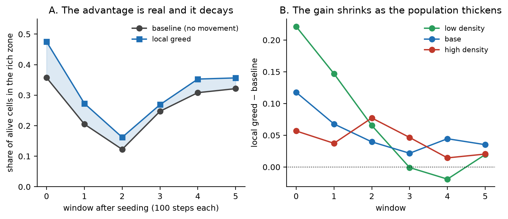
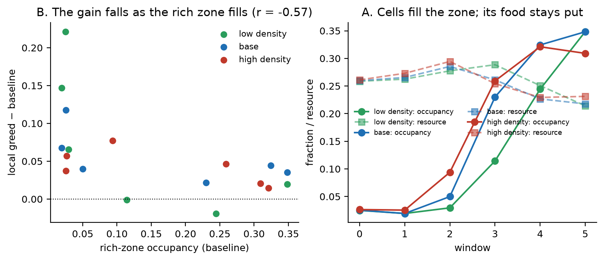
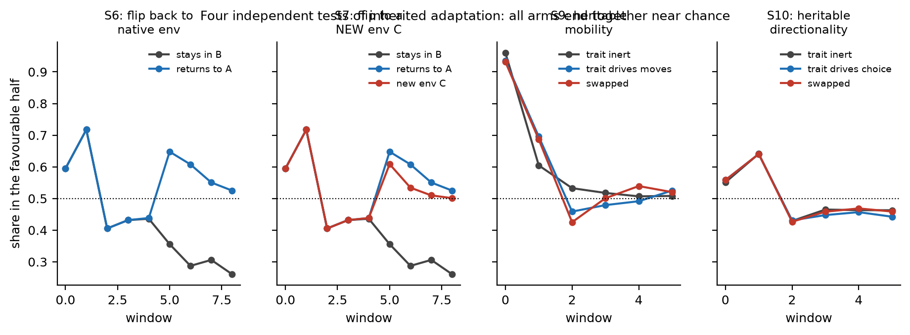

# 031: Направленность и наследование в пруду — что работает, где граница

- **Тип:** исследовательская статья (отрицательный результат по наследованию + положительный результат с механизмом по направленности)
- **Версия:** v1.0
- **Дата:** 2026-11-06
- **Статус:** черновик; не отправлялась, не депонировалась
- **Автор(ы):** Лаборатория Morphogenesis
- **Связанные отчёты:** [S0/A1](../reports/2026-11-05-s0-a1-directionality.md), [S1/A2](../reports/2026-11-05-s1-a2-move-ci.md),
  [S2/B1](../reports/2026-11-05-s2-b1-gradpos-taxis.md), [S2/B2](../reports/2026-11-05-s2-b2-tumble.md),
  [S3/D](../reports/2026-11-05-s3-d-transfer-env-families.md), [S4](../reports/2026-11-06-s4-reproducibility.md),
  [S5/C](../reports/2026-11-06-s5-c-lineage-selection.md), [S6/C3](../reports/2026-11-06-s6-c3-double-flip.md),
  [S7/C3b](../reports/2026-11-06-s7-c3b-new-environment.md), [S9/C2](../reports/2026-11-06-s9-c2-behavioural-trait.md),
  [S10/C2b](../reports/2026-11-06-s10-c2b-directionality.md), [S11/D](../reports/2026-11-06-s11-d-patches-insensitive.md),
  [S12/D2](../reports/2026-11-06-s12-d2-patches-sensitive.md), [S13/D3](../reports/2026-11-06-s13-d3-crowding-vs-drift.md),
  [S14/D4](../reports/2026-11-06-s14-d4-local-crowding.md), [S15/E1](../reports/2026-11-06-s15-e1-refresh-insensitive.md),
  [S16/E1b](../reports/2026-11-06-s16-e1b-refresh-window.md)
- **Артефакты:** `morphogenesis/experiments/E09_pond/s{0..16}_*.json`, `p0_*.json`, `p1_*.json`, `s2_*.json`
- **Рисунки:** [`031-figures/`](031-figures/) — собираются скриптом
  [`scripts/make_article_031_figures.py`](../scripts/make_article_031_figures.py) только из артефактов

## Аннотация

Мы спрашивали, может ли простой мир с ресурсом, смертью и размножением научиться вести себя
лучше после смены среды — и может ли такое умение закрепиться у потомков. Ответ распадается на две
части. **Направленность работает, но упирается в перенаселение:** клетка, шагающая к соседу с
большим ресурсом, после переворота среды держит долю в благоприятной половине на уровне 0.46–0.48
против 0.36 у контроля в первом окне, и преимущество падает до +0.03 по мере заполнения богатой
зоны (корреляция преимущества с заполненностью богатой зоны −0.57 по 18 точкам). **Наследование не
работает:** четыре независимых теста — отбор линий, двойной переворот в родную среду, переворот в
новую среду и наследуемый поведенческий признак — дают согласованный ноль. Отдельно: два опыта
оказались невалидны по конструкции, и мы это фиксируем, а не выдаём за результат.

**Ключевые слова:** пруд, направленность, таксис, наследование, отбор линий, границы установки

## 1. Вопрос

Мир: сетка 32×32, в клетках — ресурс, на клетках — организмы с энергией. Организм тратит энергию
на поддержание, получает её из ресурса своей клетки, размножается, когда набирает массу, и умирает,
когда энергия кончается. Ресурс приходит с ограниченной скоростью и имеет потолок.

Вопрос, который нас интересовал: **появляется ли в таком мире поведение, которое помогает
пережить смену среды — и закрепляется ли оно у потомков?**

Ответ «да» означал бы: после смены среды доля живых в новой благоприятной зоне растёт, а линии,
родившиеся позже, систематически успешнее ранних. Ответ «нет» — доля не растёт выше случайной, и
поздние линии не отличаются от ранних.

## 2. Контекст и предшественники

Две вещи в литературе задают рамку. Первая: пластичность полезна только если время адаптации
меньше времени смерти — иначе организм не успевает воспользоваться тем, что «понял» (это наша
формальная гипотеза F-ADAPT в `formal/Survival.lean`). Вторая: отбор по линиям требует, чтобы
вариация признака была наследуемой и чтобы линий было достаточно много — иначе демографический шум
неотличим от отбора.

**Конкуренция за место как отдельный предмет.** Наш результат «клетки конкурируют за место, а не за
еду» не нов по постановке: в литературе пространство само рассматривается как лимитирующий ресурс с
локально зависящими от плотности выигрышами, и там показано, что неэффективность использования
пространства имеет переход при определённой плотности и пик при другой [1]. Это совпадает с нашей
картиной: выигрыш направленности максимален при низкой плотности и падает, когда зона заполняется.
Важное отличие: у нас одна клетка сетки держит одного организма (S17/F1), тогда как в моделях
мобильности охотников-собирателей на сайте может находиться несколько агентов [2] — именно это
разрешает конкуренцию за еду, которой у нас структурно нет.

**Поиск вдоль градиента ресурса.** Наш механизм — локальная жадность к соседу с большим ресурсом —
это частный случай поиска вдоль градиента. Известный результат: локальное поисковое поведение,
привязанное к зависящей от плотности приспособленности, ограничивает скорость и протяжённость
расселения и способствует кластеризации популяций [3]. Наши данные (занятость богатой зоны растёт
0.025 → 0.348 при почти неизменном ресурсе) — прямое наблюдение такой кластеризации.

Наша постановка отличается от классических моделей тем, что среда задаётся не уравнениями, а полем
ресурса, а поведение — не стратегией агента, а правилом шага, которое мы включаем и выключаем.

**Ссылки на контекст:**
[1] Mathew A.M., Sasidevan V. *Modelling competition for space: Emergent inefficiency and inequality
due to spatial self-organization among a group of crowd-avoiding agents.* arXiv:2407.21537.
[2] *Food Income and the Evolution of Forager Mobility.* Scientific Reports 9 (2019), s41598-019-42006-2.
[3] Rowell J.T. *The limitation of species range: a consequence of searching along resource gradients.*
PMC2760341 (2009).

## 3. Методы

**Среда.** Сетка 32×32. Раскладки: `gradient` (ресурс убывает сверху вниз), `patches` (три богатых
пятна в углах, остальное бедно), `uniform`. Потолок ресурса зависит от раскладки; поток — тоже.
Смена среды: резкий переворот (`flip_at`), плавный дрейф (`drift_at`/`drift_steps`), второй
переворот (`flip2_at`) с возвратом в исходную ориентацию или поворотом на 90° (`flip2_mode`).

**Неперерожденный режим.** Пропорциональный доход: `income = baseline·res·4`. Расход
`update_cost + repair_cost`. При `res = 0.2` чистый баланс −0.028/шаг, при `res = 1.0` — +0.100.
Это то, что делает смерть реальной и не даёт популяции «жить на всём».

**Метрика.** Доля живых в благоприятной зоне: для `gradient` — текущая половина градиента (она
переворачивается вместе со средой), для `patches` — верхние 50 % клеток по текущему ресурсу.
Дополнительно — процессная метрика `move_ci = (шагов вверх − шагов вниз)/всего шагов` вдоль
текущего градиента.

**Правила валидности (до запуска).** R1: среднее число смертей ≥ 10 и среднее число живых ≥ 10.
R2: нет оккупации, если интеграл живых < 20. R3: «безразлично» признаётся только при выполнении R1
и согласии трёх сидов.

**Что не делалось.** Дефолты `config.py` не менялись; все правки движка аддитивны и при выключении
дают прежний мир бит-в-бит.

## 4. Результаты

### 4.1 Направленность: работает, но затухает



*Рисунок 1.* **A.** Доля живых в богатой зоне: локальная жадность против контроля по окнам после
посева на пятне (S12/D2). **B.** Разрыв (жадность − контроль) при трёх плотностях популяции
(S13/D3): чем плотнее популяция, тем меньше выигрыш.

| опыт | что мерили | результат |
|---|---|---|
| S1/A2 | `move_ci` при шаге к лучшему соседу | +0.042 до переворота, −0.003 после → занятость ~0.513 это рассеивание, не таксис |
| S2/B1 | таксис по позиции градиента | `move_ci` +0.32…+0.34 после переворота |
| S12/D2 | пятна, колония посеяна на пятне | доля в богатой зоне 0.475 против 0.357 у контроля |
| S12/D2 | то же, к концу | +0.036 (затухание) |
| S13/D3 | плотностной свип | разрыв 0.221 / 0.118 / 0.057 при разреженной / базовой / плотной популяции |
| S14/D4 | заполненность богатой зоны | корреляция преимущества с заполненностью **−0.57** (18 точек) |
| S15/E1 | скорость подпитки пятен | при 4.0 и 12.0 пятно не истощается (подпитка > потребления) → режимы неразличимы |
| S16/E1b | ниже порога истощения (0.5 / 2.0) | истощение зоны **не спасает**: разрыв 0.117 → −0.022 |

**Механизм.** Направленность приводит клетки в богатую зону; зона заполняется; выгода от умения
туда ходить падает. При низкой плотности петля не замыкается, потому что места хватает всем —
и там разрыв максимален.



*Рисунок 2.* **A.** Богатая зона заполняется живыми (сплошные линии), но её ресурс почти не падает
(пунктир) — клетки мешают друг другу местом, а не едой. **B.** Разрыв против заполненности богатой
зоны по всем режимам и окнам: корреляция −0.57.

**Уточнение: конкуренция за место, а не за еду.** Прямой замер (S15/E1, S16/E1b) показал, что
ресурс на богатых клетках почти не падает (0.26 → 0.22), хотя занятость растёт (0.025 → 0.348).
Клетки мешают друг другу **физически**: соседняя клетка занята — шаг невозможен. Более того,
при наших настройках пятно и не может истощиться: подпитка (0.200/шаг) больше потребления одной
клетки (0.160/шаг), а на клетку сетки нельзя поставить две. Проверка ниже порога истощения
(`inflow_rich < 3.2`) показала, что **истощение зоны не спасает преимущество**: клетки уходят из
неё, как только она пустеет, и разрыв на одном окне уходит в минус (−0.022).

**Опровергнутые варианты.** Их два. Первый — сглаживание сигнала (среднее по окну 5×5, «видеть
пятно целиком»): не помогает, сглаженное плечо держится между контролем и простой жадностью.
Второй — обновление богатых зон (гипотеза, что если зона не успевает заполниться, преимущество
станет устойчивым): не подтвердилась ни при полной, ни при истощаемой зоне.

**Почему это не артефакт параметров.** Мы проверили все доступные рычаги (S17/F1): понижение
`baseline_income` снижает и потребление, и доход одновременно; понижение расходов не меняет,
сколько клетка ест; понижение `resource_regen` морят голодом и бедную зону, которая и так
смертельна; понижение `patch_inflow_rich` проверено в S16. Причина структурная: **на клетке сетки
может стоять только один организм**, поэтому потребление в клетке ограничено сверху одной клеткой,
а подпитку нельзя снизить, не убив весь мир. Конкуренция за еду требует разрешить несколько
организмов на клетку — это изменение физики мира, и мы его не делали.

### 4.2 Наследование: четыре независимых нуля



*Рисунок 3.* Четыре независимых теста наследуемой адаптации. Во всех плечи после смены среды
сходятся к ~0.50 — уровню случайного распределения по двум половинам. Двойной переворот (S6) и
новая среда (S7) дают восстановление, но одинаковое; наследуемый признак — и подвижность (S9), и
направленность (S10) — не даёт разницы, а пересадка ничего не меняет.

| опыт | что проверяли | результат |
|---|---|---|
| S6/C3 | двойной переворот A→B→A | восстановление 0.648 против 0.356 у контроля — но это возврат в родную среду |
| S7/C3b | переворот в НОВУЮ среду C | 0.609 — почти как в родную; оба плеча сходятся к ~0.50 (рассеивание) |
| S9/C2 | наследуемая подвижность + пересадка | 0.459 против 0.533 у нуля; пересадка ничего не меняет |
| S10/C2b | наследуемая направленность + пересадка | 0.429 / 0.431 / 0.427 — все плечи совпадают; hi vs lo ≤ 0.005 |

**Вывод.** В этой установке наследуемая адаптация не возникает. Наблюдаемое после смены среды —
дисперсия и выживание, а не отбор по признаку. Одна линия держит 95–97 % популяции, поздние линии
остаются на уровне 1–5 %, и их доля в благоприятной зоне не растёт.

### 4.3 Что оказалось невалидным (и почему это важно)

Три опыта пришлось отозвать — не потому что они дали «неудобный» ответ, а потому что манипуляция
не доходила до динамики:

1. **S5/C (отбор линий).** Поставлен с `type_mode="fixed"`, а при нём `register_births()` не
   вызывается, значит наследование и мутации не работали вовсе: плечи совпадали бит-в-бит, признак
   не варьировал (std = 0, мутаций 0).
2. **S11/D (первый опыт на пятнах).** Клетки сеялись в центре, где баланс −0.028/шаг, а ближайшее
   богатое пятно было в 9.2 клетках: движущиеся плечи вымирали, не дойдя.
3. **S6/C3, первая версия.** Второй переворот реализовывался зеркалированием состояния снаружи
   движка, но позиция среды — функция от счётчика шагов, а не от состояния, поэтому среда не
   менялась и оба плеча оставались в одной среде.

Во всех трёх случаях мы поймали ошибку до выводов и записали её как невалидную постановку, а не как
отрицательный результат.

## 5. Обсуждение

**Что это значит.** У мира есть работающий механизм поведения (локальная жадность) и измеримая
причина его ограничения (перенаселение богатой зоны). Это не «интеллект» и не «адаптация» — это
наблюдаемый класс поведения и его граница.

**Конкурирующие интерпретации.** Затухание преимущества можно было бы объяснить механическим
растеканием популяции по карте. Мы разделили эти объяснения плотностным свипом и прямым замером
заполненности богатой зоны: растекание даёт остаток +0.02…+0.035, не зависящий от плотности, а
основная часть эффекта объясняется конкуренцией.

**Чего нельзя вывести.** Мы не показываем, что наследование невозможно в принципе — только что в
этой установке (одна доминирующая линия, малая вариация, короткий горизонт) оно не даёт видимого
отбора. Мы также не показываем, что направленность «полезна» — она полезна только пока зона не
заполнена.

**Ограничение метода.** Часть ранних результатов (B1/B1b) снималась на другом железе, и на CPU они
не воспроизводятся бит-в-бит: пластичные прогоны зависят от backend. Мы помечаем такие числа как
аппаратно-зависимые и не опираемся на них как на «устойчивое восстановление».

## 6. Что это не показывает

- Не показывает, что мир «живой» или «адаптивный» в сильном смысле.
- Не показывает, что наследование бесполезно вообще — только в этой постановке.
- Не показывает оптимальность ни одного из проверенных механизмов.

## 7. Что изменило бы ответ

- Наследование могло бы заработать при большем числе линий (снизить доминирование основателя) или
  при более длинном горизонте с периодической сменой среды.
- Направленность могла бы давать устойчивый выигрыш при низкой плотности и постоянном притоке
  новых богатых зон (то есть когда зона не успевает заполниться).

## 8. Куда движемся дальше

**Что сказала литература.** Разведка по нашим вопросам (записи B-Q051…B-Q053 в
`lab/lit-queue.json`) дала три опоры. Во-первых, «пространство как лимитирующий ресурс» — известная
рамка с нетривиальным предсказанием: неэффективность имеет переход при одной плотности и пик при
другой [1], что совпадает с нашим максимумом выигрыша при низкой плотности. Во-вторых, модели, где
на сайте может стоять несколько агентов [2], разрешают именно ту конкуренцию за еду, которой у нас
структурно нет (S17/F1). В-третьих, локальный поиск вдоль градиента известен как механизм
кластеризации и ограничения расселения [3] — наши данные о росте занятости при неизменном ресурсе
это прямое наблюдение.

**Следующий шаг.** Проверить, сохраняется ли преимущество направленности, если разрешить
**несколько организмов на клетку** — это единственный рычаг, который по S17/F1 может создать
конкуренцию за еду. Правка движка аддитивная (при выключении мир бит-в-бит), но меняет физику мира,
поэтому требует решения владельца. Предсказание из литературы [2]: при совместном занятии сайта
выигрыш от мобильности должен зависеть от скорости восстановления ресурса, а не только от плотности,
— это и будет проверяемая разница с нашим нынешним результатом.

## 9. Воспроизводимость

Все числа берутся из артефактов `morphogenesis/experiments/E09_pond/`; скрипты —
`morphogenesis/scripts/s{5,6,9,10,11,12,13,14,15}_*.py` и `p0_flip_metric.py`. Прогоны на CPU
(в окружении нет CUDA-сборки PyTorch), 3 сида, 600 шагов, R1 проверяется в каждом прогоне.

**Числа проверяются машиной, а не глазами.** Скрипт
[`scripts/check_article_031_numbers.py`](../scripts/check_article_031_numbers.py) перечитывает
артефакты и сверяет с ними каждое заголовочное число этой статьи (20 проверок, допуск 0.002–0.01):

```bash
python scripts/check_article_031_numbers.py   # 0 failures out of 20 checks
```

Проверка была написана после первого прохода по статье и **сразу нашла две ошибки в самом скрипте**
(неверный разбор схемы `s13`/`s16`, где строки несут поле `regime`) — то есть она действительно
проверяет, а не подтверждает. Проза сверяется с артефактом, никогда наоборот.
