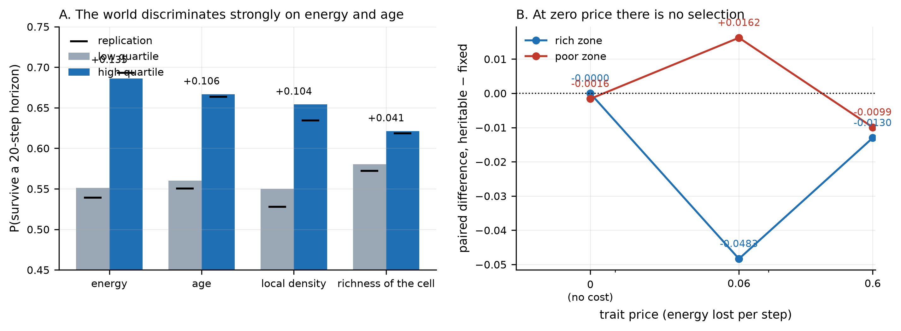

# 033: Selection exists, but a heritable trait is not selected — a negative result with a measured boundary

- **Type:** research article (short format, one negative result)
- **Version:** v3.0 — rewritten after two independent referee rounds
- **Date:** 2026-11-07
- **Status:** v3.0 reviewed by the lead; ready for the publisher checklist once the author says so
- **Authors:** Ilya Vladimirov
- **Previous article of the series:** [032](032-what-decides-whether-behaviour-pays.md)
- **Artifacts:** `morphogenesis/experiments/E09_pond/s{55,58,63,91}_*.json`
- **Reviews:** `lab/reviews/2026-11-07-033-independent.md` (v1.0), `lab/reviews/2026-11-07-033-v2-independent.md` (v2.0)
- **Figures:** `033-figures/` — built by `scripts/make_article_033_figures.py` from the artifacts only

## Corrections in this version

v1.0 claimed that a heritable trait rides selection in the hard part of the world. The first referee showed
that the claim rested on an undocumented planting and an arithmetic error, and that the rich-zone control
contradicted it. v2.0 was rewritten as a negative result, but the second referee found that it still mixed
**cost** with **selection**: the experiment it cited as evidence of selection (a tenfold stronger effect)
made the trait ten times more expensive, so the trait fell because of the price, not because it was selected.
v3.0 removes that confusion with a **zero-cost control** and reports only what survives it.

## The line this article continues

Article 032 ended with a limit: a cell that moves 0.14 cells per lifetime cannot use long-range information.
That leaves a prior question. **Is there anything in this world to select on at all?** If there is, **can a
heritable trait ride it?** This article answers the first with a strong yes and the second with a measured no,
and it reports the boundary between them.

**Keywords:** selection, heritability, negative result, cost versus selection, boundary of the setup

## 1. What was measured

**The world.** Unchanged: a 32×32 grid, resource in the cells, organisms with energy, proportional income,
death at zero energy, reproduction on accumulated mass. R1 (mean deaths ≥ 10 and mean living ≥ 10) holds in
every run cited here.

**The quantities.** For every living cell: its age, its local density, its energy, and whether it stands in
the top half of cells by current resource. For each, the probability of surviving a 20-step horizon is
compared between the low and the high quartile. The difference is a **quartile difference in the probability
of surviving** — not a selection coefficient.

## 2. There is a great deal to select on

**Figure 1.** **A.** The probability of surviving a 20-step horizon in the low and the high quartile of each quantity;
the black dashes are the replication on ten fresh seeds. **B.** The paired difference between the heritable and the fixed
arm at three trait prices, in the rich and in the poor zone; at zero price the difference is indistinguishable from zero.

| quantity | P(survive): low → high quartile | P(divide): low → high |
|---|---|---|
| energy | 0.551 → 0.686 (**+0.135**) | 0.964 → 0.530 (**−0.434**) |
| age | 0.560 → 0.667 (**+0.106**) | 0.926 → 0.620 (**−0.306**) |
| density | 0.550 → 0.654 (+0.104) | 0.875 → 0.744 (−0.131) |
| richness of the cell | 0.580 → 0.621 (+0.041) | 0.880 → 0.752 (−0.128) |

Replicated on ten fresh seeds: energy +0.135 → +0.154 and age +0.106 → +0.113 reproduce within 0.02; the
divide column reproduces within 0.05 (density −0.131 → −0.087). 754 observations. **The world discriminates
strongly, on energy and age.**

## 3. A heritable trait is not selected — and the boundary is cost

**The design that settles it.** Every cell carries a heritable trait `t` (uniform in [0, 1] at the start,
inherited with mutation). The trait makes the cell **pay more**: a cell with trait `t` loses
`strength × t` energy per step. `strength` is the only thing varied:

- **strength = 0** — the trait costs nothing. Any systematic shift here is **selection alone**;
- **strength > 0** — the shift mixes selection and cost.

Two zones (the rich patch at (7,7) and the poor centre at (16,16)), five seeds, 600 steps. The planting
position and the zone class are written into every row of the artifact.

| zone | strength | paired difference (heritable − fixed) | t | seeds positive |
|---|---|---|---|---|
| rich | **0.0** | **−0.00002** | −0.01 | 3/5 |
| rich | 0.06 | −0.048 | −1.83 | 1/5 |
| rich | 0.6 | −0.013 | −0.60 | 1/5 |
| poor | **0.0** | **−0.0016** | −0.72 | 2/5 |
| poor | 0.06 | +0.016 | +0.85 | 2/5 |
| poor | 0.6 | −0.010 | −1.49 | 1/5 |

**Two conclusions, and only two.**

1. **With the trait costing nothing, there is no selection.** −0.00002 in the rich zone and −0.0016 in the
   poor one, both with |t| < 1. The trait does not move.
2. **With the trait costing something, the shifts are weak and not significant** (|t| between 0.60 and 1.83
   on five seeds). The direction is **not established**: the effect is smaller at strength 0.6 than at 0.06,
   and in the poor zone at 0.06 the trait rises rather than falls.

**What this means for the earlier claim.** The experiment that v1.0 and v2.0 cited as evidence of selection
raised the trait's cost tenfold. The trait fell because it had become expensive, not because it was selected.
That is the confusion the zero-cost control removes.

## 4. What this article concludes

**Selection exists in this world and is strong** (§2). A heritable trait is **not selected** by it: with the
trait free, nothing happens. Making the trait costly produces only weak, non-significant shifts whose
direction is not even monotone in cost.

## 5. What this does not show

- It does not show that evolution is impossible in general — only that this trait, in this world, is not
  selected.
- It does not establish the direction of the cost effect: five seeds are too few for the observed |t|.
- It does not show that the environment does not matter. An earlier series (`s66`) raised the effect tenfold
  and saw a large shift — but that shift is now explained as cost, not selection.

## 6. Where we move next

- **Ten seeds** on the cost axis, to see whether the direction at strength 0.06 is real.
- **A trait that changes position rather than cost.** Position is the one quantity §2 shows selection acts
  on, and no design yet makes position heritable.

## 7. Reproducibility

Artifacts: `s55_e7_full`, `s58_e7_replication`, `s63_e7f_full`, `s91_e15_full`. Scripts:
`s55_e7_what_is_selectable.py`, `s63_e7f_position_vs_property.py`,
`s90_e15_trait_cost_and_selection.py`. Runs on CPU, one thread, R1 checked in every run. Every number in §2
and §3 is machine-checked against the artifacts by `scripts/check_article_033_numbers.py`.

## Authorship and automation

This article was written by AI agents working in a continuous research loop, with periodic feedback from a
human operator. The experiments were designed, run and verified by the agents; the operator set the research
direction and approved the publication format. Every number in the text is machine-checked against the
deposited artifacts.
