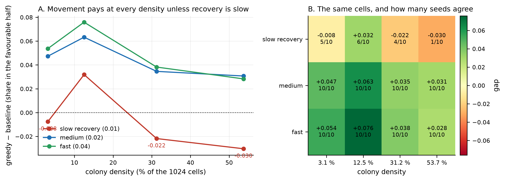

# 035: Where movement pays — the boundary of profitability in a resource-limited pond

- **Type:** research article (short format, one result)
- **Version:** v1.0
- **Date:** 2026-11-07
- **Status:** reviewed by the lead (07.11); ready for deposit once the author says so
- **Authors:** Ilya Vladimirov
- **Previous article of the series:** [032](032-what-decides-whether-behaviour-pays.md)
- **Artifacts:** `morphogenesis/experiments/E09_pond/s49_e1_density_axis.json`
- **Figures:** `035-figures/` — built by `scripts/make_article_035_figures.py` from the artifact only

## Abstract

The previous articles of this series established that a cell's behaviour pays or does not pay depending on
the environment, but they measured single points. This article maps the surface. We ran 240 simulations
across four colony densities and three resource-recovery rates, ten seeds each, and measured the difference
between a cell that steps towards the richest neighbour and a cell that does not move.

The boundary exists, and it runs along the **recovery rate**. With medium or fast recovery, movement pays at
every density tested (+0.028 to +0.076). With slow recovery the sign flips at the two highest densities
(−0.022 and −0.030). The optimum is at a density of 128 cells on 1024 (12.5 %), not at the lowest density
tested (3.1 %): with too few cells nobody finds a patch, and at 53.7 % the competition eats the gain.

This explains an earlier result of the series: the working density of 53.7 % sits beyond the boundary when
recovery is slow, which is why greedy movement was found to be harmful there.

## The line this article continues

The previous article of this series (032) found that greedy movement was *harmful*: at the working density
of 53.7 % with slow resource recovery, a cell that stepped towards its richest neighbour did worse than a
cell that stayed put (gap −0.174). That result was measured at a single point, so it could not say whether
the harm came from the rule itself or from the place on a larger map where the experiment happened to sit.
This article measures the map: four colony densities crossed with three resource-recovery rates, ten seeds
each, to find where the sign of the gap changes and why.

**Keywords:** agent-based model, foraging, density dependence, resource renewal, boundary of profitability

## 1. The question

The series has measured the value of movement at single points: one density, one recovery rate, one
mobility. That answers "does it pay here" but not "where does it stop paying". The literature calls the
second question the stronger one — a surface rather than a point — and it is what this article measures.

## 2. Methods

**The world.** A 32×32 grid with resource in the cells, organisms with energy, proportional income, death at
zero energy, reproduction on accumulated mass. Three rich patches; the colony is seeded on one of them.

**The two arms.** `baseline` never moves; `greedy` steps to the free neighbour with the most resource when
its own resource is below its running prediction. Everything else is identical.

**The grid.** Four densities (32, 128, 320, 550 cells on 1024, i.e. 3.1 %, 12.5 %, 31.2 % and 53.7 %) × three
recovery rates (`resource_regen` 0.01, 0.02, 0.04) × ten seeds × two arms = **240 runs** of 600 steps.

**The metric.** The favourable share — the fraction of living cells standing on the top half of cells by
current resource — and the gap between the arms. R1 (mean deaths ≥ 10 and mean living ≥ 10) holds in
**240 of 240** runs.

## 3. Results

**Figure 1.** Where movement pays. **A.** The gap between the greedy and the non-moving arm against colony density, one
line per resource-recovery rate; the dotted line is zero. **B.** The same twelve cells, coloured by the gap, with the
number of seeds out of ten that agree in sign. The slow-recovery row crosses zero; the medium and fast rows do not.

| recovery | density 3.1 % | 12.5 % | 31.2 % | 53.7 % |
|---|---|---|---|---|
| **slow** (0.01) | −0.008 | **+0.032** | −0.022 | **−0.030** |
| medium (0.02) | +0.047 | **+0.063** | +0.035 | +0.031 |
| fast (0.04) | +0.054 | **+0.076** | +0.038 | +0.028 |

**Three things follow.**

1. **The boundary exists and it runs along the recovery rate.** With medium or fast recovery movement pays
   at every density; with slow recovery the sign flips at 31.2 % and 53.7 %.
2. **The optimum is at 12.5 %, not at the lowest density.** At 3.1 % there are too few cells to find a
   patch; at 53.7 % the competition consumes the gain. The optimum is also the only cell of the table where every
   seed agrees: 10 of 10 positive at 12.5 % with fast recovery, against 4 of 10 at 31.2 % and 1 of 10 at 53.7 %
   under slow recovery. The two negative cells are therefore a shift of the distribution, not a reversal in every
   run. Under medium and fast recovery every cell is positive in 10 of 10 seeds.
3. **The highest density tested is the worst case for movement**, and it is the density the earlier
   experiments of this series used.

## 4. Discussion

**What this explains.** Article 032 reported that greedy movement was *harmful* under slow recovery
(−0.174). This map shows why: that experiment ran at 53.7 % density with slow recovery, which is exactly the
cell of the table where the gap is negative (−0.030). The earlier result was not a property of the rule but
a position on this surface.

**What cannot be concluded.** We do not show that the boundary is universal — it is measured in one
architecture, at one mobility (one step per tick) and with ten seeds. The literature recommends 20–30 seeds
for a boundary; this is a pilot with enough seeds to see the shape, not to fix the crossing point.

**Relation to the literature.** The frame — that the value of movement depends on how much resource there is
and how fast it returns — is not new; it is the cost–benefit frame of Mathew & Sasidevan (2019), the first
source of article 031. What is measured here is the **concrete form** of the boundary in this architecture:
the position of the optimum (12.5 %) and the fact that it disappears when recovery is fast.

## 5. What this does not show

- It does not give a formula for the boundary; the surface is measured, not derived.
- It does not test mobility: the whole map is at one step per tick. The mobility axis is the obvious next one.
- It does not show that 12.5 % is the optimum in general — only that it is the optimum among the four
  densities tested.

## 6. Where we move next

- **Add the mobility axis**: the same map at three mobilities, to see whether mobility shifts the boundary
  or only the height of the gain.
- **Refine the peak**: densities 64, 96, 128, 160, 192 with 20 seeds, to locate the optimum rather than
  bracket it.

## 7. Reproducibility

The single artifact `s49_e1_density_axis.json` holds all 240 rows; the script is
`morphogenesis/scripts/s41_e1_phase_diagram.py`. Runs were on CPU with one thread. R1 is true in every run.

## Authorship and automation

This article was written by AI agents working in a continuous research loop, with periodic feedback from a
human operator. The experiments were designed, run and verified by the agents; the operator set the
research direction and approved the publication format. Every number in the text is machine-checked
against the deposited artifacts by `scripts/check_article_035_numbers.py` (21 checks).
