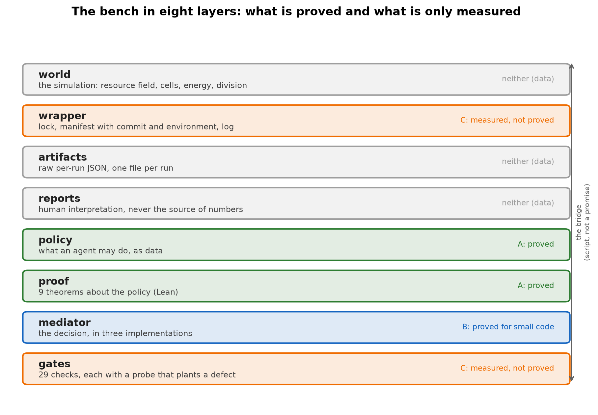
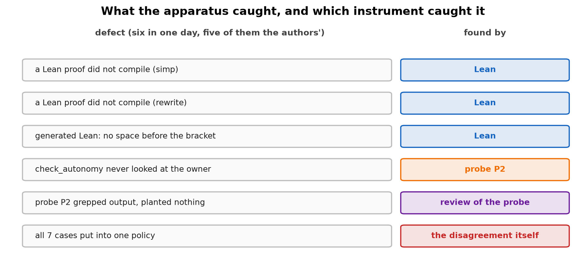

# A research bench where the instrument reports on itself

**How a two-year study of a minimal artificial world was made reproducible, refutable and formally
checkable — and what it cost**

---

## Abstract

We describe the engineering and methodological apparatus of a long-running study of a minimal artificial
world: a 32×32 grid of cells that take up a resource, pay for maintenance, and divide. The study produced
583 reports, 44 articles and 791 raw artifacts, and it produced mostly null results. This paper is not about
those results. It is about the bench: the machinery that made it possible to run 2151 commits of
experiments without losing track of which numbers were real, and that repeatedly caught the authors being
wrong.

Three claims are made and each is checkable by a command:

1. **Reproducibility is enforced, not promised.** Every long run goes through a wrapper that takes a lock,
   writes a manifest with the commit, the command and the environment, and refuses to run twice in the same
   lane. A bit-for-bit anchor check runs before any new series, and a diagnostic that changes the random
   stream is treated as a change to the world.
2. **Refutation is structural.** Every gate is required to fail on a planted defect. A gate that cannot fail
   is decoration, and the repository treats it as such.
3. **The policy that governs the agents is proved.** What an agent may do without asking, what needs the
   owner, and what is forbidden is a data file; its properties are theorems in Lean; and three independent
   implementations of the decision are required to agree before the harness acts.

We also report the failures, because they are the argument. Six defects were found in a single day of work
on the formal layer, and five of them were the authors', not the code's. The value of the apparatus is not
that it proves the science correct; it is that it refuses to let an error pass quietly.

---

## 1. The problem this bench was built for

A minimal world is easy to simulate and hard to study. The simulation is a few hundred lines. The difficulty
is that a null result is indistinguishable from a bug, and that a small effect is indistinguishable from an
artifact of the harness. In our own history the same mistake appeared in five different costumes:

- a mechanism that added resource every step — a tap, not a feedback loop;
- two arms given unequal doses, so the comparison measured the dose;
- an effect clipped by a ceiling, so the recorded dose was not the dose applied;
- a trait that was never read by the world, so its "selection" was a tautology;
- a "paired design" that was a no-op, because the two arms were already seeded identically.

Each was found by a reader, not by a test. The bench described here exists so that the next such mistake is
found by a command.

---

## 2. What the bench consists of

| layer | what it does | where |
|---|---|---|
| world | the simulation: resource field, cells, energy, division | `morphogenesis/world/` |
| runner | the wrapper: lock, manifest, log, environment | `scripts/lab.py run` |
| artifacts | raw per-run JSON, one file per run | `morphogenesis/experiments/` |
| reports | human interpretation, never the source of numbers | `reports/` |
| policy | what an agent may do, as data | `lab/autonomy-rules.json` |
| proof | properties of the policy, as theorems | `formal/*.lean` |
| mediator | the decision, in three implementations | `scripts/policy_mediator.py`, `mediator/` |
| gates | 29 checks that must fail on a planted defect | `scripts/check_*.py`, `scripts/verify.py` |



*Figure 1. The eight layers of the bench. Green: level A, proved. Blue: level B, proved for small code.
Orange: level C, measured and not proved. Grey: data. The double arrow is the bridge — a script that fails on
disagreement, not a promise.*

**A note on the counters.** The bench at the moment this check runs: **583 reports, 44 articles, 791 raw
artifacts, 497 scripts, 8 Lean files, 83 tests, 29 gates.** These are checked by
`scripts/check_article_036_numbers.py` against the repository, and they move whenever the repository moves —
including when this article itself is committed. They describe the bench **at the moment the check runs**, not
at publication. A commit count is deliberately absent: it cannot be stable, because publishing the article adds
commits, and a number that is wrong by construction is worse than no number.

---

## 3. Reproducibility as enforcement

### 3.1 The wrapper

No long run starts without `scripts/lab.py run`. The wrapper:

- takes a lock `lab/locks/<experiment>.lock` and refuses a second writer in the same lane;
- writes `lab/runs/<run_id>.json` with the git commit, the command, the environment and the working
  directory;
- runs the command from `morphogenesis/` and captures stdout to a log;
- closes the manifest and releases the lock.

The manifest is the fact about the run. The raw artifact is the fact about the world. When they disagree, the
artifact wins.

### 3.2 The anchor

Before any new series, the world is run twice — once with the change, once without — and the summaries are
required to be identical. A diagnostic that consumes the random stream is a change to the world, and the
repository says so explicitly: `world/` and `run_pond.py` are not edited while a series is running, even
additively.

Two configurations are checked, not one: a change that adds a branch must pass the anchor on both
configurations, and for a new branch the reference is determinism — the same configuration and seed twice
give an identical summary.

### 3.3 The gates

29 gates run in `make verify`. The rule that makes them worth something is in the contract: **a gate that
cannot fail is decoration**. Each gate is accompanied by a probe that plants the defect it is supposed to
catch and checks that it does.

---

## 4. Refutation as a structure

### 4.1 Five design checks before a series

A series does not start until five checks have been performed and recorded:

1. **connectivity** — the hashes of the arms differ, so the manipulation reaches the code;
2. **positive control** — the effect is recorded as a number, not as an impression;
3. **response** — the field is written by slices and varies;
4. **sensitivity arithmetic** — the expected spread, the effect size and the number of seeds are computed
   before the run, and a coefficient of variation above 0.3 requires a paired design;
5. **the refusal rule** — the condition under which the experiment is declared insensitive by construction.

Check 1 is the one that would have caught four of our five historical mistakes.

### 4.2 The manifest

Each experiment carries a manifest written **before** it runs (`lab/experiments/<id>.json`). The gate
`scripts/check_experiment_manifest.py` refuses a manifest that:

- does not state the symptom the experiment addresses;
- does not distinguish adding from removing;
- changes only the values of variables rather than the set (a re-weighting of the past, not a new question);
- does not record how the manipulation was checked to reach the dynamics;
- omits the sensitivity arithmetic;
- omits the readouts;
- does not report the first steps;
- would not be equally satisfied by either answer.

The last item is the one we found hardest to satisfy honestly.

### 4.3 The report form

A report is either an **experiment report** (it measures something new: three readouts and the first 20
steps are mandatory) or an **audit report** (it reads artifacts that already exist: the count and the honest
split are mandatory). The gate `scripts/check_report_style.py` distinguishes them, because demanding the
same things of both was a mistake the first version made.

Both forms forbid adjectives of magnitude, comparatives, the words "breakthrough" and "novel", and moral
verdicts on designs. The reason is not stylistic. In our own experience a report that says "a stronger
effect" is a report in which the comparison has replaced the measurement.

---

## 5. The policy layer, proved

### 5.1 Three levels that must not be mixed

Following the model of a harness as a network of atomic cells:

| level | what | provable |
|---|---|---|
| **A. policy** | who may do what, over which resource | **yes**, by proof |
| **B. mediator** | the code that executes the policy | **yes**, for small code |
| **C. closure** | that nothing passes around the mediator | **no**, only measured |

The rule is: **A and B are proof; C is measurement.** Claiming more than is proved is forbidden by the
contract.

### 5.2 The theorems

`formal/Policy.lean` states and proves nine theorems; six carry the argument:

| id | statement |
|---|---|
| F-POLICY-1 | forbid beats allow — an action in both lists is not allowed |
| F-POLICY-2 | forbid beats the owner's consent — a forbidden action cannot be done even with permission |
| F-POLICY-3 | allowed-without-asking does not require the owner |
| F-POLICY-4 | allowed-without-asking is not forbidden |
| F-POLICY-5 | an action in exactly one list has a definite decision |
| F-POLICY-6 | an empty policy allows nothing (negative control) |

The repository total is 8 files and 40 theorems, all compiling with no non-standard axioms.

### 5.3 The bridge from file to model

A proof about a model is worth nothing if the file that governs the repository says something else. The
bridge `scripts/policy_bridge.py` reads `lab/autonomy-rules.json`, maps each English rule to a concrete
action, asks Lean to decide it, and compares the decision with the list the rule sits in.

**Result: 15 rules, 15 mapped, 0 unmapped, 0 disagreements.**

### 5.4 Three implementations must agree

`scripts/policy_diff.py` compares three independent implementations of the same decision — Lean, Python and
Rust — on seven cases that exercise every branch, including both conflict cases (allowed+forbidden,
owner+forbidden).

**Result: 3 implementations available, 7 cases, 0 disagreements.**

Seven cases is not a proof of agreement in general. The cases exercise every branch of the rule, but three
implementations can share a wrong specification, a wrong reading of the priorities, or an incomplete set of
cases. What the comparison establishes is narrower and worth stating exactly: **the three implementations agree
on the branch structure of the rule**, not that the rule is right. Property-based testing over randomly generated
policies and a mutation test of each implementation are the obvious next step and are not done.

The Rust mediator (`mediator/`) has no dependencies, six unit tests, and exists because the thing that runs
in a harness is compiled and has no interpreter to argue with.

### 5.5 Closure, measured

`scripts/closure_probe.py` plants a defect and checks that the machinery catches it.

| probe | defect | result |
|---|---|---|
| P1 | an artifact with no run manifest | caught |
| P2 | a run claiming a foreign owner | caught |
| P3 | a commit staging weights | caught |
| P4 | a protected path staged without a decision-log entry | caught |
| P5 | two items marked running in the queue | caught |

**5 scenarios, 5 defects caught with the expected reason, 5 recoveries verified, 0 holes.**

The first version of this probe was wrong, and a reviewer of this paper found it. Four of its five probes did
not plant a defect at all: they ran a check on the existing repository and reported "caught" when the check
exited 0. A check that passes on a clean tree proves nothing about whether it would fail on a dirty one. The
rewritten probe follows a six-step scheme, and a probe that cannot demonstrate step 4 (fails on the defect) and
step 6 (passes again after cleanup) is reported as a HOLE and the script exits non-zero:

1. copy the laboratory into a scratch tree;
2. plant one concrete defect;
3. run exactly the mechanism that should catch it;
4. require that it fails **and names the expected reason**;
5. remove the defect;
6. require that the same mechanism passes again.

Two numbers are reported, not one: **how many defects were caught** and **how many scenarios were exercised**.
The number 5 is a measure of our imagination, not of the system, and the report says so.

---

## 6. What the apparatus caught

In one day of work on the formal layer, six defects were found. Five were the authors':

| defect | found by |
|---|---|
| a proof that did not compile (`simp` could not see `contains`) | Lean |
| a proof that did not compile (`rewrite` could not find the pattern) | Lean |
| generated Lean with no space before the closing bracket | Lean |
| `check_autonomy` never looked at the run's owner | probe P2 |
| probe P2 grepped the output instead of planting a defect | a review of the probe |
| the three-way comparison put all seven cases into one policy, so the mediator was right and the test was wrong | the disagreement itself |

The theorems are short. What the machines did was refuse to let an error pass quietly.



*Figure 2. The six defects of one day of formal work and the instrument that found each. Five of the six were
the authors'. The colours separate the three kinds of instrument: a compiler that refuses an uncompilable proof,
a probe that plants a defect, and a review of the instruments themselves.*

### 6a. The six defects in detail

| # | what was wrong | why it happened | what it could have distorted | found by | fixed by | regression guard |
|---|---|---|---|---|---|---|
| 1 | a Lean proof did not compile (`simp` could not see `contains`) | the proof was written against an assumed simp set, not against the actual definitions | nothing — it never compiled | Lean | three Boolean lemmas instead of `simp` | the file is compiled by `lean_check.py` on every verify |
| 2 | a Lean proof did not compile (`rewrite` could not find the pattern) | the pattern was written for a different form of the goal | nothing — it never compiled | Lean | explicit `and_true_left` / `and_true_right` | same |
| 3 | generated Lean had no space before `⟩` | the generator built the string by concatenation | the three-way comparison silently reported "Lean unavailable" | Lean | a space in the literal | `policy_diff.py` now fails loudly on a Lean error |
| 4 | `check_autonomy` never looked at the run's owner | the check validated the policy structure, not the manifests | any run could claim any owner, and nothing noticed | probe P2 | `check_owners()` with a known-owner list | P2 plants a foreign owner and requires the gate to fail |
| 5 | probe P2 grepped the output instead of planting a defect | the probe was written to confirm, not to test | the probe passed for the wrong reason | a review of the probe | P2 now copies the lab, plants a manifest, runs the gate | the probe is itself checked by the six-step scheme |
| 6 | the three-way comparison put all seven cases into one policy | the test wrote one policy for all cases | the mediator was right and the test was wrong; three "disagreements" were reported that did not exist | the disagreement itself | one policy per case | `policy_diff.py` runs each case in its own policy |

**The pattern in the table is the argument of the paper.** Defects 1–3 were found by a machine that refuses to
accept a proof that does not compile. Defect 4 was found by a probe that was written to plant a defect. Defects
5 and 6 were found by reviewing the instruments themselves — and defect 6 was found only because the
disagreement it produced was investigated rather than explained away.


---

## 7. What this apparatus does not do

1. **It does not prove the science.** It proves properties of the policy and checks the arithmetic of the
   reports. Whether a mechanism is interesting is not a theorem.
2. **Closure is measured on five probes.** There may be bypasses we did not think to probe.
3. **The Lean model is a model.** The bridge connects it to the file, but the mapping from an English rule to
   an action is explicit and auditable, not automatic.
4. **The corpus audit counted artifacts, not conclusions.** Of 320 artifacts, **300 can answer** the question
   "did this help the cell, in the cell's own terms" and 20 cannot; the audit does not yet say what those
   measures show. The split matters: an artifact that records only the ranking metric cannot answer the
   question, because a ranking is blind to order.
5. **The three new readouts exist but have not been used in a completed experiment.** The instrument is
   built; the measurement is not made.

---

## 8. Installation, for another researcher, with an agent

The repository is designed so that an agent can set it up and verify it without a human reading the source.
The steps below are the ones the contract requires; each ends in a command whose output is the evidence.

### 8.1 Prerequisites

| tool | version used | why |
|---|---|---|
| Python | 3.13 | the simulation and every gate |
| PyTorch | 2.14 (CPU is enough) | the world runs on CPU; a GPU only shortens runs |
| git | any recent | the manifests record the commit |
| Lean 4 | v4.35.0 via `elan` | the formal layer |
| Rust | 1.99 via `rustup` | the mediator |

On Windows the GNU toolchain may resolve `cc` to a linker that rejects the flags rustc passes. The
repository handles this by pointing the mediator at the linker that ships with `rustup`
(`mediator/.cargo/config.toml`), and the mediator has no dependencies so that no build script needs a linker
of its own.

### 8.2 Clone and install

```bash
git clone <repository-url> bench
cd bench

# Python
python -m venv .venv
. .venv/bin/activate          # Windows: .venv\Scripts\activate
pip install -r requirements.txt

# Lean
curl -sSf https://raw.githubusercontent.com/leanprover/elan/master/elan-init.sh | sh -s -- -y
elan default leanprover/lean4:stable

# Rust
rustup toolchain install stable
```

### 8.3 Verify — the five commands that matter

```bash
# 1. the contract: README ledger, manuscript map, queue, locks
python scripts/lab.py validate

# 2. every gate, including the ones that must fail on a planted defect
make verify

# 3. the formal layer: 40 theorems, no non-standard axioms
python scripts/lean_check.py

# 4. the policy: file -> model, and three implementations in agreement
python scripts/policy_bridge.py
python scripts/policy_diff.py

# 5. closure: five probes with planted defects
python scripts/closure_probe.py
```

**What to expect:** `validate` reports counts and no errors; `verify` passes 29 gates; `lean_check` reports
`8 files, 40 theorems, 0 errors`; `policy_bridge` reports `15 rules, 0 disagreements`; `policy_diff` reports
`3 implementations, 0 disagreements`; `closure_probe` reports `5 probes, 5 caught, 0 holes`.

If any of these numbers differ, the checkout is not the one described here, and the difference is the first
thing to investigate.

### 8.4 Run your first experiment

```bash
# a manifest is required BEFORE the run
cp lab/experiments/E18.json lab/experiments/MY_EXPERIMENT.json
# edit it: question, symptom, adds_or_removes, readouts, first_steps_reported
python scripts/check_experiment_manifest.py lab/experiments/MY_EXPERIMENT.json

# then run through the wrapper, never directly
python scripts/lab.py run \
  --experiment MY_EXPERIMENT --owner my-agent \
  -- python morphogenesis/scripts/my_script.py --out morphogenesis/experiments/out.json
```

The wrapper will ask the policy mediator before taking the lock. The manifest will record the decision as
`policy_gate: {ran: true, source: "python+rust", agree: true}`. If the two implementations disagree, the run
does not start and no lock is left behind.

### 8.5 Instructions for the agent doing the install

A short, literal checklist. Each step has a command and an expected result.

1. `python scripts/lab.py validate` → exit 0, no errors.
2. `make verify` → exit 0, 29 gates.
3. `python scripts/lean_check.py` → `40 theorems`, `0 errors`. If Lean is absent the script prints
   `skipped` and exits 0; **that is not a proof** and the contract says so. Install Lean before claiming the
   formal layer is checked.
4. `python scripts/policy_bridge.py` → `15 rules, 0 disagreements`.
5. `python scripts/policy_diff.py` → `3 implementations, 0 disagreements`. If Rust is absent the script
   reports fewer implementations; **do not report a three-way agreement when only two ran.**
6. `python scripts/closure_probe.py` → `5 probes, 5 caught, 0 holes`.
7. `python scripts/policy_mediator_selftest.py` → `0 failures of 5`.
8. `python scripts/gate_refusal_selftest.py` → `0 failures of 5`.
9. Read `AGENTS.md` before changing anything. It is the contract, and it is longer than this section for a
   reason.
10. Never `git push --force`. Never commit weights. Never run a series without a manifest.

**The rule the agent must not break:** if a command reports `skipped`, that is not a pass. The repository
distinguishes "checked and correct" from "not checked" everywhere, and a report that blurs the two is the one
failure mode this apparatus cannot catch for you.

---


## 8a. Related work

The bench combines five families of practice. None of the individual methods is new; the claim of this paper is
about their **integration and about one addition** — that the checks themselves are required to fail on planted
defects, and that the failures of the authors are published as part of the evidence.

| family | what it contributes here | what it does not cover |
|---|---|---|
| computational reproducibility (environment capture, seeds, artifact archives) | the manifest, the anchor, the raw artifact as the source of truth | whether a *check* can detect a defect |
| scientific workflow systems (provenance graphs, run registries) | the run registry, the queue, the lock | the proof that the policy is consistent |
| mutation testing | the idea that a test is only worth what it can kill | applied here to the **gates**, not to the code |
| formal verification (Lean, model checking) | the theorems about the policy, the bridge from file to model | the correspondence between model and execution |
| AI-agent governance (permission models, sandboxes) | the three levels: policy, mediator, closure | the proof that the mediator is what runs |

**What is new here, stated narrowly:** the combination in which (a) the policy that governs the agents is a data
file whose properties are proved, (b) the file is bridged to the model by a command that fails on disagreement,
(c) the decision is implemented three times and the harness refuses to act when they disagree, and (d) every gate
is accompanied by a probe that plants the defect it is supposed to catch. Each of (a)–(d) exists elsewhere;
their conjunction, and the requirement that (d) apply to (a)–(c) as well, is the contribution.

**What is not new and should not be claimed:** the simulation, the statistical practice, the use of Lean, the
idea of a run manifest, and the idea of mutation testing.

## 8b. What the apparatus cost

The paper's subtitle promises to say what the bench cost. The honest answer is that the cost was not
instrumented, and the numbers below are reconstructions from the repository, not measurements taken at the time.

| quantity | value | how it was obtained |
|---|---|---|
| commits | not stated | publishing the article changes it (see the note in §2) |
| reports written | 583 | `python -c "import glob;print(len(glob.glob('reports/*.md')))"` |
| articles | 43 | `python -c "import glob;print(len(glob.glob('articles/*.md')))"` |
| raw artifacts in the pond line | 791 | `python -c "import glob;print(len(glob.glob('morphogenesis/experiments/E09_pond/*.json')))"` |
| scripts | 490 | `python -c "import glob;print(len(glob.glob('scripts/*.py')))"` |
| tests | 83 | `python -c "import glob;print(len(glob.glob('morphogenesis/tests/test_*.py')))"` |
| Lean files / theorems | 8 / 40 | `python scripts/lean_check.py` |
| gates | 29 | `python scripts/verify.py` |

**What is missing and why it matters.** There is no record of human hours, of compute hours, of the wall time of
`make verify`, of the size of the artifact store, or of the time to find and fix a single defect. The last of
these is the most interesting and the most absent: the paper's argument is that the apparatus catches errors
quickly, and it cannot say how quickly, because nobody wrote the timestamps down.

**A qualitative statement that the numbers support:** the apparatus was built alongside the research, not
before it. Most gates were added *after* the mistake they now catch — the design checks exist because five
invalid designs were run in a row; the manifest gate exists because four tautologies were published and
retracted. **The bench is a record of failures, turned into checks.**

## 8c. Portability: what another researcher can reuse

The bench has two halves. One is domain-independent and can be lifted whole; the other is tied to this policy
and this world.

| component | reusable? | what a new project must supply |
|---|---|---|
| `scripts/lab.py run` (wrapper, lock, manifest) | **yes, as is** | the command to wrap |
| `lab/autonomy-rules.json` + `formal/Policy.lean` | **the shape, not the content** | its own rules and its own theorems |
| `scripts/policy_mediator.py` + `mediator/` | **yes, as is** | its own policy file |
| `scripts/closure_probe.py` | **the scheme, not the probes** | probes for its own gates |
| `scripts/check_experiment_manifest.py` | **yes, as is** | its own manifest fields |
| `scripts/check_report_style.py` | **the shape, not the words** | its own forbidden list |
| the world, the gates about the world, the articles | **no** | everything |

**The minimal bench** for a new project is four files and two commands: a wrapper that writes a manifest, a
manifest gate, one probe that plants a defect the manifest gate should catch, and a number gate for the first
paper. That is the smallest version that can fail honestly.

## 8d. Authorship and automation

This article was written by AI agents working in the repository it describes, with periodic feedback from a
human operator. The operator set the research frame and the standing permissions, and reviewed the results; the
agents designed the gates, wrote the code, ran the checks and wrote the text. The failures reported in §6 are
the agents' own, found by the agents' own instruments and by a reviewer.

The claim that the bench "refuses to let the authors be wrong quietly" should be read with that authorship in
mind: the authors are the same agents whose errors the bench is designed to catch, and the bench has caught them
six times in a single day of work.

---

## 9. Conclusion

A bench for a minimal world is not a simulation with tests bolted on. It is a set of rules about what counts
as evidence, each of which is enforced by a command, and each of which is required to fail when the evidence
is absent.

The apparatus described here produced mostly null results and one day of formal work. Its contribution is not
the theorems, which are short, nor the gates, which are ordinary. It is that the bench refused to let the
authors be wrong quietly — six times in one day, five of them the authors' own mistakes.

That is the property worth copying.

---

## Appendix: where each claim is checked

| claim | command | expected |
|---|---|---|
| the contract holds | `python scripts/lab.py validate` | no errors |
| 29 gates pass | `make verify` | exit 0 |
| 40 theorems compile | `python scripts/lean_check.py` | `0 errors` |
| the policy file matches the model | `python scripts/policy_bridge.py` | `0 disagreements` |
| three implementations agree | `python scripts/policy_diff.py` | `0 disagreements` |
| closure is measured | `python scripts/closure_probe.py` | `5 of 5` |
| the mediator refuses | `python scripts/gate_refusal_selftest.py` | `0 of 5 failures` |
| the reports are indexed | `python scripts/check_reports_index.py` | `0 missing` |
| the manifest gate holds | `python scripts/check_experiment_manifest.py` | `0 errors` |
| the report form holds | `python scripts/check_report_style.py` | `0 errors` |
