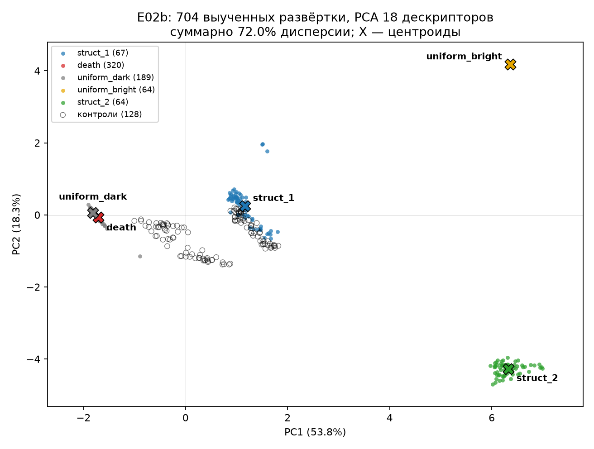
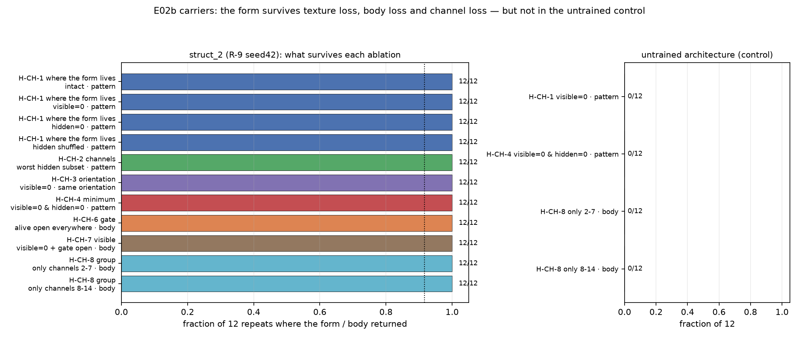
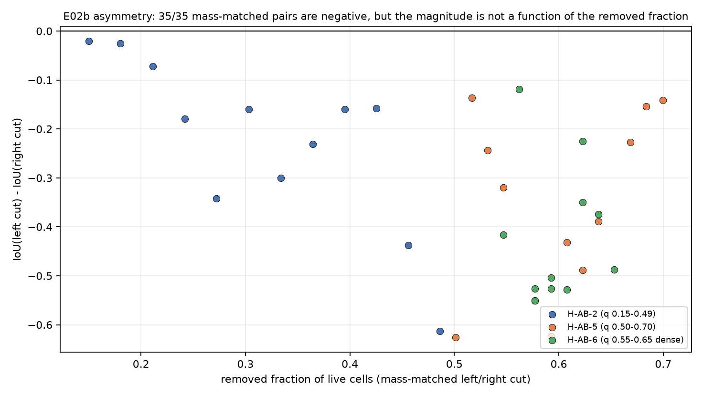
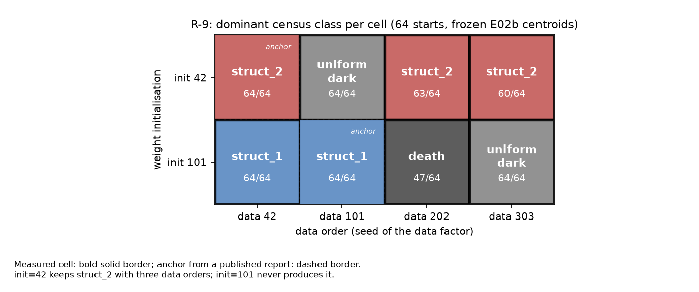

# What Morphologies Does a Neural Cellular Automaton Hold? A Census and a Negative Result

**Status:** DRAFT v0.33 (2026-10-22) — not submitted, not peer-reviewed, do not cite. **Publication gate:** E02c is closed, the seed42 run repeats bitwise and returns the class 64/64 (§4.6), and the portable package passed an independent CPU reproduction of the E02b census; an independent retraining of seed42 on a different stack was attempted and did **not** reproduce the class (§4.12), so the claim is now explicitly stack-conditional and external submission remains a decision of the owner. No claim about life, consciousness or intelligence; only observable behavioural classes and their boundaries ([AGENTS.md](../AGENTS.md) §3).

<!-- TODO: owner decision on the stack-conditional claim (and on H-REPRO-2/H-REPRO-3) before any external submission. -->

## Abstract

Neural cellular automata are usually trained to grow a prescribed pattern. What morphologies does such a system hold when the target is removed? We census twelve frozen checkpoints (five H-A0, five R-9, one R-11, one H-P1) plus an untrained control: 64 deterministic noise starts per model, 2000 steps, frozen weights, 18 descriptors and Ward clustering at k = 5. Of 704 learned rollouts, 573 (81.4%) end in death or in a uniform field; two structured classes remain. `struct_1` is reproduced by the untrained architecture, so its repair does not require learning. `struct_2` appears only in R-9 seed42, is absent from all controls and from 768 rollouts of other models, and returns to its class after 20% amputation. An earlier ring target had failed: the ring was neither reached from noise nor held. A pre-registered replication then trained R-9 on three new seeds (142/242/342) and repeated the 64-start census: **none** produced `struct_2` (seed142 → `struct_1`, seed242/342 → `uniform_dark`), while the seed42 control reproduced it 64/64. A repeat of the seed42 run with frozen code reproduced all seven weight tensors bitwise and the class 64/64, so the run behind the observation is stable and the candidate is tied to its training seed rather than to the recipe. A grid over weight initialisation and data order then separates the two factors: with initialisation 42, `struct_2` returns with three different data orders (64/64, 63/64 and 60/64 starts), while initialisation 101 never produces it, so the class rests on an initialisation basin rather than on one lucky seed pair (§4.13). Retraining the same seed42 recipe on a different hardware and software stack (Colab, Tesla T4) produced a different class instead — `uniform_dark` 64/64 — and a screening of five further seeds transferred in one case out of six, with `struct_2` never appearing on that stack, so the seed-to-class map is conditional on the numerical environment even though the run is deterministic within one; a pre-registered local rerun that disabled TF32 reproduced the class change, naming the precision of the convolutions in training as a sufficient cause. It is therefore a study bounded to one numerical stack and to the 2000-step horizon. Follow-up ablations then ask what carries that form: it survives texture loss, body loss and channel loss, no single hidden channel or half of the hidden state is necessary, and the body and the texture rebuild each other, while the untrained control loses the form under the same interventions. The structural left-right asymmetry is robust in sign across every mass-matched pair but its magnitude is not a function of the removed fraction, nor of the cut geometry: at two fixed cuts it scatters with standard deviations of 0.11–0.17, because the right half regenerates into nearly the same outcome from every noise start while the left half does not. The carrier can be narrowed further than a half: one hidden channel alone returns the body in 12/12 starts, while seven of the fourteen channels are inert on their own, so the redundancy is real but not uniform. We describe the map as sparse, the repair as class-level rather than bitwise, the left/right difference as a detector of structural asymmetry rather than a measure of its size, and make no claim that either class is alive.

## 1. Introduction

Can a local learnable rule hold more than the one pattern it was optimised for? The first target was explicit: a ring, trained as a coverage objective and probed for reach and hold. E02 closed negatively — the ring was not an attractor of the learned dynamics ([E02 report](../reports/2026-10-20-e02-pattern.md), [article 002](../articles/002-pochemu-kolco-ne-stalo-attraktorom.md)). That failure motivated a different question: not whether one prescribed form can be grown, but **which morphologies the existing frozen checkpoints already hold when asked nothing specific**.

E02b answered by census rather than training: it froze every canonical checkpoint, started each model from 64 deterministic noise states, ran 2000 steps without gradient, described each final state with 18 descriptors and clustered the results ([E02b results](../reports/2026-10-20-e02b-results.md)). This manuscript assembles that census, the E02 negative result, and the exploratory follow-up probes into one cumulative text.

The contribution is deliberately narrow: a sparse census of what twelve frozen checkpoints hold; a description of repair as recovery of a **class** of texture, not of a bitwise pattern; a pre-registered replication showing that the only learned candidate does **not** survive a change of training seed, while the same seed repeats bitwise on the same hardware; and an explicit account of what the measurements cannot show. The scope is equally narrow: one architecture, one recipe family, one training seed for the only learned candidate, and no claim about adaptation, goals, information or agency.

## 2. Related work

The conceptual frame is the literature on morphogenesis as computation and on "agential materials" — a tissue can solve a shape problem rather than execute a fixed plan (Levin; reading map in [`library/levin/README.md`](../library/levin/README.md)). This frame motivates the question but is not a result: our data can say that a class of texture returns after amputation; they cannot say that the tissue "remembers a plan".

The technical lineage is the neural cellular automaton: a differentiable local rule trained to grow and regenerate a target (Mordvintsev et al., 2020, and the works in [`library/hypotheses/nca-lineage.md`](../library/hypotheses/nca-lineage.md)). Our contribution is not a new architecture but a pre-registered census of what trained rules hold, including the negative ring result that preceded it. No source is restated or reprinted; records and our notes are in the library ([index](../library/publications/README.md), [Levin map](../library/levin/README.md), [NCA lineage](../library/hypotheses/nca-lineage.md)).

The records behind these citations are fixed in the library index, whose metadata were verified against Crossref/arXiv (index date 2026-10-21), and we take method and caution from them, never evidence about our own model. The computational line is the differentiable local rule trained against a target (Mordvintsev et al., 2020), its 3D extension that grows volumetric artefacts and functional machines (Sudhakaran et al., 2021), and the continuous-state precursor whose catalogue of localised patterns is a descriptive vocabulary rather than a claim about organisms (Chan, 2019). Three works bound what a shape can be asked to do: a form that classifies itself through local agreement (Randazzo et al., 2020), a soft-robot body whose shape is regrown while locomotion recovers only partially (Horibe et al., 2021), and physical NCA modules that classify global shape and detect damage without a centre (Moreno et al., 2026). Two set expectations for a map like ours: whether local interactions can hold an ordered phase at all is fixed by the interaction graph rather than by rule details (Sacco et al., 2026), and the corpus review lists collapse into trivial attractors and limited capacity as standing limitations of the method (Hartl, Levin & Pio-Lopez, 2026) — our sparse map is consistent with that list but is not a test of it. Two further works supply vocabulary we use only operationally: autotelic reinforcement learning that finds and holds structures with small interventions (Cvjetko et al., 2026) and a computable measure of goal-directedness (MacDermott et al., 2024). The frame itself (Levin, 2022, 2023) motivates the question and is not a result here: our data can say that a class of texture returns after amputation; they cannot say that anything pursues a goal. Full bibliographic records, with DOI or publisher URL as held in the index, are in the References.

## 3. Methods

### 3.1. Model and checkpoints

The automaton is a 64×64 grid with 16 channels: channel 0 visible, channel 1 alive mask, channel 15 stress ([E02 report](../reports/2026-10-20-e02-pattern.md)). We use the twelve canonical `nca_final.pt` checkpoints of E02b — H-A0 ×5 (seeds 42/101/202/303/404), R-9 ×5, R-11 ×1, H-P1 ×1 (positive control whose training pool starts from the target) — plus an untrained model of the same architecture as a runtime control without weights.

Provenance was audited before any class was read: byte hashes match the index, seeds and metadata match their families, iteration is 2000 for all, SHA-256 over `model_state_dict` is pairwise distinct 12/12, and four H-A0 files share a final loss to the last bit while having distinct weights — the same loss on a dead field, not duplicate files ([E02b results](../reports/2026-10-20-e02b-results.md), "Происхождение канонических чекпоинтов").

### 3.2. Training recipes

All checkpoints were trained for 2000 steps against a ring with density p = 0.15234375 and signature b0 = 1, b1 = 1, chi = 0. H-A0 is the baseline; R-9 adds a quiet-background term of weight 1.0 on top of R-8; R-11 adds the same term on top of R-7 without the strengthened alive-policy; H-P1 is the positive control whose pool starts from the target ([E02 report](../reports/2026-10-20-e02-pattern.md), [WP4 status](../reports/2026-10-20-wp4-status.md), [negative-results log](../morphogenesis/memory/negative_results.md)). The arms differ in loss composition, not architecture — which is why the census can compare five R-9 seeds that share a recipe but differ in training seed.

#### Loss composition of the R-9 arm

The arm definition is frozen in code and mirrored in the data, so the values below are read, not recalled. `ARMS["R-9"]` in [`morphogenesis/wp4_ablations.py`](../morphogenesis/wp4_ablations.py) sets, on top of the defaults: `RETENTION_ENABLED = true`, a retention rollout of 16 steps (`RETENTION_ROLLOUT_STEPS = 16`), survival mode `level` with alive margin 0.1 (`RETENTION_SURVIVAL_MODE = "level"`, `RETENTION_ALIVE_MARGIN = 0.1`), survival weight 10.0 (`RETENTION_SURVIVAL_WEIGHT = 10.0`), quiet weight 1.0 (`RETENTION_QUIET_WEIGHT = 1.0`), loss weights `{"retention": 1.0, "alive_policy": 2.0}`, and a flat BPTT curriculum `TRAIN_BPTT_CURRICULUM = [16, 16, 16]`. The same values are written into [`census.json`](../morphogenesis/experiments/E02b_morphospace/census.json) → `checkpoints[]` → `overrides` with `overrides_source: "wp4_ablations.json"`, which makes the arm auditable without the training log.

| Term | Weight in R-9 | Source |
| --- | ---: | --- |
| `retention` | 1.0 (default 0.0) | `ARMS["R-9"]` → `LOSS_WEIGHTS` |
| `alive_policy` | 2.0 (default 0.5) | `ARMS["R-9"]` → `LOSS_WEIGHTS` |
| `visible_mse` | 1.0 | `config.LOSS_WEIGHTS` |
| `hidden_regularization` | 0.05 | `config.LOSS_WEIGHTS` |
| `stress_proxy` | 0.1 | `config.LOSS_WEIGHTS` |
| `topo_proxy` | 0.1 | `config.LOSS_WEIGHTS` |
| `attractor_divergence` | 0.2 | `config.LOSS_WEIGHTS`, phase 3 only |

The retention term is `1.0 × (retention_mse + 10.0 × retention_survival + 1.0 × retention_quiet)` ([`morphogenesis/train.py`](../morphogenesis/train.py)); the other terms enter as `weight × term`. Batch size is 8 (`TRAIN_BATCH_SIZE`, and `batch_size` in the training manifest `lab/runs/20261019T201445Z-WP4_R-9_s2000_seed42.json`). `attractor_divergence` is added only in phase 3, i.e. after `PHASE1_STEPS = 10000` (`train.py` → `resolve_phase`), so a 2000-step run does not reach it.

Two limits are part of the statement. The arm record stores weights and modes, not the algebraic definition of each term: the shape of `retention_survival` and `retention_quiet` is defined by `train.py` (`retention_rollout_loss`), not by `wp4_ablations.json`. And R-11 differs in composition — the same quiet term without the strengthened alive policy — which is why the arms are described here by composition rather than called identical.

### 3.3. Census protocol

For every checkpoint we ran 64 deterministic initial states (seeds 0–63) from `init_state` for 2000 steps with frozen weights and no gradient, snapshotting every 50 steps. With 13 families (12 checkpoints plus untrained) this gives 832 rollouts, 704 learned and 128 control. The protocol ran on CUDA in 5070.2 s; families took 365.4–423.9 s. All 64 seeds enter the denominator ([E02b results](../reports/2026-10-20-e02b-results.md)).

Controls are projected onto learned centroids and do not participate in fitting. Class semantics are fixed: `death` when alive_fraction < 0.01, `uniform_dark` when binary_fraction < 0.01, `uniform_bright` when binary_fraction > 0.95, else `structured`.

### 3.4. Descriptors and clustering

Each final state gets 18 features: alive fraction, binary and bright density, mean soft intensity, entropy, components and holes (b0, b1), Euler characteristic, bounding-box fill, largest-component fraction, radial profile and variance, rotational and reflection symmetry, autocorrelations (lags 1, 4; 2 and 8 in follow-ups) and edge fraction ([E02b results](../reports/2026-10-20-e02b-results.md)). Features are z-normalised; Ward clustering builds classes with k chosen by silhouette and minimum class size 5; DBSCAN is an agreement check, not the source of classes. The solution is k = 5, silhouette 0.8545; DBSCAN gives 7 clusters, 4/704 noise (0.57%), ARI 0.9137. The taxonomy is descriptive: bootstrap over k selects k = 5 in 52%, while `struct_2` survives intact for k = 3–8.

### 3.5. Perturbations

For each structural class three prototypes were chosen by distance to the centroid. Three prototypes per class × six perturbations × five repeats gave 180 rollouts: 10% and 20% amputation, noise σ = 0.1, a cut of half the field, a patch transplant into a dead field, and a dead-field control. Runs lasted 500 steps with snapshots every 25; recovery means the final state is assigned to the prototype's class again ([E02b results](../reports/2026-10-20-e02b-results.md), "Возмущения"). Two deviations are recorded, not hidden: amputation zeroes all 16 channels (stronger than the literal protocol), and the protocol transplant was degenerate (bounding box = whole field), so the growth claim rests on exploratory patches (§4.3).

### 3.6. Determinism and compute

Runs follow the specification's determinism contract ([spec §9.2](../docs/spec/MORPHOGENESIS_v5.6_Rev11.md)): `CUBLAS_WORKSPACE_CONFIG` set before CUDA init, `torch.use_deterministic_algorithms(True)`, deterministic cuDNN with benchmark off, fixed seeds. Census used CUDA on an RTX 3070 Laptop; the canonical prototype path reproduces bit-identically within and across processes ([E02b results](../reports/2026-10-20-e02b-results.md)). A full 2000-step training run is also bitwise repeatable on this device: the seed42 repeat matched all seven weight tensors of the canonical checkpoint (§4.6, [seed42 repeat](../reports/2026-10-21-e02c-seed42-repro-results.md)). Cross-stack determinism, by contrast, does not hold: retraining the same recipe and seed on a different hardware and software stack ended in another class (§4.12, [T4 result](../reports/2026-10-22-colab-t4-repro-results.md)).

## 4. Results

### 4.1. The ring target was not an attractor

E02 asked whether a ring is reachable from noise and stable from the target; it is neither. The layer-1 gate (5 seeds × 800 steps) failed all four conditions — no collapse 0/5, Chamfer improvement 0/5, coverage above threshold 0/5, retention 0/5 — and every run was stopped by `collapse_fuse` with visible MSE 0.2498–0.2499, the dead-field plateau ([E02 report](../reports/2026-10-20-e02-pattern.md), [WP4 status](../reports/2026-10-20-wp4-status.md)). With the structural ceiling 2p/(1+p) = 0.2644 and the gate 0.3144, the best family-R f1 was 0.2419 at iteration 650 (R-9), 0.0225 below the ceiling and 0.0725 below the gate. Reach maxima were 0.2755–0.2793 at precision 0.15–0.17 ("almost everything bright", not a ring); the only holder, H-P1, decayed with horizon (0.9495 → 0.3959 → 0.2069). The WP4 artefact gate is formally unpassed (`journal_pairs_13_3 = false`): `met = true` means fields and runs exist, not that the science succeeded.

#### Why the ring is a calibration target, not a control for form in general

The ring was the training objective, not a control arm: every E02 arm was trained against the same ring, and the four layer-1 conditions tested reach and hold of that one target, not the capacity to hold any form ([E02 report](../reports/2026-10-20-e02-pattern.md), "Дизайн"). A control in the sense this manuscript uses needs an arm whose expected outcome is fixed independently of the treatment; E02 had none — the untrained architecture and the H-P1 positive control were added only in E02b (§3.1). The failure therefore bounds one optimisation: this architecture, this loss family, this horizon, this target. It does not bound the capacity to hold form, and the census makes the distinction concrete rather than academic: two structural classes appear in the frozen map, one of them from every start of a single checkpoint (§4.2). The E02 report states the same boundary in its own section ("Что НЕ следует из результата": it is not proved that an NCA cannot produce morphogenesis — one architecture, loss, horizon and target were tested). Reading the ring as a negative control for form in general would be the measurement trap of §5.3 applied to a single failure: a single maximum — or a single absence of one — taken as a verdict about a class.

### 4.2. A sparse map with two structural classes

Ward at k = 5 gives class sizes [67, 320, 189, 64, 64] over learned runs: `struct_1`, `death`, `uniform_dark`, `uniform_bright`, `struct_2` ([E02b results](../reports/2026-10-20-e02b-results.md)). Of 704 learned rollouts, 573 end in death or a uniform field — 81.4% (death_or_uniform_fraction = 0.8139) — and 131 (18.6%) are structural. The formal outcome is `rich_map`, but the map is sparse: four of five learned runs show no structure.

The two structural classes are not equivalent. **`struct_1`** (67 learned, 93 control rollouts) is a fine speckle: alive median 0.7959, binary median 0.2561, b0 ≈ 382, b1 ≈ 2; it is reproduced 64/64 by the untrained architecture and appears in 29/64 H-P1 rollouts, so it is an architectural confound, not evidence of learned morphology. **`struct_2`** (64 learned, 0 control) is a connected tissue with many holes: alive median 0.5310, binary median 0.5310, b0 ≈ 1, b1 ≈ 1844.5, entropy median 0.2535; R-9 seed42 produces it from all 64 noise starts, no control produces it, and it is absent even transiently from the 768 rollouts of other models.

**Classes at Ward k = 5** — learned/control counts and medians from [E02b results](../reports/2026-10-20-e02b-results.md), "Классы"; the 128 controls split 93 + 35 and are projected, not fitted:

| Class | Semantics | Learned | Control | alive (median) | binary (median) |
| --- | --- | ---: | ---: | ---: | ---: |
| `struct_1` | structured | 67 | 93 | 0.7959 | 0.2561 |
| `death` | death | 320 | 35 | 0.0000 | 0.0000 |
| `uniform_dark` | uniform_dark | 189 | 0 | 1.0000 | 0.0000 |
| `uniform_bright` | uniform_bright | 64 | 0 | 1.0000 | 1.0000 |
| `struct_2` | structured | 64 | 0 | 0.5310 | 0.5310 |

**Figure 1.** PCA of the 18 descriptors, fitted on the 704 learned rollouts only; the first two components carry 72.0% of the variance (axes labelled 53.8% and 18.3%, each rounded independently on the figure), and all 832 rollouts are shown — 704 learned, denoted by colour, and 128 controls, drawn as open circles projected onto the learned axes and never used in fitting. Black crosses mark class centroids. `struct_2` (64 learned, 0 control) is an isolated island at the lower right; `death` and `uniform_dark` form a tight pair on the left, `struct_1` a compact group near the origin, and the controls spread along the band between them, sitting inside `struct_1` and `death` rather than forming a class of their own. The figure visualises the partition already obtained and is not an additional test ([map script](../morphogenesis/experiments/E02b_morphospace/scripts/e02b_morphospace_map.py); the figure file is 95 345 bytes).

H1 (a non-trivial reproducible class) and H2 (R-11's structure is transient: 61/64 finals non-structural, `struct_1` on some snapshot 64/64) were supported; H3 was refuted (§4.3); H4 — whether the rule variant matters more than the seed — was not run.

### 4.3. Repair at the level of a class, not a pattern

After 20% amputation of live cells (zeroing all 16 channels), both structural classes returned to their own class in 15/15 repeats, median return at the first snapshot (25 steps) ([E02b results](../reports/2026-10-20-e02b-results.md)). This refutes H3, which expected no recovery above 50%. For `struct_1` learning is not required: three seeded untrained initialisations give 64/64 `struct_1` and 45/45 returns after the same amputation.

Recovery is class-level, not bitwise. Patches of 8×8, 16×16 and 32×32 transplanted into a zero field (2 classes × 3 sizes × 5 positions = 30) all grew into their class within 500 steps, but the global pattern did not return: IoU with the prototype was 0.15–0.47, and `struct_1` agreement was at the random-field level. Small seeds organise more slowly (25 steps for 32×32, 225 for 8×8, 275 for 16×16 in `struct_2`), and convergence is not observed even at 2000 steps.

The transplant matrix says the same from the other side. A 12×12 matrix (144 transplants) found six killers (H-A0 ×5 and H-P1), five single-live-attractor models, one diagonally unstable model (R-11) and zero multi-basin candidates: no model holds two stable live forms. A repeat with nine samples per pair (1296 transplants) reproduced the verdicts; R-9 seed42 pulled all 54 foreign live states into `struct_2` with death share exactly 0.000. The reverse transplant is equally model-specific: `struct_2` into R-9 seed101 ends in death 16/16, while seeds 202 and 303 return to their own classes 16/16.

#### The 25-step return is an upper bound, not a measurement

The number 25 is the resolution of the measurement, not a measured latency. Perturbation runs last 500 steps with a snapshot every 25 (`run_perturbations(..., steps=500, every=25)` in [`morphogenesis/e02b_morphospace.py`](../morphogenesis/e02b_morphospace.py); the same interval is stated in the E02b design), so "return at the first snapshot" means that the first post-lesion snapshot already carries the class. Any return anywhere in the interval (0, 25] is recorded as 25: the true time is **at most** 25 steps and may be shorter. The E02b report records the same reading (limitation 6: "the median of 25 steps is the first snapshot, the real time may be less"). Nothing in the archive resolves sub-25-step timing; this manuscript therefore claims no faster or slower repair than the bound, and a denser snapshot grid would be needed to narrow it.

### 4.4. Exploratory probes: channels, strength, asymmetry, nucleation, transplants

The follow-up probes below were run after the census with rules written before each run; they do not change the pre-registered verdicts.

**Where the form lives (H-CH-1).** In 144 rollouts (3 models × 4 conditions × 12), `struct_2` reproduced the same pattern 12/12 intact, with visible texture zeroed, with hidden channels zeroed, and with hidden channels shuffled; median IoU 0.786–0.825 ([channel-memory report](../reports/2026-10-21-e02b-channel-memory.md)). "Form is held in hidden channels" is rejected in its strong form: `memory_in_hidden_channels = false`. The prototype was non-canonical (alive 2200/3240 vs canonical 2174/3263), so absolute IoU is not comparable with canonical runs; a clean provenance repeat is required before publication.

**Strength of the body (H-BI-1).** In 252 rollouts (3 models × 7 fractions × 12), `struct_2` survived 12/12 at every fraction from 0 to 0.9 and 0/12 at 1.0 — a threshold, not a dose-response ([body-integrity report](../reports/2026-10-21-e02b-body-integrity.md)). T is 0.90 for both learned models and 0.50 for the untrained network; the verdict is `mixed` because `struct_2` is not more tolerant than `struct_1`. What it adds is a connected body: median alive_b0 = 1 at T, against about 22 islands for `struct_1`.

**Asymmetry (H-AB-1).** On the canonical prototype, 216 rollouts (3 models × 6 lesions × 12) gave, for `struct_2`, cut_left 0.473 vs cut_right 0.792 (Δ = −0.336, sign 12/12) and cut_top 0.806 vs cut_bottom 0.659 (Δ = +0.184, sign 12/12). Both axes pass the pre-registered rule (sign in ≥11/12 and |Δ| ≥ 0.05); `struct_1` and untrained stay below 0.01. The class was retained in all 216 rollouts; central lesions healed with IoU 0.841 (16×16) and 0.745 (32×32) ([asymmetry report](../reports/2026-10-21-e02b-asymmetry-canonical.md)). Prototype mass is balanced (1078/1122 horizontally, 1082/1118 vertically), so the effect is not explained by more tissue on one side; whether it is structural is left to H-AB-2, not yet run.

**Instrument bug found on the way.** The first 12-repeat asymmetry run built the learned prototype with a zeroed stress-EMA because of an inverted `is_trained` flag; 2070 of 4096 cells differed from the canonical prototype. The corrupted artefact is kept as documented history of the error; its absolute IoU is not comparable with canonical runs.

#### One table for the exploratory probes

The probes are collected here so that their status travels with their numbers. `exploratory` is part of the result, not a label to be dropped in the abstract: every row is a run outside the pre-registered E02b protocol, on one prototype (or one transplanted state) per model, and none of them is evidence for §4.2–4.3.

| Probe (hypothesis) | Design | Result | Status | Source |
| --- | --- | --- | --- | --- |
| Where the form lives (H-CH-1) | 3 models × 4 conditions × 12 = 144 rollouts, 2000 steps | `struct_2` same pattern 12/12 in all four conditions (`none`, `visible_zeroed`, `hidden_zeroed`, `hidden_shuffled`), median IoU 0.786–0.825; `memory_in_hidden_channels = false`, `rederivable_from_visible = true`, `hidden_layout_matters = false` | exploratory; prototype non-canonical (alive 2200 vs canonical 2174), so absolute IoU is not comparable | [channel-memory report](../reports/2026-10-21-e02b-channel-memory.md) |
| Strength of the body (H-BI-1) | 3 models × 7 fractions × 12 = 252 rollouts, 2000 steps | survival 12/12 at p = 0…0.9 and 0/12 at p = 1.0; T = 0.90 for both learned models, 0.50 for untrained; verdict `mixed`; at T median alive_b0 = 1 (`struct_2`) vs 22 (`struct_1`) | exploratory; hypothesis refuted in its original dose–response form | [body-integrity report](../reports/2026-10-21-e02b-body-integrity.md) |
| Asymmetry (H-AB-1) | 3 models × 6 lesions × 12 = 216 rollouts, 2000 steps | `struct_2`: cut_left 0.473 vs cut_right 0.792 (Δ = −0.336, sign 12/12), cut_top 0.806 vs cut_bottom 0.659 (Δ = +0.184, sign 12/12); controls below 0.01; class retained 216/216 | exploratory; H-AB-1 confirmed on the canonical prototype only | [asymmetry report](../reports/2026-10-21-e02b-asymmetry-canonical.md) |
| Nucleogenesis (H-NU-1) | 5 focus sizes × 2 packings × 12 × 3 models, plus the k = 0 control and a cross-class block; 420 rollouts, 2000 steps | minimal focus 1 cell (`struct_2`, expansion ×2158) and 8 cells (`struct_1` seed101); untrained never wakes; cross-class block dies 12/12 both ways; "same picture" reached only at 128 cells, `scattered` | exploratory; wake-up verdicts robust, "same picture" verdict rests on the non-canonical prototype | [E02b results](../reports/2026-10-20-e02b-results.md), "Нуклеогенез" |
| Transplants and basins | 12×12 matrix, one state per source = 144 transplants, 2000 steps; repeat with 9 samples per pair = 1296 transplants | 144-run matrix: 6 killers, 5 `single_live_attractor`, 1 `diagonal_unstable` (R-11), 0 multi-basin; the 1296-run repeat finds 0 multi-basin again, `struct_2` 54/54 with death share 0.000 | exploratory; descriptive map, not a proof of a basin | [E02b results](../reports/2026-10-20-e02b-results.md), "Матрица переходов" |

Two of these rows carry a known instrument defect and are labelled as such in their reports: the channel-memory and nucleogenesis prototypes were built with a zeroed stress-EMA from an inverted `is_trained` flag (alive 2200 rather than 2174). The H-AB-1 repeat of 2026-10-21 avoided that path and built its prototypes from the checkpoint EMA (alive 0.530762, 2174 cells). A clean provenance repeat of the channel-memory probe on the canonical prototype is queued and is a condition for using its absolute IoU values. A follow-up inference run then closed four of the open probes — hidden-channel subsets, the return of orientation, the minimum channel requirement and the mass-matched asymmetry — and it also exposed an interpretation gate: pattern metrics are only defined where the prototype reproduces its own figure (§4.7).

### 4.5. Replication: `struct_2` does not survive a change of training seed

E02c trained the same R-9 recipe on three pre-registered seeds (142/242/342), then repeated the 64-start, 2000-step census with frozen weights; seed42 was the positive control and the untrained architecture the negative control ([E02c results](../reports/2026-10-21-e02c-results.md), [article 006](../articles/006-replikaciya-r9-struct2-ne-vosproizvelsya.md)).

| Family | `struct_2` | Frozen-centroid class | Ward class |
| --- | ---: | --- | --- |
| seed142 | **0/64** | `struct_1` 64 | `struct_1` 64 |
| seed242 | **0/64** | `uniform_dark` 64 | `uniform_dark` 64 |
| seed342 | **0/64** | `uniform_dark` 64 | `uniform_dark` 64 |
| control seed42 | 64/64 | `struct_2` 64 | `struct_2` 64 |
| control untrained | 0/64 | `struct_1` 64 | `struct_1` 64 |

The result is **0/3**: H-R1 and H-R2 are rejected, H-R3 is confirmed, and H-E02C-1 is rejected. The positive control rules out a broken census; the untrained control reproduces the architectural confound. Final training losses of the new seeds (1.119–1.235) overlap seed42 (1.105), and seed342 has the best `best_loss` of all, so the class difference is not a crude under-training artefact. Across the eight R-9 training seeds, `struct_2` is observed in 1/8 (seed42 only), `struct_1` in 2/8 (101, 142), `uniform_dark` in 4/8 and `uniform_bright` in 1/8; this is a descriptive frequency, not a probability estimate (seed42 is the base seed, not a random draw). A 0/3 outcome is compatible with a frequency up to about 63% by the rule of three, so the correct claim is "not reproduced on the 2000-step horizon", not "impossible".

On this horizon, `struct_2` is a single-seed case study. The E02b findings about its geometry, repair, orientation and basin remain properties of that frozen model; they are not promoted to a property of the R-9 recipe. §4.6 closes the remaining alternative — an unstable run: the seed42 run itself repeats bitwise, so the tie is to the seed, not to run noise.

### 4.6. Seed reproducibility: the class returns with its own seed

E02c left one alternative open: perhaps the seed42 run was not repeatable at all, in which case "a single-seed observation" would also mean an unstable run, and the seed-versus-recipe dispute would be premature. A separate protocol was frozen before the run — same seed, same recipe, same code, same hardware, criterion `struct_2 ≥ 52/64` and stability `≥ 0.80` — and the new checkpoint was written to its own family without overwriting the canonical file ([protocol](../reports/2026-10-21-e02c-seed42-repro-plan.md)).

Training repeated bit for bit. All seven tensors of `model_state_dict` are **bitwise equal** to the canonical `WP4_R-9_s2000_seed42`, and `best_loss` 1.104736089706421 and `alive_fraction_final` 0.34686279296875 agree to the last bit; only the file metadata differs ([seed42 repeat](../reports/2026-10-21-e02c-seed42-repro-results.md)).

The census of the repeat returns `struct_2` in **64/64** starts under the frozen E02b centroids, with stability 58/64 = 0.906 over the last quarter of the run under the protocol's fit-relative labelling (the criterion as registered); under the frozen E02b projection, which does not depend on the census composition, every snapshot of every start is `struct_2`, so the comparable stability is 64/64 = 1.00. The positive control (canonical seed42) also returns 64/64 with stability 0.906, and the negative control (untrained) returns `struct_1` 64/64. Descriptor vectors of the repeat and of the positive control are bitwise identical on all 64 starts (maximum absolute difference 0.0), so the census itself added no drift. The frozen criterion (52/64 and 0.80) is met and the outcome is `reproduced`; 192 rollouts took 1257 s on CUDA.

Ward clustering does not name classes in this narrow census. Fitted on 192 rollouts of three families it selects k = 2 with silhouette 0.315, and under those conditions the untrained architecture receives the Ward label `struct_2` (64/64) although the frozen projection gives `struct_1`, while start 61 receives different Ward labels in the two families from bitwise identical descriptors. That is an artefact of the clustering, not a physical difference, so the numbers above come from the frozen projection and the Ward split (42/22 for the repeat against 41/23 for the control) is reported descriptively only. The 0.906 figure is fit-relative: it rides on the same weak split, and the E02b census gave 1.00 for the same checkpoint from identical raw trajectories. A recount with the frozen projector ([frozen-stability protocol](../reports/2026-10-21-stability-frozen-plan.md)) returns 64/64 = 1.00 for both the repeat and its control, so the apparent 0.906-versus-1.00 difference is an artefact of census composition and is not read as a degradation of the form. The same frozen metric is 1.00 for the untrained control as well, so it measures label persistence, not structure.

Three boundaries follow. The repeat is **not an independent reproduction**: same machine, same environment, same code, and the publication gate still requires a different stack. It does not make `struct_2` a property of the recipe: E02c's 0/3 stands, and the class is tied to the training seed. And it checks exactly one seed, so "reproducible from this seed" does not become "stable across seeds" (refuted in E02c) or an estimate of the class frequency for the recipe.

### 4.7. What carries the form, and why the left half is worse

Four probes that had stayed open were closed by one inference run on frozen checkpoints (816 rollouts, 96 min CUDA, three models x 12 repeats; [closures results](../reports/2026-10-21-e02b-closures-results.md), [protocol](../reports/2026-10-21-e02b-closures-plan.md)).

**Hidden channels are redundant, not specific (H-CH-2, refuted).** Zeroing any single hidden channel 2-14, or any of six groups, left the `struct_2` pattern intact in 12/12 rollouts for all 20 conditions (mean IoU 0.63-0.86; the untouched control scores 0.864). The untrained architecture behaves the same. A channel that stores the form is not identified; this is consistent with the H-CH-1 reading that the figure is re-derived.

**Orientation returns (H-CH-3, confirmed).** With the visible texture zeroed, the best of the eight D4 transforms is the identity in 12/12 rollouts (mean dihedral IoU 0.799): the figure comes back in the same orientation, not merely in the same class.

**The body itself carries the form (H-CH-4, refuted as stated).** Zeroing visible and hidden channels while keeping the alive channel leaves `struct_2` recovering the pattern 12/12 (IoU 0.77-0.80, class `struct_2` 12/12). The reason is structural: the binary mask is read out of the alive channel, so "keep alive" means "keep the body". The tested dichotomy (visible vs hidden) is therefore incomplete, and the test cannot separate "re-derived" from "never destroyed". For the untrained architecture the same condition ends in `death` 12/12, so a preserved body is not sufficient by itself.

**Asymmetry is structural, not mass (H-AB-2, confirmed).** H-AB-1 compared halves of equal area, but the prototype holds different numbers of live cells on each side, so the gap could have been a mass artefact. Twelve pairs with matched removed mass (removed fraction 0.15-0.486, mismatch 0.0023-0.0046 under a 0.01 tolerance) give `d = IoU_left - IoU_right < 0` in 12/12 pairs, mean -0.225, from -0.02 at the smallest lesion to -0.61 at the largest. The left half recovers worse at equal removed mass.

**An interpretation gate.** The `none` control is a gate, not a formality: for R-9 seed101 (class `struct_1`) the untouched prototype reproduces its class 12/12 but its figure 0/12 (IoU 0.13-0.17, alive 0.76-0.82). Every 0/12 for that model is therefore a baseline failure, not an ablation effect, and its pattern numbers are descriptive only.

### 4.8. One seed is two factors

The word "seed" in this repository has always covered three things at once: the initial weights, the initial field and pool, and the order of training samples with their noise. E02c showed that one of eight training seeds yields `struct_2`; this run asks which part of the seed does the work.

The seed was split into `init_seed` (only the global RNG, hence the initial weights) and `data_seed` (the generator for noise, the pool and the sampling order); with both `None` the behaviour is bitwise the old one, which the pre-run smoke checks by comparing a plain run against an explicit `init_seed = data_seed = 42` ([protocol](../reports/2026-10-22-e02c-seed-decomposition-plan.md)). Two cells were trained with the same R-9 recipe: **A** = init 42 / data 101, **B** = init 101 / data 42, and both were censused with the same 64 starts and frozen centroids ([results](../reports/2026-10-22-e02c-seed-decomposition-results.md)).

| init \ data | 42 | 101 |
| --- | --- | --- |
| **42** | `struct_2` 64/64 (anchor, E02b) | `uniform_dark` 64/64 (A) |
| **101** | `struct_1` 64/64 (B) | `struct_1` 64/64 (anchor, E02b) |

Neither mixed cell contains `struct_2` (0/64 in both; A ends in a nearly full live field with `alive_fraction_final` 0.9998 and `best_loss` 1.0712, B in `struct_1` with 0.9240 and 1.1332). Two asymmetries are visible and are the actual result: with initialisation 101 the data order does not change the class (`struct_1` in both cells), while with initialisation 42 the data order decides between the form and a uniform field.

The registered criterion had three branches (initialisation decides, data decides, both needed). The first two did not occur; the third occurred only in the weak sense that no single factor suffices. Its strong form is **not claimed**: the review raised before launch that one run per cell cannot distinguish "both factors are necessary" from "this combination is unlucky", and the protocol text was not amended before the run, so the honest statement is that *the factor is not separated on this design* ([notices](../lab/notices.md)). Both cells also come with one horizon, one recipe and two anchors trained by an earlier code version, and `struct_1` is the architectural confound, so B reads as "no structure of its own" rather than "a different learned class".

What follows for the program: the class frequency must be counted on the full seed until a second wave separates the factors (H-E02C-6), and the claim "the class is decided by the weight initialisation" is unsupported.

### 4.9. The body and the texture rebuild each other

§4.7 left a gap: with the visible texture and the hidden channels zeroed, the pattern returned, but the `alive` channel is both the body and the update gate, so "the body carries the form" mixed up geometry with permission to update. The mirror experiment opens the gate everywhere (`alive = +8` in every cell, `sigmoid(8) > 0.5`) and leaves the visible and hidden channels untouched: does the original body come back? ([protocol](../reports/2026-10-22-alive-open-plan.md), [results](../reports/2026-10-22-alive-open-results.md)).

It does. In 48 rollouts (two conditions x 12 repeats x `struct_2` and untrained, 2000 steps) the body of `struct_2` returns 12/12 with `body_iou` 0.821 against a control of 0.864, class `struct_2` 12/12; the untrained control returns its body 12/12 with IoU 1.000. The pre-registered criterion is therefore refuted: with the gate open, the body is re-derived from the texture and the hidden channels, so the body's geometry is not a separate memory store.

Together with §4.7 this gives the symmetric statement that replaces "the body carries the form": **the two carriers rebuild each other**. Zero the texture and hidden channels, keep the body, and the pattern returns (H-CH-4, 12/12); open the body everywhere, keep the texture, and the body returns (12/12). In model terms `binary = alive and (visible > 0.5)`, and both factors are recoverable from one another.

An analysis of the twelve mass-matched pairs from §4.7 (no new rollouts) adds a dose-response to the asymmetry: all twelve differences are negative and the Spearman correlation between the difference and the removed fraction is -0.706 (at q < 0.2 the difference is -0.02, at q > 0.4 it reaches -0.44 and -0.61). The correlation threshold is post hoc, so it is reported descriptively and not as a pre-registered test.

Boundaries: one prototype per model, one horizon and one machine; with the gate open `body_iou` and `texture_iou` coincide by construction; the dose-response needs fresh pairs (H-AB-5) before it is a prediction.

### 4.10. The hidden state is the carrier, and the asymmetry has a hump

Two pre-registered checks close the carrier question in the opposite direction and test whether the asymmetry's dose-response extends beyond half the body ([protocol](../reports/2026-10-22-carriers2-plan.md), [results](../reports/2026-10-22-carriers2-results.md)).

**Without the visible channel the form survives (H-CH-7, refuted).** Zeroing the visible channel while opening the update gate everywhere (`alive = +8`) and leaving the hidden channels intact, the body of `struct_2` returns 12/12 with `body_iou` 0.809 against a control of 0.864, class `struct_2` 12/12. The untrained architecture in the same condition loses its body entirely (0/12, `uniform_dark`), so the reserve is learned rather than architectural. With §4.7 and §4.9 this leaves the hidden state as the only carrier that has not been bypassed: hidden channels suffice (here), body and texture rebuild each other (H-CH-4 and H-CH-6), and no single channel stores the form (H-CH-2).

**The dose-response does not continue (H-AB-5, not confirmed).** Twelve new mass-matched pairs with q = 0.500-0.698 give a negative difference in 12/12 pairs, but the median is -0.354 against a pre-registered prediction of at most -0.60. The magnitude peaks near q = 0.5-0.63 (-0.63) and falls to -0.14 at q = 0.698, where both halves are nearly dead: the difference is a hump, not a monotone function. The earlier monotone reading from q = 0.15-0.49 (rho = -0.71, §4.9) therefore does not extrapolate.

Boundaries: one prototype, one horizon and one machine; damage beyond q = 0.5 overlaps and leaves narrow survivors, which is part of the finding rather than an artefact; the struct_2-versus-untrained contrast rests on one untrained initialisation.

### 4.11. The hidden state is redundant, and the asymmetry magnitude is not a function of damage

The hidden state carries the form (§4.10); the next question is how much of it is needed and how stable the asymmetry's magnitude really is ([protocol](../reports/2026-10-22-clusters3-plan.md), [results](../reports/2026-10-22-clusters3-results.md)).

**Any half of the hidden channels is sufficient (H-CH-8, confirmed).** With the visible channel zeroed and the gate open, keeping only channels 2-7 or only channels 8-14 still returns the body of `struct_2` in 12/12 rollouts (mean IoU 0.784 and 0.805 against a control of 0.864), class `struct_2` 12/12; the untrained architecture loses the body in both conditions (0/12, `uniform_dark`). Together with H-CH-2, which found no single necessary channel, this says the form is stored redundantly across the hidden state rather than in a privileged place.

**Figure 2.** Every ablation that breaks the texture, the body or the channel set leaves the `struct_2` form recoverable (12/12 in all eleven conditions), while the untrained control loses it in four of the four tested conditions. The two metrics are labelled: *pattern* means binary IoU with the prototype body at least 0.5, *body* means the mask itself returns. H-CH-6 is not shown for the untrained control because opening the gate does not change a body that is already the alive mask. Built from the committed artifacts by [`scripts/make_carrier_figures.py`](../scripts/make_carrier_figures.py); no new measurements.

**The dose-response is a statistical artefact (H-AB-6, not confirmed).** Eleven dense mass-matched pairs with q = 0.55-0.65 were run against a pre-registered prediction that the largest difference would fall in 0.63 +- 0.05. The observed maximum is 0.551, and all eleven differences are negative, so the direction is stable while the magnitude is not. The decisive observation is methodological: two adjacent targets fell into the same integer cut `c = (40, 24)`, and the difference on two noise seeds was -0.225 and -0.350. A 0.125 spread at identical geometry, with the left-half IoU ranging 0.16-0.61 across neighbouring configurations while the right half stays at 0.66-0.77, means the "curve over q" was tracking variance. The asymmetry's sign is robust; its magnitude scatters even at a fixed geometry — standard deviations of 0.11 and 0.17 at two cuts, with the variance concentrated in the left half (§4.14) — so no curve over the removed fraction is drawn.

**Figure 3.** All 35 mass-matched pairs from the three asymmetry experiments are negative, so the direction is robust; the magnitude scatters from -0.02 to -0.63 without forming a curve, and two points at identical geometry (`q = 0.623`, `c = (40, 24)`, green) differ by 0.125. The figure is the visual form of the H-AB-6 verdict and of why no dose-response is claimed. Built from committed artifacts by [`scripts/make_carrier_figures.py`](../scripts/make_carrier_figures.py).

Boundaries: one prototype, one horizon and one machine; the two groups were fixed in advance and no partition search was done; damage beyond q = 0.5 overlaps.

### 4.12. The same seed on another stack ends in another class

The replication above changes the training seed on one machine. The complementary test is the numerical environment: keep the recipe and the seed, change the hardware and the software stack. The plan fixed both outcomes before the run — classes agree, so reproduction succeeded; classes diverge, so the seed-to-class map is stack-conditional and any frequency must be stated per stack ([plan](../reports/2026-10-22-colab-reproduction-plan.md), [result](../reports/2026-10-22-colab-t4-repro-results.md)).

**The classes diverged (H-REPRO-1, rejected).** R-9 seed42 was retrained for 2000 steps on Google Colab with a Tesla T4 GPU, then censused with the same 64 deterministic starts and the same frozen E02b centroids. Locally the census returns `struct_2` in 64/64 starts; on the T4 run it returns `uniform_dark` in 64/64 and `struct_2` in 0/64. The divergence appears at training before the census: `best_loss` 1.0969 against 1.1047 locally, and the fraction of live cells at the end of training 0.929 against 0.347 — the T4 model ends as a nearly full, uniform live field.

**The census itself transferred.** The untrained architecture control returned `struct_1` 64/64 on the T4 stack, the same class as locally, so the frozen projection, the clustering and the rollout protocol are not what broke. A positive control was not available: the canonical `WP4_R-9_s2000_seed42` checkpoint was not on Colab, so the census ran with `--allow-missing-control` and the summary records `positive_control_present: false` instead of substituting a look-alike.

**The mechanism, at least in part: convolution precision (H-REPRO-8, pre-registered, confirmed).** On Ampere and later GPUs TF32 is enabled by default for cuDNN convolutions and matmuls, so the same code trains with a 19-bit mantissa; Turing — the T4 — has no TF32 at all and computes in plain FP32. A local rerun changed exactly one thing: `MORPH_TF32=0`, with the same GPU, the same torch 2.6.0+cu124, the same code and the same seed ([pre-registered plan](../reports/2026-10-22-e02c-repro-tf32-plan.md), [result](../reports/2026-10-22-e02c-repro-tf32-results.md), [artifact](../morphogenesis/experiments/E02c_replication/summary_e02c_fp32_seed42.json)). The class left the basin: `struct_2` in 0/64 starts and `struct_1` in 64/64, with `best_loss` 1.1028 against 1.1047 locally and a final live fraction of 0.571. The effect is produced during **training**, not during the census: censusing the same trained model with TF32 re-enabled again returns `struct_1` 64/64, while the canonical checkpoint censused inside the TF32-off process still returns `struct_2` 64/64.

**The other stack does not reproduce itself either (H-REPRO-3, rejected).** Two runs of the same seed inside one T4 runtime produced different weights — their SHA-256 differs — and the second run's census was lost to the Colab quota, so the cross-stack comparison rests on a stack that is not bitwise reproducible ([result](../reports/2026-10-22-colab-t4-determinism-result.md)). One caveat is recorded there and repeated here: the difference may come from the determinism mode falling back to `warn_only` on that stack rather than from the hardware being non-deterministic, and the backend log needed to tell the two apart was not saved. The TF32 result is therefore the cleaner evidence: it was obtained on a machine whose bitwise reproducibility is verified (§4.6).

**What that does and does not settle.** Disabling TF32 is *sufficient* for leaving the basin, which removes the last alternative that the divergence was an artefact of the census, the seeds or the projection. It is not the whole story: the local FP32 run ends in `struct_1` while the T4 FP32 run ends in `uniform_dark`, so framework version, cuDNN algorithms and driver still differ between the two FP32 stacks. Precision explains *why the same recipe can land in different classes at all*; it does not make the two FP32 runs identical.

**What this changes in the claim.** Determinism is a property of a stack, not of a seed. Within this stack the seed42 run repeats bitwise and the class returns 64/64 (§4.6); changing the precision mode, or the stack, ends in another class. The `struct_2` observation therefore stands as measured — but every frequency statement derived from it is conditional on the arithmetic in which the weights were trained, and mixing census results from different precision modes into one frequency would be a measurement error of the kind catalogued in §5.3. A determinism repeat on the T4 itself was not run (H-REPRO-3), and the framework-version experiment is blocked by network access (H-REPRO-2).

Boundaries: one other stack, one GPU model, one retrained family; the raw Colab artifacts (census, summary, journal) were left on the external Colab drive and are not in this repository, so the numbers here are report-level (§6, §7).

**A five-seed screening (preliminary) makes the same point at a larger n.** Five further R-9 seeds (101, 142, 202, 242, 303) were retrained and censused on the same T4 stack ([preliminary screening](../reports/2026-10-22-colab-t4-seed-screening-results.md)); with seed42 that is six seeds across two stacks. Exactly one seed kept its local class (101, `struct_1` 64/64 on both); the other five changed (`42` and `142` to `uniform_dark`; `202`, `242` and `303` to `struct_1` on the T4). `struct_2`, the class on which the E02b/E02c series rests, did not appear on the other stack at all (0/6). The divergence is visible in the weights themselves: for the three seeds whose T4 files were hashed, all three differ from the local ones by SHA-256, and the serialized file size differs too (539 496 267 against 539 495 742 bytes), so the class difference follows from different weights rather than from a different labelling. The two stacks differ in framework version (torch 2.11.0+cu130 on the T4 against 2.6.0+cu124 locally), which narrows the open mechanism to framework-plus-driver without separating them. This screening is **preliminary**: its raw census and summary files stayed in the Colab container and only the notebook output and the backend log are committed, so its numbers are report-level as well.

### 4.13. The initialisation is a basin, not a seed

§4.5 changed the training seed and lost the class; §4.8 split the seed into two factors with two cells and could not separate them. This grid does the separating: eight cells of weight initialisation × data order, four of them new training runs, all censused with the same 64 starts and frozen centroids ([frozen criterion](../reports/2026-10-22-e02c-seed-grid-plan.md), [result](../reports/2026-10-22-e02c-seed-grid-results.md)).

| init \ data | 42 | 101 | 202 | 303 |
| --- | --- | --- | --- | --- |
| **42** | `struct_2` 64/64 | `uniform_dark` 64/64 | **`struct_2` 63/64** | **`struct_2` 60/64** |
| **101** | `struct_1` 64/64 | `struct_1` 64/64 | **`death` 47/64** | **`uniform_dark` 64/64** |

**The pre-registered asymmetry was refuted (H-E02C-6, rejected).** The criterion expected initialisation 101 to fix `struct_1` regardless of data, and initialisation 42 to change class with data while never reaching `struct_2` in 52/64. Both halves failed. With initialisation 101 the class is as data-dependent as anywhere else: `death` in 47/64 starts at data 202 and `uniform_dark` in 64/64 at data 303, with `struct_1` in only 12/64 and 0/64. With initialisation 42, `struct_2` reaches 63/64 at data 202 (stability 0.9844) and 60/64 at data 303 (0.9375) — above the 52/64 threshold.

**The branch the plan wrote in advance is what fired.** It said explicitly that a cell with init 42 and `struct_2` ≥ 52/64 would mean that the data factor can substitute for data 42, and that this would be a new hypothesis rather than a confirmation. That is what happened, twice. The class is therefore not carried by one lucky pair: fixed at initialisation 42, it returns with three of the four tested data orders (42, 202, 303) and breaks with only one (101). Initialisation 101, by contrast, produced no `struct_2` with any of the tested data orders.

**Figure 4.** The eight cells of the design: four measured in this wave (bold solid border) and four anchors from published reports (dashed border). Colour is the dominant frozen-centroid class, the second line is how many of the 64 deterministic starts landed in it. The upper row reads as a basin — `struct_2` in three of four cells — while the lower row never reaches `struct_2` at all, changing class with the data order instead. Built from `seed_grid.json` by [`scripts/make_seed_grid_figure.py`](../scripts/make_seed_grid_figure.py); no new measurements.

**What this does to §4.5 and §4.8.** The 0/3 replication of §4.5 remains correct and is now explained rather than merely reported: the seeds 142/242/342 change the initialisation, which is the factor that decides. The "both factors are needed" reading of §4.8 was an over-generalisation from two cells — (42, 101) and (101, 42) — and is superseded here: initialisation selects the basin, data decides whether the class holds inside it. Article 009 is not rewritten; it stays a correct description of its own design.

**Controls.** The same census included the canonical positive control (`WP4_R-9_s2000_seed42`, `struct_2` 64/64) and the negative control (untrained, `struct_1` 64/64), so the classes above are read by the same instrument that reproduces the canonical result.

**The residual misses belong to the model, not to particular starts.** The two `struct_2` cells lose 1 and 4 starts out of 64; the failing noise seeds are `{5}` and `{10, 33, 56, 62}`, and their intersection is empty — the same holds for the two initialisation-101 cells. If the misses had come from a handful of "hard" noise starts, they would repeat across cells; they do not, so each trained model carries its own few unstable starts while the class itself is stable.

Boundaries: a 2×4 grid is a direction, not a frequency — the data seeds were not drawn at random, so "three of four" is not a probability; one recipe, one horizon, one device, and a class that is itself stack-conditional (§4.12).

### 4.14. One channel out of fourteen carries the body, and the asymmetry's magnitude is noise

The carrier series ended with "any half of the hidden state suffices" (§4.11). Two pre-registered questions followed: how far the carrier can be narrowed, and whether the asymmetry's magnitude is a function of the cut geometry ([protocol](../reports/2026-10-22-lesion-minimal-plan.md), [results](../reports/2026-10-22-lesion-minimal-results.md)).

**A single channel is enough (H-CH-9, confirmed).** With the visible channel zeroed, the gate open and only one hidden channel kept, channel 14 alone returns the body of `struct_2` in 12/12 rollouts (mean IoU 0.721). Pairs and triples in the same region do as well: `{2,3}` 12/12 (0.847), `{2,3,4}` 12/12 (0.841), `{11,12}` 12/12 (0.818), `{13,14}` 12/12 (0.774), `{12,13,14}` 12/12 (0.809), `{10,11,12}` 12/12 (0.760). The control conditions behave: intact 12/12 (0.864), untrained 0/12 with `alive` 12/12 — the absence of a body is not an absence of liveness.

**But not every subset** — and this corrects the reading of §4.11 rather than restating it. Seven of the fourteen hidden channels are inert on their own: `{8,9}` gives 0/12, `{5,6}` 1/12 and `{6,7,8}` 0/12, even though the whole half `{8–14}` gives 12/12 and `{2–7}` gives 12/12. Single channels 2, 4, 6, 8 and 10 give 0/12, channel 12 gives 5/12. The informative region is therefore `{2,3,4}` together with `{10–14}`; the middle `{5–9}` does not regenerate the body by itself. Redundancy is real (no single channel is necessary, §4.10) but it is not *uniform*: "no channel is indispensable" and "any subset is sufficient" are different statements, and only the first survives.

**The noise has an address, and it is the left half (H-AB-8, rejected).** A pre-registered test of whether the magnitude tracks the *speed* of recovery — correlation of `d` with the difference in time-to-plateau, snapshots every 10 steps, plateau tolerance 0.02 — gives `rho = +0.434`, below the frozen 0.5 threshold, with a non-degenerate spread of plateau times (`std = 531.8` steps ([plan](../reports/2026-10-22-asymmetry-variance-retry-plan.md), [result](../reports/2026-10-22-asymmetry-variance-retry-results.md)). The first attempt at this question used a time-to-threshold metric that never varied (both halves crossed IoU 0.5 on the first or second snapshot) and is recorded as inconclusive rather than as a result. What the data do show, descriptively and on three independent sets of twelve starts at the same geometry, is that the right half is nearly deterministic (IoU 0.66–0.74, standard deviation 0.010–0.025) while the left half is not (0.11–0.77, 0.104–0.203): the scattered magnitude of the asymmetry is mostly the variance of the left half rather than a difference between the halves. The sign remains negative in every pair.

**The asymmetry's magnitude is noise even at a fixed cut (H-AB-7, rejected).** Two pre-registered geometries, 12 independent noise seeds each: at `c = (40, 24)` the mean difference is −0.379 with a standard deviation of 0.167, at `c = (38, 26)` it is −0.472 with 0.114; the pre-registered thresholds were 0.05 for "geometry explains it" and 0.10 for "noise". Both geometries are noise, one of them twice the threshold, while every one of the 24 pairs is negative. The left/right IoU difference is thus a reliable *detector* of structural asymmetry and an unreliable *measure* of its size; a magnitude claim needs a different instrument, such as averaging over many starts with an interval, or a geometric measure that does not inherit regeneration noise.

**The complementary removal confirms a subset, not the whole state (H-CH-10, confirmed).** If the split between informative and inert channels is real, then keeping only the inert middle should cost the body. It does: with `{2,3,4,10–14}` kept and `{5–9}` zeroed the body returns 12/12 (IoU 0.826), while with only `{5,6,7,8,9}` kept it returns 3/12 (IoU 0.395) against an intact control of 12/12 (0.806) — a 9/12 gap against the pre-registered 8/12 ([plan](../reports/2026-10-22-lesion-necessity-plan.md), [result](../reports/2026-10-22-lesion-necessity-results.md)). Removing the five inert channels costs nothing measurable (0.826 against 0.806), so they are not a reserve that the model falls back on: the carrier is the subset `{2,3,4} ∪ {10–14}`, with several interchangeable variants inside it, and not the hidden state as a whole. The class stayed `struct_2` in 12/12 starts of every condition, so the body and the class remain separate readouts.

**Inside the carrier, single channels are interchangeable (H-CH-11, rejected).** Removing any one channel from `{2,3,4,10–14}` costs nothing: all seven ablations return the body in 12/12 starts (mean IoU 0.808–0.846 against a control of 0.823), with `struct_2` and `alive` at 12/12 throughout ([plan](../reports/2026-10-22-lesion-core-plan.md), [result](../reports/2026-10-22-lesion-core-results.md)). Together with the two previous steps this gives three levels of one question rather than three contradictions: a single channel can be sufficient (§4.14, `{14}` alone), the eight-channel set is necessary as a set (H-CH-10), and no individual member of that set is necessary (here). Redundancy is therefore very high inside the informative part and absent outside it, and single-channel ablations answer only the second question — which is why three different experiments were needed to see the structure at all.

Boundaries: one prototype (`struct_2`, prototype seed 35), one horizon, one device; the sixteen channel sets were fixed before the run and no post-hoc selection was made; `body` means binary IoU ≥ 0.5 with the prototype, a protocol threshold rather than a physical one; the two geometries were chosen from earlier data, not at random.

## 5. Discussion

### 5.1. A class label is not a criterion of life

The census labels final states; it does not measure life. A field with one live cell out of 4096 (alive 0.00024) was labelled `struct_2` by the nearest centroid ([E02b results](../reports/2026-10-20-e02b-results.md), limitation 14; [article 005](../articles/005-chto-perepis-nashla-v-morfoprostranstve.md)). Verdicts are therefore decided by alive_fraction (threshold 0.05), not by the label, and such rows are flagged `class_alive_conflict`. A label describes visible morphology; it does not certify a body. Hence "structured class", "morphological attractor in the operational sense", "class-level repair" — never "alive" or "the tissue remembers" ([AGENTS.md](../AGENTS.md) §3; [articles/README](../articles/README.md), rule 5).

### 5.2. One live attractor is not one structured live form

Three of five R-9 models (seeds 202, 303, 404) have exactly one live attractor, but it is a uniform field (chi = 1.0 or 0.0 at alive_fraction = 1.000): alive, structureless. Only seed42 holds a structured form, and it is the only model that neither kills nor homogenises a foreign live state — 54/54 transplants end in `struct_2`. "One live attractor" is not "one live form", and "does not die" is not "holds a morphology". Conversely, `struct_1` appears without training at all: its stability is architectural, not learned.

### 5.3. Measurement traps

1. **Class is not identity.** Recovery is measured by 18 descriptors; IoU 0.15–0.47 shows the global pattern is not restored. High class recovery can coexist with no memory.
2. **A single maximum is not retention.** Reach and hold use different decision points; hold from the target is 1.0 by construction, and `met = true` means fields exist, not that the hypothesis succeeded ([article 004](../articles/004-lovushki-izmereniya-v-nca.md)).
3. **The instrument can be the bug.** The non-canonical stress-EMA prototype produced plausible but incomparable IoU values; only a provenance audit and a reproducibility check exposed it. Corrupted artefacts are kept, not deleted.

### 5.4. Recomputing a class label from the archive

A class can be recomputed without retraining and without re-clustering, from two files — `census.json` for the descriptor vectors and `class_centroids_frozen.json` for the projection:

1. **Descriptor vector.** In `census.json` → `runs[]` → `final`, read the 18 fields listed in `class_centroids_frozen.json` → `features`, in that order. The canonical extractor is `descriptor_vector()` in [`morphogenesis/e02b_morphospace.py`](../morphogenesis/e02b_morphospace.py), which keeps exactly the order of the clustering feature list.
2. **z-normalisation.** `z = (descriptor − scaler_mean) / scaler_std`, with the 18 frozen values from `class_centroids_frozen.json`. Recomputing the scaler on a subset would shift the labels relative to the published ones, which is why `scripts/verify_portable.py` takes it from the frozen file.
3. **Nearest centroid.** `label = labels_valid[argmin(sum((z − centroids_z)², axis=1))]` and the class name is `class_names[label]` — the `how_to_project` string stored in the file; the canonical implementation is `assign_to_clusters()`.
4. **Liveness is a separate verdict.** `alive_fraction ≥ 0.05` (§5.1). A label can coexist with an almost dead field, and such rows are flagged `class_alive_conflict`; verdicts about a body are never taken from the label alone.

A working example is [`scripts/verify_portable.py`](../scripts/verify_portable.py) → `frozen_assign()`, which performs steps 1–3 by calling the canonical function; that is the path the Kaggle CPU run used to reproduce 48/48 census classes with 0 disagreements. The frozen file carries its own check: reprojecting every member of the parent census returns each to its own class (67/67, 320/320, 189/189, 64/64, 64/64, `projection_selfcheck.fraction = 1.0`, 128 control projections checked on refit). One caveat stands and is the reason the centroids were frozen separately: `census.json` does not store `centroids_z` or per-run cluster membership in a form intended for external reassignment ([E02b results](../reports/2026-10-20-e02b-results.md), limitation 9).

### 5.5. The form is distributed, not stored in a place

The ablation series that follows the census (§4.7-§4.11) converges on a single structural claim: the form of `struct_2` is not kept in a place one can point at. Zeroing the visible texture and the hidden channels leaves the pattern recoverable; zeroing visible and hidden and keeping only the body leaves the pattern; opening the body everywhere and keeping the texture returns the body; keeping only six or seven hidden channels still returns it. No single channel and no single half of the hidden state is necessary, and the untrained architecture loses the form under the same interventions, so the reserves are learned rather than architectural.

This changes what a "memory" claim can mean here. It is not that we failed to find the store; it is that the measured object behaves like a distributed, mutually redundant encoding: `binary = alive and (visible > 0.5)`, with each factor reconstructible from the others. The right claim is a redundancy statement with measured boundaries, not a location statement. Those boundaries were then tightened twice: the carrier narrows to a single hidden channel, which is far beyond "any half", yet seven of the fourteen channels are inert on their own (§4.14), so the redundancy is real but unevenly spread rather than uniform. The same caution applies with more force to the asymmetry: its sign is stable across 35 mass-matched pairs and across 24 rollouts at two fixed geometries, but its magnitude scatters by 0.125 at one geometry and 0.11–0.17 in standard deviation at fixed cuts (§4.14), so neither a curve over the removed fraction nor a point estimate is warranted.

### 5.6. Determinism belongs to a stack, not to a seed

The negatives in this paper are of two different kinds, and keeping them apart is what makes the result usable. The replication (§4.5) changes the seed inside one environment: `struct_2` appears for seed42 and for none of three new seeds, and that statement is not weakened by anything below. The other-stack run (§4.12) changes the environment at a fixed seed and recipe, and the class changes with it. The proper object of the map is therefore a pair, seed × stack → class, not a function of the seed alone.

Two consequences follow. First, a class label is a property of a trajectory, and a trajectory is computed by a particular arithmetic in a particular order; the archive preserves one such environment, so a label travelling without its stack is under-specified. This is the same lesson as §5.3 in a different costume: the instrument is part of the measurement. The reproducibility literature reaches the same conclusion from the other side, separating non-determinism in the execution environment from variance intrinsic to the method, and insisting that a single run is not evidence about either (Henderson et al., 2018; Sirvent et al., 2025). Second, a frequency estimated by mixing stacks would measure the mixture, not the recipe — the reason §4.12 narrows every frequency statement to one stack rather than abandoning it.

The honest form of the claim is asymmetrical. On its own stack, the run is deterministic to the last bit (§4.6), and the negative replication holds there. Across stacks, the map is contingent, and the mechanism is now partly named: convolution precision during training is a sufficient cause for leaving the basin (§4.12), while two FP32 stacks still disagree on where the trajectory lands. A stronger paper would close that residue as well; this one can name one factor and bound the rest.

### 5.7. Three kinds of reproducibility, and which one this paper has

The question "does it reproduce?" has three answers in this study, and conflating them is what makes replication results look contradictory. Each kind has its own test and its own verdict.

**Seed-level reproduction.** Given the same recipe, seed and machine, the run repeats: the seven weight tensors matched bitwise and the census returned the class 64/64 (§4.6). This is a test of the run, not of the science, and it passed.

**Basin-level reproduction.** Given the same initialisation and varying the data order, the class returns with three of four orders while a different initialisation never reaches it (§4.13). This is a test of the phenomenon rather than of the run: the class is not an accident of one seed pair, but it is also not a property of the recipe as a whole — it belongs to a region of the initialisation space, and the data order decides whether the trajectory stays in it.

**Stack-level reproduction.** Given the same recipe and seed on other hardware and another framework version, the class does not return, and the weights themselves differ (§4.12). This is a test of the *measurement environment*, and treating it as a test of the claim is a category error in both directions: it neither refutes the basin (the basin was measured on its own stack) nor licenses publishing the frequency as if it were a property of the recipe.

The paper's negative results therefore have different scopes: the recipe-level claim is refuted (0/3 seeds, §4.5), the basin-level claim is supported with a bounded frequency (§4.13), the stack-level claim is refuted for transferability with one cause named and one residue open (§4.12). A replication study that reports only "reproduced / not reproduced" would collapse these three into one bit and lose the only part that generalises — the same failure mode that made deep reinforcement learning results hard to compare across seeds and implementations (Henderson et al., 2018), and the same reason reproducibility work on scientific stacks treats the environment as part of the result (Sirvent et al., 2025).

## 6. Limitations

- **`struct_2` is tied to an initialisation basin, not to one seed pair**: the 2×4 grid of §4.13 shows it with initialisation 42 and three of four data orders (64/64, 63/64, 60/64), and never with initialisation 101; the three replication seeds of §4.5 (142/242/342) change the initialisation and accordingly fail. What remains unbounded is the *frequency*: the data seeds were not drawn at random, the grid is 2×4, and a "three of four" is a direction rather than a probability. A 0/3 result is compatible with a frequency up to about 63%, so the claim is "not reproduced on the 2000-step horizon with other initialisations", not "impossible".
- **`struct_1` is an architectural confound**: untrained reaches it 64/64 and repairs 45/45; H-P1 reaches it in 29/64.
- **H4 was never run**: whether the rule variant matters more than the seed has no data.
- **One architecture**: 64×64×16, fixed channels, one loss family; no claim about NCA in general.
- **Pattern metrics need a baseline gate**: a probe is interpretable only if its `none` control reproduces the prototype's figure; for `struct_1` it does not (0/12), so that model's pattern numbers are descriptive.
- **Exploratory probes are small**: one prototype per model, 12 repeats, 2000 steps; the channel-memory prototype is non-canonical, and the untrained network is bit-identical across repeats, so its 12 repeats are not independent samples.
- **Determinism is local**: the specification's §9.2 was enforced on one CUDA device and bitwise repetition holds there. On a different hardware and software stack the same recipe and seed ended in another class (§4.12), so the seed-to-class map is conditional on the numerical environment, not only on the seed.
- **The repeat is not independent reproduction, and independent reproduction failed**: the seed42 repeat ran on the same machine, environment and code. Independent reproduction was then attempted on a different stack (Colab, Tesla T4) and did not reproduce the class: `uniform_dark` 64/64 instead of `struct_2` 64/64, while the untrained control reproduced its class. The pre-registered "classes diverge" branch therefore fired, and the claim narrows to the stack on which the model was trained; the Kaggle pass covers the E02b census, not the E02c series.
- **The other-stack artifacts are external**: the T4 census, summary and training journal were left on the Colab drive and are not in this repository; the numbers in §4.12 come from the run card and are not independently recomputable from the archive. The torch version of that image was not recorded. The five-seed screening is preliminary for the same reason — its raw JSONs were not downloaded, and only the notebook output and backend log (`colab/2026-10-22_t4-seed-screening/`) are committed.
- **Taxonomy is descriptive**: k = 5 in 52/100 bootstraps, the `death`/`uniform_dark` boundary is least stable, though `struct_2` survives k = 3–8, jackknife and 10% feature noise.
- **Journal gap (process fixed, history visible)**: seven exploratory runs of 2026-10-21 (channel memory, body integrity, transient analysis, geometry of form, H-AB-1 lesion repeat, E02c census, seed42-repro census) have manifests and stdout but no start/finish pair in the canonical journal; recorded, not backfilled. A second census process aborted after one minute and left only an `aborted` manifest. The 2026-10-22 wave census was also started twice by mistake; one of the two wrappers was stopped, both children ended, and the attempt left an `aborted` manifest and a `start` row without `finish`. The census was rerun as a separate run, which produced the artifacts behind §4.13.
- **Independent reproduction is class-level, not bitwise**: the portable 18-MB package reproduced 48/48 classes of the E02b census on Kaggle CPU; `n_pixels` and other threshold descriptors drifted, and a GPU run was not available (phone verification). This is enough for the class-level claim, not for numerical identity.

## 7. Data and code availability

Everything needed to re-derive the numbers above is in this repository. Nothing is behind a private link except the two Kaggle copies, which are private by decision and are not required for any claim.

**Artifacts (canonical, in-repo).**

- `morphogenesis/experiments/E02b_morphospace/census.json` — all 832 rollouts (704 learned, 128 control): per-run final 18-descriptor vector, 40-snapshot trajectory, class labels and stability. SHA-256 `e81678b603ddc4def4b3c736a4ca0d9b99b2b0b234f666ef620bcae60cad0775`, 15 526 457 bytes. The hash is the one recorded as `source_census.sha256` in the frozen-centroid file and re-checked on disk on 2026-10-21.
- `morphogenesis/experiments/E02b_morphospace/class_centroids_frozen.json` — the frozen k = 5 centroids (5 × 18) with `scaler_mean`/`scaler_std`, class names and semantics, and the projection self-check (§5.4). SHA-256 `ef71d679a939a089cce6d550b5ea731861ede18161f1cf363972a955e892672d`.
- `morphogenesis/experiments/E02b_morphospace/perturbations.json` — the 180 perturbation outcomes (6 prototypes × 6 perturbations × 5 repeats) behind §4.3. SHA-256 `64a685acd3ea880b6a21a96518d2c5c6a27105b85177ce284c18d809b0b4125b`.
- `morphogenesis/logs/journal.jsonl` — the append-only canonical journal of training runs. The census is forward-only and has no start/finish pair there; its record is the run manifest below (§6 records the same gap for the 2026-10-21 exploratory runs).
- `lab/runs/20261020T195942Z-E02b_morphospace_census.json` — the run manifest of the census: command (`e02b_morphospace.py --steps 2000 --seeds 0-63`), working directory, start and finish, `exit_code: 0`, and the environment below. This is the manifest id referenced throughout.
- `lab/checkpoints.json` — the index of the twelve canonical checkpoints with SHA-256 and size (539 495 742 bytes each); weights themselves are not committed.
- `morphogenesis/experiments/E02c_replication/summary_e02c_seeddec_wave2.json` and `census_e02c_seeddec_wave2.json` — the second-wave census behind §4.13: four seed-decomposition families × 64 starts, plus the positive control (`struct_2` 64/64) and the untrained control (`struct_1` 64/64), with per-family counts and stability. The run manifest is `lab/runs/20261022T101344Z-E02c_seeddec_census_wave2_run.json` (384 rollouts, 42 min on the same device).
- `morphogenesis/experiments/E02c_replication/seed_grid.json` — the 2×4 grid with each cell's provenance (measured or anchor), the frozen criterion's verdict (`H-E02C-6_refuted`) and the list of failed conditions, produced by `scripts/e02c_seed_grid.py` from the summaries only.

**Environment of the census run** (from that manifest, not from memory): python 3.13.11, torch 2.6.0+cu124, numpy 2.5.4, platform `Windows-11-10.0.26300-SP0`, device `NVIDIA GeForce RTX 3070 Laptop GPU, 595.79` (CUDA), 5070.2 s total for 832 rollouts.

**Portable inference package (built locally, not in git).** `dist/e02b-portable` is produced by `scripts/export_portable.py` and described by its `portable_manifest.json`: 30 files of which 29 are payload (17 961 042 bytes) and one is the 18 820-byte manifest, twelve lite checkpoints of 152 602 bytes each against 539 495 742 bytes for a full `nca_final.pt`, with both hashes recorded per checkpoint. The package is checkable without trusting this text: `scripts/verify_portable_package.py` re-hashes every entry of `files[]` against the manifest, confirms that the packaged census (sha256 `01a68fb0…`) is not the canonical one (`e81678b6…`, unchanged), and fails if any author-absolute path survives in the package's sixteen text files; it reports 0 errors and 0 warnings on 2026-10-22. On an independent stack — Kaggle kernel on CPU — the smoke mode reproduced 48/48 census classes for three families with 0 disagreements and `max_abs_descriptor_diff = 125.0` on `n_pixels`, i.e. class-level rather than bitwise agreement ([portable/Kaggle verification](../reports/2026-10-21-portable-kaggle-verification.md), [kaggle/README](../kaggle/README.md)). The Kaggle dataset `mak777777uh/morphogenesis-e02b-portable` and kernel `mak777777uh/morphogenesis-e02b-portable-verify` are **private** pending the owner's decision; the packaged copy of `census.json` rewrites 25 absolute author paths to repository-relative form and leaves the canonical file byte-identical.

**What is not available.** No independent reproduction of the E02c training series exists inside this repository: the seed42 repeat ran on the same machine, environment and code (§4.6), and the Kaggle pass covers the E02b census only. An independent reproduction of the training was carried out on a different stack (Colab, Tesla T4) and did not hold: it ended in `uniform_dark` instead of `struct_2` (§4.12), and a preliminary five-seed screening on the same stack transferred one class out of six with `struct_2` never reproduced. Its raw artifacts — census (2.6 MB), summary, training journal, and the screening's census files — remain on the external Colab drive and are not published here; the in-repo record is the report, the screening notebook and the backend log, so those numbers are report-level rather than archive-level. The corrupted non-canonical artifacts (channel memory, nucleogenesis, the first 12-repeat ablation) are kept as documented history, not withdrawn, and their absolute IoU values are not comparable with canonical runs.

**The full artifact table.** Every in-repo JSON artifact and figure used above is listed, with its size and SHA-256, in [`SUPPLEMENT.md`](SUPPLEMENT.md); the table is generated by [`scripts/make_artifact_table.py`](../scripts/make_artifact_table.py) and a test fails if it drifts from the files on disk.

**Checks that run on the repository.** The archive is meant to be verified rather than trusted. `python scripts/lab.py validate --ci` checks the README ledger and the manuscript map; `python morphogenesis/experiments/E02b_morphospace/scripts/e02b_verify.py` recomputes the census classes, silhouette, ARI and the H1/H3 verdicts from the committed `census.json` and `perturbations.json`; `scripts/check_links.py --all`, `scripts/check_section_refs.py` and `scripts/check_references.py` check the text — relative links, in-text section references, and that every reference in the list has a row in the library index; `scripts/verify_portable_package.py` re-hashes the 29 payload files of the portable package and confirms that the canonical census was not rewritten; `scripts/e02c_seed_grid.py` rebuilds the grid and the verdict of §4.13 from the census summaries alone, and `scripts/analyze_grid_failures.py` reproduces the per-start breakdown quoted there. The first five run in CI on every push; the portable-package check needs the locally built `dist/`. On 2026-10-22 every one of them reported zero failures.

## 8. Conclusion

A frozen NCA trained on a ring does not hold the ring, but one of twelve checkpoints holds a structured, self-repairing class of texture that no control reproduces. The map is sparse: four of five learned rollouts end in death or uniformity, and the second structural class is an architectural confound. Repair is real at class level and absent at pattern level. The learned candidate, `struct_2`, does not survive a pre-registered change of training seed: 0/3 new R-9 seeds reproduce it, while the seed42 control does so 64/64. Repeating the seed42 run reproduces the weights bitwise and the class 64/64, so the negative replication is not run instability. A grid over weight initialisation and data order then moves the claim rather than weakening it: the class is held by an initialisation basin, not by one lucky seed pair, and what stays bounded is the frequency, not the existence. Retraining on another numerical stack changes the class even at a fixed seed, so the map is conditional on the stack in which it was measured; a pre-registered local rerun that disabled TF32 reproduced that change, naming the precision of the convolutions in training as a sufficient cause while leaving the residual disagreement between two FP32 stacks open. The carrier question closes with the same shape: the body returns from a single hidden channel, no single channel inside the carrier set is necessary, and the inert middle of the hidden state is not a hidden reserve. What remains is a measured morphology and its boundaries — a basin, a condition, a redundancy with an address, and nothing about life.

## References

Every record below was taken from the library index ([`library/publications/README.md`](../library/publications/README.md)) and independently re-checked against the Crossref API on 2026-10-21, with the two reproducibility records re-checked on 2026-10-22 (title, container, volume/issue and pages or article number); the DOIs/URLs are reproduced as recorded in the index. Two Levin records carry a publisher URL because the index holds no DOI for them. No work is cited that the text does not use (§2).

- Chan, B. W.-C. (2019). *Lenia: Biology of Artificial Life*. Complex Systems, 28(3), 251–286. https://doi.org/10.25088/ComplexSystems.28.3.251
- Cvjetko, M., Hartl, B., Levin, M., Moulin-Frier, C., & Oudeyer, P.-Y. (2026). *The Artificial Experimentalist: Discovery and Control of Self-Organizing Phenomena with Autotelic Reinforcement Learning*. ALIFE 2026: Proceedings of the 2026 Artificial Life Conference. https://doi.org/10.1162/isal.a.971
- Hartl, B., Levin, M., & Pio-Lopez, L. (2026). *Neural cellular automata: applications to biology and beyond classical AI*. Physics of Life Reviews, 56, 94–108. https://doi.org/10.1016/j.plrev.2025.11.010
- Horibe, K., Walker, K., & Risi, S. (2021). *Regenerating Soft Robots Through Neural Cellular Automata*. Genetic Programming (EuroGP 2021), LNCS, 36–50. https://doi.org/10.1007/978-3-030-72812-0_3
- Levin, M. (2022). *Technological Approach to Mind Everywhere*. Frontiers in Systems Neuroscience. https://www.frontiersin.org/articles/10.3389/fnsys.2022.768201/full
- Levin, M. (2023). *Synthetic morphology with agential materials*. Nature Reviews Bioengineering. https://www.nature.com/articles/s44222-022-00001-9
- MacDermott, M., Fox, J., Belardinelli, F., & Everitt, T. (2024). *Measuring Goal-Directedness*. Advances in Neural Information Processing Systems 37, 11412–11431. https://doi.org/10.52202/079017-0363
- Moreno, R., Faíña, A., Sudhakaran, S., Walker, K., & Risi, S. (2026). *Smart cellular bricks for decentralized shape classification and damage recovery*. Nature Communications, 17, 5932. https://doi.org/10.1038/s41467-026-75166-7
- Mordvintsev, A., Randazzo, E., Niklasson, E., & Levin, M. (2020). *Growing Neural Cellular Automata*. Distill, 5(2). https://doi.org/10.23915/distill.00023
- Randazzo, E., Mordvintsev, A., Niklasson, E., Levin, M., & Greydanus, S. (2020). *Self-classifying MNIST Digits*. Distill, 5(8). https://doi.org/10.23915/distill.00027.002
- Sacco, F., Sakthivadivel, D. A. R., & Levin, M. (2026). *Topological constraints on self-organization in locally interacting systems*. Philosophical Transactions of the Royal Society A, 384(2320). https://doi.org/10.1098/rsta.2025.0011
- Sudhakaran, S., Grbic, D., Li, S., Katona, A., Najarro, E., Glanois, C., & Risi, S. (2021). *Growing 3D Artefacts and Functional Machines with Neural Cellular Automata*. The 2021 Conference on Artificial Life (ALIFE 2021), MIT Press. https://doi.org/10.1162/isal_a_00451

- Henderson, P., Islam, R., Bachman, P., Pineau, J., Precup, D., & Meger, D. (2018). *Deep Reinforcement Learning That Matters*. Proceedings of the AAAI Conference on Artificial Intelligence, 32(1). https://doi.org/10.1609/aaai.v32i1.11694
- Sirvent, R., Carratalá-Saez, R., Gueroudji, A., Islam, T., Pouchard, L., & Taufer, M. (2025). *Reproducibility for HPC and Distributed Environments: Committees, Nondeterminism, Performance and Workflows*. Proceedings of the 3rd ACM Conference on Reproducibility and Replicability, 29–40. https://doi.org/10.1145/3736731.3746141
- **Primary sources index:** [`library/publications/README.md`](../library/publications/README.md) (source → hypothesis → experiment, status per row).

---

**Verification:** numbers were checked against [E02](../reports/2026-10-20-e02-pattern.md), [E02b](../reports/2026-10-20-e02b-results.md), [channel memory](../reports/2026-10-21-e02b-channel-memory.md), [body integrity](../reports/2026-10-21-e02b-body-integrity.md), [asymmetry](../reports/2026-10-21-e02b-asymmetry-canonical.md), [E02c](../reports/2026-10-21-e02c-results.md), the [seed42 repeat](../reports/2026-10-21-e02c-seed42-repro-results.md) (bitwise weight equality, `best_loss` 1.104736089706421, 64/64 and 58/64 = 0.906, Ward k = 2 / silhouette 0.315), the [T4 other-stack run](../reports/2026-10-22-colab-t4-repro-results.md) (report-level: `uniform_dark` 64/64 versus `struct_2` 64/64, `best_loss` 1.0969 versus 1.1047, live fraction 0.929 versus 0.347; raw artifacts external) and the [seed grid](../reports/2026-10-22-e02c-seed-grid-results.md) (64/64, 63/64, 60/64 and 0/64 counts, stability 0.9844 and 0.9375, controls 64/64 each, read from `seed_grid.json` and the wave census). Data-availability paths, SHA-256 values, file sizes and environment versions were read from the artifacts and manifests and re-checked on disk on 2026-10-21 (census `e81678b6…0775`, centroids `ef71d679…2672d`, perturbations `64a685ac…125b`, manifest `20261020T195942Z-E02b_morphospace_census`, lite 152 602 B vs full 539 495 742 B). Bibliographic records were taken from the library index and not from memory. Internal consistency was machine-checked on 2026-10-22: all 41 in-text section references resolve to existing headings (`scripts/check_section_refs.py`), and all 496 relative links of the sixteen public documents resolve to existing files (`scripts/check_links.py`, also run over the whole repository: 80 files, 798 links). Independent reproduction passed at class level (48/48) on Kaggle CPU for the E02b census ([verification report](../reports/2026-10-21-portable-kaggle-verification.md)); the seed42 repeat ran on the same hardware and is not independent. **Do not cite without owner approval.**
