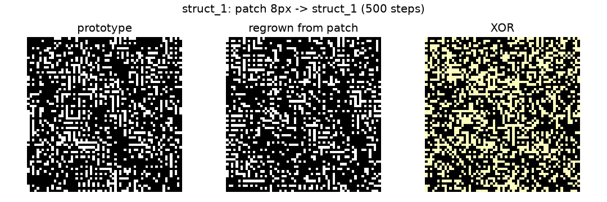

# E02b: перепись морфопространства — результаты

- **ID:** E02b_morphospace
- **Дата:** 2026-10-20
- **Статус:** закрыто
- **Автор/исполнитель:** autonomous-agent
- **Связанные NEG:** NEG-30
- **План:** [2026-10-20-e02b-plan.md](2026-10-20-e02b-plan.md)

## Вопрос

Какие морфологии выученные динамики NCA удерживают из шума и восстанавливаются ли они
после повреждения? E02 проверил одну форму — кольцо — и закрылся отрицательно; E02b
измеряет всё морфопространство имеющихся чекпоинтов без обучения и без новой цели.

## Предзарегистрированные гипотезы

- **H1.** Среди выученных чекпоинтов (кроме H-P1) хотя бы один даёт из шума класс,
  который (а) не смерть/однородное поле, (б) имеет `alive_fraction` 0.05–0.80,
  (в) воспроизводится в ≥80% из 64 стартов, (г) устойчив на последней четверти.
  Опровержение: ≥95% прогонов — смерть/однородность, либо все структурные классы <50%.
- **H2.** Структура R-11 транзиентна: к 2000 шагам переходит в смерть/однородное поле.
  Опровержение: последняя точка структурна у ≥80% стартов.
- **H3.** Ни один класс не восстанавливается после ампутации 20% живых клеток до того же
  класса за 500 шагов в ≥50% повторов. Опровержение: хотя бы один класс ≥50%.
- **H4 (вторичная).** Разброс классов между вариантами локального правила больше, чем
  между сидами внутри варианта. Проверяется только после H1–H3, на малой сетке.

## Дизайн

- **Чекпоинты:** 12 канонических файлов — H-A0 ×5 (сиды 42/101/202/303/404),
  R-9 ×5, R-11 ×1, H-P1 ×1 (положительный контроль, пул стартует из цели) — плюс
  необученная модель той же архитектуры (runtime-контроль, без файла).
- **Старты и развёртка:** 64 детерминированных начальных состояния на чекпоинт
  (сиды 0…63) из `init_state`, 2000 шагов, снимок каждые 50; веса заморожены,
  градиента нет. Устройство и overrides записаны в `census.json`.
- **Дескрипторы (18):** `alive_fraction`, `binary_fraction`, `bright_fraction`,
  `soft_mean`, `entropy`, `log1p_b0`, `log1p_b1`, `chi`, `bbox_fill`,
  `largest_component_fraction`, `radial_var`, `radial_peak_bin`,
  `radial_center_occupancy`, `symmetry_rot_centered`, `symmetry_reflect_centered`,
  `autocorr_lag1`, `autocorr_lag4`, `edge_fraction`.
- **Кластеризация:** Ward по z-нормированным финальным дескрипторам; k выбирается по
  silhouette при минимальном размере класса 5. DBSCAN — проверка согласия (ARI), не
  источник классов. Контроли (H-P1 и необученная модель) проецируются на центроиды
  выученных классов и не участвуют в подгонке.
- **Семантика класса:** `death` при `alive_fraction < 0.01`; `uniform_dark` при
  `binary_fraction < 0.01`; `uniform_bright` при `binary_fraction > 0.95`; иначе
  `structured`.
- **Возмущения:** 3 прототипа на структурный класс; 6 возмущений × 5 повторов = 30
  развёрток на прототип: ампутация 10% и 20%, шум σ=0.1, разрез половины поля,
  пересадка патча в мёртвое поле, мёртвое поле как контроль. 500 шагов, снимок каждые
  25. Восстановление — финальная точка снова назначена на класс прототипа.
- **Контроль:** H-P1 и необученная модель исключены из H1 и из знаменателя исхода;
  мёртвое поле проверяет, не самовоспламеняется ли динамика.
- **Пилот:** 8 сидов × 500 шагов, 13 чекпоинтов, 157.4 с; только тайминг, гипотезы по
  нему не проверялись.

### Отклонения и уточнения до анализа

- Прототип класса в плане назван «медианным по дескрипторам»; операционализирован как
  три прогона по расстоянию до центроида: ближайший, медианного ранга и 2/3-ранга.
  Выбор сделан до запуска переписи и зафиксирован в коде.
- Пункт H1(б) проверяется по медиане `alive_fraction` членов класса, а не по каждому
  прогону: это свойство класса, а не отдельного выброса.
- H2 использует структурные классы, найденные по финальным точкам, и проверяет, был ли
  класс на любом снимке траектории; это чуть строже буквального «структура была».
- Ампутация обнуляет всё состояние выбранных клеток (все 16 каналов), а не только
  `alive` и `visible`. Это сильнее буквального протокола и делает H3 консервативной;
  ограничение зафиксировано ниже.
- H4 переписью не проверяется: нужна отдельная сетка вариантов правила.

## Артефакты

- `morphogenesis/experiments/E02b_morphospace/census.json` — 832 прогона, дескрипторы,
  траектории, кластеры, H1/H2, исход.
- `morphogenesis/experiments/E02b_morphospace/perturbations.json` — прототипы, 180
  возмущений, H3.
- `morphogenesis/experiments/E02b_morphospace/pilot.json` — пилот 13×8×500.
- `reports/figures/e02b_*.png` — 6 прототипов структурных классов, patch identity
  и PCA-карта морфопространства.
- `lab/runs/20261020T195942Z-E02b_morphospace_census.json` — манифест прогона.
- `patch_transplant_exploratory.json`, `patch_identity_exploratory.json`,
  `patch_identity_long_exploratory.json`, `geometric_lesion_exploratory.json`,
  `untrained_recovery_exploratory.json`, `heldout_seeds_exploratory.json` —
  exploratory-проверки после переписи; воспроизводящие их скрипты — в
  `morphogenesis/experiments/E02b_morphospace/scripts/`
  (там же независимый `e02b_verify.py`).
- Лог: `morphogenesis/logs/20261020T195942Z-E02b_morphospace_census.log` (локальный,
  в git не входит).
- Коммиты артефактов: `8e6ee40` (перепись), `481881b` (патчи), `cb776c9`
  (геометрическая абляция), `255e1a3` (сидированный untrained-контроль).

## Результаты

### Перепись

Полный протокол отработал на CUDA: 13 семей × 64 старта = 832 развёртки по 2000 шагов,
снимок каждые 50. `total_seconds=5070.2` (84 мин 30 с), отдельные семейства —
365.4–423.9 с. Манифест лаборатории: 19:59:42–21:30:34 UTC, exit 0. Ошибок и
пропущенных стартов нет; все 64 сида входят в знаменатель.

| Семейство | n | alive med [IQR] | binary med | Классы финалов | Динамика |
| --- | ---: | --- | ---: | --- | --- |
| H-A0 seed42 | 64 | 0.000 [0.000, 0.000] | 0.000 | death 64 | fixed 64 |
| H-A0 seed101 | 64 | 0.000 [0.000, 0.000] | 0.000 | death 64 | fixed 64 |
| H-A0 seed202 | 64 | 0.000 [0.000, 0.000] | 0.000 | death 64 | fixed 64 |
| H-A0 seed303 | 64 | 0.000 [0.000, 0.000] | 0.000 | death 64 | fixed 64 |
| H-A0 seed404 | 64 | 0.000 [0.000, 0.000] | 0.000 | death 64 | fixed 64 |
| R-9 seed42 | 64 | 0.531 [0.515, 0.546] | 0.531 | struct_2 64 | drift 62, fixed 2 |
| R-9 seed101 | 64 | 0.795 [0.755, 0.832] | 0.257 | struct_1 64 | drift 64 |
| R-9 seed202 | 64 | 1.000 [1.000, 1.000] | 0.000 | uniform_dark 64 | fixed 64 |
| R-9 seed303 | 64 | 1.000 [1.000, 1.000] | 1.000 | uniform_bright 64 | fixed 64 |
| R-9 seed404 | 64 | 1.000 [1.000, 1.000] | 0.000 | uniform_dark 64 | drift 64 |
| R-11 seed42 | 64 | 0.938 [0.895, 0.965] | 0.000 | uniform_dark 61, struct_1 3 | drift 64 |
| H-P1 seed42 (контроль) | 64 | 0.017 [0.013, 0.022] | 0.017 | death 35, struct_1 29 | fixed 61, drift 3 |
| untrained (контроль) | 64 | 0.502 [0.488, 0.515] | 0.252 | struct_1 64 | fixed 64 |

Пять H-A0 не оставляют ничего; R-9 расщепляется на четыре разных режима, включая две
структурные морфологии; R-11 почти целиком уходит в `uniform_dark` (живые клетки без
бинарного паттерна); H-P1 в основном умирает. Необученная архитектура устойчиво даёт
`struct_1`.

### Классы

Ward, k=5, silhouette 0.8545. Размеры классов (все прогоны / выученные):
`[160/67, 355/320, 189/189, 64/64, 64/64]`. DBSCAN: 7 кластеров, шум 4/704 (0.57%),
ARI с Ward 0.9137 — разбиение не зависит от выбора алгоритма.

| Класс | Семантика | Выученных | Контролей | alive med | binary med | b0 med | b1 med | entropy med |
| --- | --- | ---: | ---: | ---: | ---: | ---: | ---: | ---: |
| c1 `struct_1` | structured | 67 | 93 | 0.7959 | 0.2561 | 382 | 2 | 0.8606 |
| c2 `death` | death | 320 | 35 | 0.0000 | 0.0000 | 0 | 0 | 0.0000 |
| c3 `uniform_dark` | uniform_dark | 189 | 0 | 1.0000 | 0.0000 | 0 | 0 | 0.0000 |
| c4 `uniform_bright` | uniform_bright | 64 | 0 | 1.0000 | 1.0000 | 1 | 0 | 0.0000 |
| c5 `struct_2` | structured | 64 | 0 | 0.5310 | 0.5310 | 1 | 1844.5 | 0.2535 |

Два структурных класса устроены по-разному. `struct_2` — связная бинарная ткань с
огромным числом дырок (b1 ≈ 1844) и умеренной плотностью 0.531: на снимках это
шахматный лабиринт с горизонтальной трещиной и диагональной линией. `struct_1` —
мелкая спека/перколяция: много компонент (b0 ≈ 382), почти нет дырок, плотность 0.256.
`uniform_dark` — живые, но «молчащие» клетки (`alive=1`, `binary=0`); `uniform_bright` —
сплошная яркая заливка. Ни то, ни другое не является структурой.


На карте первых двух главных компонент 18 дескрипторов (72.0% дисперсии) пять классов
образуют компактные области, а контроли проецируются внутрь `struct_1` и `death`, не
образуя собственного класса. Это визуализация уже найденного разбиения, а не
дополнительное свидетельство.

### H1 — поддержана

Кандидатов два, и оба воспроизводятся идеально:

| Семейство | Класс | Стартов | Воспроизводимость | Устойчивость | alive med |
| --- | --- | ---: | ---: | ---: | ---: |
| R-9 seed42 | `struct_2` | 64 | 64/64 = 1.00 | 64/64 = 1.00 | 0.5310 |
| R-9 seed101 | `struct_1` | 64 | 64/64 = 1.00 | 64/64 = 1.00 | 0.7954 |

`death_or_uniform_fraction = 573/704 = 0.8139` — ниже порога опровержения 0.95.
Максимальная доля структурного класса по семействам: R-9 seed42 = 1.0, R-9 seed101 =
1.0, R-11 = 0.0469 — условие «все структурные < 0.5» не выполнено. H1 **поддержана**.

Оговорка по границе: `struct_1` проходит пункт H1(б) с запасом всего 0.0046
(0.7954 против потолка 0.80). Это не нарушение протокола, но класс находится у самой
границы критерия; сдвиг медианы на полпроцента перевернул бы формальный результат.

### H2 — поддержана

R-11: 64 старта. Финальная точка — смерть/однородное поле у 61/64 = 0.9531; структура
(`struct_1`) была хотя бы на одном снимке у 64/64 = 1.0; транзиентная структура с
последующим уходом — 61/64 = 0.9531. Последняя точка структурна лишь у 3/64 = 0.0469,
то есть опровергающий порог 0.80 не достигнут. H2 **поддержана**: структура R-11 —
короткая переходная фаза, а не удерживаемый аттрактор.

### H3 — опровергнута

Ампутация 20% живых клеток (обнуление всех 16 каналов) на 3 прототипах каждого класса,
5 повторов:

| Класс | n | Вернулись в свой класс | Медиана шага возврата |
| --- | ---: | ---: | ---: |
| `struct_1` | 15 | 15/15 = 1.00 | 25 |
| `struct_2` | 15 | 15/15 = 1.00 | 25 |

`max_recovery_fraction = 1.0`, `supported=false`, `refuted=true`. Оба класса
восстанавливаются после повреждения, намного превосходя порог 50%; H3, ожидавшая
отсутствия восстановления, **опровергнута**. Возврат фиксируется уже на первом снимке
(25 шагов) — быстрее, чем разрешение протокола. Важно: это восстановление **класса**
по 18 дескрипторам, а не побитовая реставрация; exploratory-анализ патчей ниже
показывает, что глобальный рисунок при этом не возвращается. Для `struct_1` ремонт
не требует обучения: необученная архитектура даёт 45/45 таких же возвратов (ниже),
поэтому H3 содержательно опровергнута прежде всего для `struct_2`.

### H4 — не проверялась

`status=not_run`: для H4 нужна отдельная сетка вариантов локального правила. Перепись
её не подменяет; H4 остаётся единственной непроверенной предзарегистрированной
гипотезой.

### Исход

Формальный исход по правилу плана — **`rich_map`**: два структурных класса, оба с
воспроизводимостью 1.0, хотя бы один с восстановлением ≥50% (фактически оба — 100%).
Числа: `n_runs=704`, `n_structural_classes=2`, `n_structural_runs=131` (18.6%),
`death_or_uniform_fraction=0.8139`. Это метка, а не оценка «живости»: 81% выученных
прогонов всё равно уходят в смерть или однородность, а один из двух структурных классов
позже оказался архитектурным конфаундом (ниже).

### Возмущения

6 прототипов (по 3 на класс), 180 исходов, 30 на прототип. Для всех возмущений, кроме
мёртвого контроля — ампутация 10%, ампутация 20%, шум σ=0.1, разрез половины поля,
пересадка — оба класса вернулись в свой класс 15/15, медиана возврата 25 шагов. Контроль мёртвого
поля: 0/15 у обоих классов, поле осталось точно нулевым — самовоспламенения нет,
восстановление требует живых соседей.

Иллюстративные финалы после ампутации 20%:

- `struct_1`: удалено 653 из 3263 живых клеток (20.0%); финал alive 0.7742, binary
  0.2556, b0 381, b1 3.
- `struct_2`: удалено 435 из 2174 (20.0%); финал alive 0.5315, binary 0.5315, b0 1,
  b1 1843.

Разрез половины поля `struct_2` даёт более крупную перестройку (b0 9, b1 1679, alive
0.5796), но к 500 шагам класс снова тот же. Это устойчивость морфологии, а не
побитовая идентичность состояния.

### Exploratory: рост из малого патча и идентичность рисунка

Протокольная пересадка была вырождена (bbox = всё поле), поэтому отдельно проверены
патчи 8×8, 16×16 и 32×32: 2 класса × 3 размера × 5 детерминированных позиций = 30
развёрток по 500 шагов; патч копировался со всеми 16 каналами в нулевое поле.

- **30/30 патчей выросли в свой класс** (5/5 для каждого класса и размера). Площадь
  патча — 1.56%, 6.25%, 25% поля; финальная бинарная плотность — 25–26% у `struct_1`
  и 52–55% у `struct_2`, то есть рост в 16×/4.2×/1.0× и 35×/8.8×/2.1× относительно
  площади патча.
- Контроли: нулевой патч и пустое поле остались ровно нулевыми (0 alive, 0 binary);
  полное состояние в мёртвом поле сохраняет класс. Самовоспламенения нет.
- Возврат в класс: `struct_1` — 25–50 шагов; `struct_2` — 25 шагов для 32×32, 225 для
  8×8 и 275 для 16×16. Чем меньше затравка, тем дольше организуется шахматная фаза.
- **Но глобальный рисунок не восстанавливается побитово.** IoU с прототипом:
  `struct_1` 0.154–0.158 (agreement 0.61–0.62 — ровно случайное совпадение для
  плотности 0.25); `struct_2` 0.453/0.329/0.200 для 8/16/32 при 500 шагах и
  0.468/0.158/0.208 при 2000. К 2000 шагам сходимости к прототипу нет.
  Случайный baseline для независимых бернуллиевских полей плотности 0.53 —
  agreement ≈0.50, IoU = p/(2−p) ≈0.36: только 8×8 выше случайного, 16/32 — ниже.
  `struct_2` из 8×8 сохраняет часть крупномасштабной структуры, но вырастает в
  многодоменную шахматную текстуру с границами зёрен, а не в копию полосы и диагонали.




Вывод exploratory: у обоих классов широкий бассейн притяжения на уровне **класса
текстуры**, а не память конкретной глобальной конфигурации. Это усиливает
интерпретацию H3 как залечивания/самосборки фазы, но не как восстановления информации.
Артефакты: `patch_transplant_exploratory.json`, `patch_identity_exploratory.json`,
`patch_identity_long_exploratory.json`; фигуры `e02b_patch_identity_*.png`.

### Exploratory: геометрическая абляция `struct_2`

Шесть повреждений × 3 повтора, 2000 шагов: половина поля (лево/право/верх/низ),
центральные квадраты 16×16 и 32×32. Все 18 прогонов остаются `struct_2` во всех
срезах (500/1000/2000), но fidelity глобального рисунка резко различается (IoU с
прототипом на 2000 шагах):

| Повреждение | IoU median | Разброс |
| --- | ---: | --- |
| центр 16×16 | 0.841 | 0.835–0.846 |
| центр 32×32 | 0.744 | 0.744–0.749 |
| срезана правая половина | 0.796 | 0.771–0.801 |
| срезана верхняя половина | 0.806 | 0.806–0.807 |
| срезана нижняя половина | 0.564 | 0.516–0.733 |
| срезана левая половина | 0.431 | 0.297–0.456 |

Локальная дыра 16×16 залечивается почти идеально (IoU 0.89 уже на 500 шагах, 0.84 к
2000), 32×32 — хуже (0.81 → 0.74). Для половин поля результат асимметричен: сохранение
правой или верхней половины восстанавливает рисунок с IoU ≈0.80, сохранение левой —
только 0.43, нижней — 0.56. То есть глобальная фаза не «размазана» равномерно по полю:
какие-то её якоря теряются вместе с левой/нижней половиной. Это exploratory на одном
чекпоинте и трёх повторах, поэтому асимметрия — наблюдение, а не установленный закон.

Артефакт: `geometric_lesion_exploratory.json`.

### Контроль архитектуры

- Канонический untrained-контроль (одна несидированная инициализация) — `struct_1`
  64/64, alive 0.502, binary 0.252, b0 271.5, b1 14.
- H-P1 — `death` 35/64, `struct_1` 29/64, alive med 0.017.

То есть `struct_1` — не уникальный продукт обучения: в ту же область попадают и
необученная архитектура, и часть H-P1. `struct_2` не встречается ни у одного контроля и
ни у одного другого выученного чекпоинта — это самый сильный кандидат на выученную
морфологию.

Отдельный exploratory-прогон с тремя **сидированными** untrained-инициализациями
(42/43/44) и той же ампутацией 20% закрывает этот вопрос: в каждой инициализации
64/64 стартов дают `struct_1` (alive med 0.5018, binary med 0.2520, b0 271.5, b1 14),
и после ампутации 20% — **45/45 возвратов в `struct_1` на 25-м шаге**. Необученная
архитектура не только попадает в тот же класс, но и «ремонтируется» так же, как
обученный R-9 seed101. Следовательно, восстановление `struct_1` не требует обучения:
это архитектурное свойство, а не выученный ремонт. Артефакт:
`untrained_recovery_exploratory.json`.

### Exploratory: отложенные сиды 64–127

Перепись использовала сиды 0–63. Чтобы исключить привязку к конкретным 64
последовательностям, те же два чекпоинта прогнаны на сидах 64–127 (другие начальные
поля и шаговый шум). Классы назначались замороженными центроидами census, без
перекластеризации. Правило зафиксировано до прогона: ≥52/64 в целевом классе и ≥80%
из них устойчивы на последней четверти.

| Семейство | Класс | n | В целевом классе | Устойчивы | alive med |
| --- | --- | ---: | ---: | ---: | ---: |
| R-9 seed42 | `struct_2` | 64 | 64/64 | 64/64 | 0.5278 |
| R-9 seed101 | `struct_1` | 64 | 64/64 | 64/64 | 0.7944 |

Оба класса перенеслись на отложенные сиды без единого исключения; alive-медианы
отличаются от переписи на 0.003 и 0.001. Это снимает возражение «класс существует
только для сидов 0–63», но не возражение о единственном тренировочном сиде:
репликация обучения R-9 seed42 по-прежнему нужна. Артефакт:
`heldout_seeds_exploratory.json`.

## Интерпретация

E02b отвечает на вопрос E02: выученные динамики не сводятся к смерти. После провала
кольца это первый положительный структурный результат: 18.6% выученных прогонов
удерживают структуру, и существует класс `struct_2`, который (а) воспроизводится из
всех 64 шумовых стартов, (б) не встречается у контролей, (в) переживает удаление 20%
клеток и разрезание поля. В рамках этого протокола `struct_2` — устойчивый выученный
аттрактор с ремонтом, а не переходный узор.

При этом «rich_map» не означает «жизнь». Формальная метка выполнена двумя классами, но
`struct_1` делит область дескрипторов с необученной архитектурой и H-P1 и
восстанавливается без обучения в 45/45 повторов, поэтому его ремонт нельзя приписать
обучению. Более того, вся перепись измеряет только
морфологию в фиксированных точках: она не проверяет адаптацию, цели, информацию или
агентность. Корректная формулировка: у одной обученной модели найден устойчивый
самовосстанавливающийся морфологический аттрактор; является ли он «геометрией жизни» —
открытый вопрос, а не вывод переписи.

Быстрый возврат (25 шагов) и восстановление после разрезания согласуются с локальным
правилом, которое залечивает дыры и восстанавливает статистику ткани, а не с
«регенерацией плана». Exploratory-патчи это уточняют: даже 8×8 фрагмент вырастает в
свой класс, но глобальная конфигурация не восстанавливается (IoU 0.15–0.47, у
`struct_1` agreement на уровне случайного). То есть работает широкий бассейн
притяжения текстуры, а не память конкретного рисунка. Для проверки памяти нужны
геометрические возмущения с фиксированной ориентацией и анализ восстановления полосы
и диагонали `struct_2`, а не только класса.

## Что опровергнуто

- **H3 опровергнута**: оба структурных класса восстанавливаются после ампутации 20%
  в 100% повторов, а не в <50%. Это положительный результат, хотя формально он
  записывается как опровержение негативной гипотезы (NEG-30).
- **Представление «структура — редкость или артефакт» опровергнуто**: 131 выученный
  прогон структурен, два класса воспроизводятся в 64/64 стартов каждый.
- **H2 поддержана, а не опровергнута**: надежда на долгоживущую структуру R-11 не
  подтвердилась — она транзиентна (финал однороден у 95.3% стартов).
- **Пересадка патча как доказательство роста не подтверждена и не опровергнута**:
  тест вырожден (патч = всё поле), поэтому в отчётности он не считается свидетельством.
- **Кольцо E02 остаётся не-аттрактором**; E02b его не реабилитирует.

## Ограничения

1. **Один сид на класс.** `struct_2` существует только у R-9 seed42, `struct_1` — у
   R-9 seed101. Перепись не различает «свойство обученной динамики» и «удачную
   траекторию одного тренировочного сида». Отложенные сиды 64–127 (exploratory) дают
   64/64 для обоих классов, но это устойчивость к шуму, а не к тренировочному сиду.
   Репликация обучения R-9 seed42 была бы прямым тестом, но это уже новый
   тренировочный прогон.
2. **Архитектурный конфаунд `struct_1`.** Необученная модель 64/64 попадает в тот же
   класс; H-P1 — 29/64. Три сидированные необученные инициализации дают 64/64
   `struct_1` и 45/45 восстановлений после ампутации 20%. H1 формально выполнена и на
   `struct_2`, но интерпретация `struct_1` как выученной морфологии не поддержана:
   это архитектурный аттрактор.
3. **Граница H1(б).** `struct_1` проходит с запасом 0.0046 по `alive_fraction`.
4. **Ампутация сильнее протокола.** Обнуляются все 16 каналов, а не только alive и
   visible. Это делает H3 консервативной, но не позволяет отделить вклад alpha-канала
   от видимого состояния.
5. **Пересадка в протоколе была неинформативна.** Bbox обоих классов — всё поле,
   поэтому «патч» равнялся полю. Exploratory-патчи 8/16/32 исправили это: класс растёт
   из фрагмента, но глобальный рисунок не восстанавливается. Поэтому пункт о пересадке
   в основном протоколе остаётся отклонением, а вывод о росте опирается только на
   exploratory.
6. **Метрика восстановления — класс, а не идентичность.** Возврат в класс означает
   совпадение 18 дескрипторов, а не восстановление исходной конфигурации клеток;
   медиана 25 шагов — это первый снимок, реальное время может быть меньше. IoU
   exploratory-патчей 0.15–0.47 подтверждает, что это не побитовая реставрация.
7. **Канонический untrained-контроль несидирован.** Одна инициализация в census не
   воспроизводима между процессами; exploratory-прогон с сидами 42/43/44 закрывает
   этот пробел частично (три инициализации, не распределение).
8. **k=5 и семантика классов** выбраны по silhouette и порогам; другие k или пороги
   могут переименовать пограничные прогоны. DBSCAN-согласие (ARI 0.914) снижает, но не
   устраняет эту зависимость.
9. **`census.json` не сохраняет `centroids_z` и метки членов кластера** в том виде,
   который нужен для внешнего переназначения; центроиды восстановимы из финальных
   дескрипторов выученных прогонов (так и сделано в exploratory-скрипте), но это
   reproducibility gap инструмента.
10. **Геометрическая абляция — exploratory на одном чекпоинте** (3 повтора, 2000 шагов).
    Асимметрия «левая половина хуже правой» статистически не установлена и может быть
    свойством конкретного сида; повтор нужен до любой интерпретации.
11. **H4 не проверена**, WP5 не открывался, дефолты `config.py` не менялись, плечо не
    промотировалось.

## Следующий шаг

1. Сидированный untrained-контроль выполнен: 3/3 инициализации дают 64/64 `struct_1`
   и 45/45 восстановлений. Вычесть `struct_1` из выученного вклада; H3 содержательно
   опровергнута только для `struct_2` (15/15 после ампутации 20%).
2. Геометрическая абляция уже выполнена exploratory (18 прогонов): центр 16/32
   залечивается с IoU 0.84/0.74, половины поля — асимметрично (0.43–0.81). Следующий
   корректный шаг — повтор на реплицированном чекпоинте и с большим числом повторов,
   иначе асимметрия остаётся наблюдением одного сида.
3. Проверить, является ли `struct_2` свойством тренировочного сида: реплицировать обучение
   R-9 seed42 (или найти промежуточные чекпоинты) — это отдельное решение владельца, а не
   часть E02b.
4. Только после этого — H4 на малой сетке локальных правил. WP5 остаётся закрытым.

## Воспроизведение

```bash
# из корня репозитория
cd morphogenesis
../.venv/Scripts/python.exe e02b_morphospace.py --steps 2000 --seeds 0-63

# через лабораторный контур (пишет манифест и state)
cd ..
.venv/Scripts/python.exe scripts/lab.py run --experiment E02b_morphospace_census \
  --experiment-id E02b --arm census --seed 0 --steps 2000 --owner autonomous-agent \
  -- .venv/Scripts/python.exe -u e02b_morphospace.py --steps 2000 --seeds 0-63

# exploratory-проверки (каждая пишет свой JSON в experiments/E02b_morphospace)
.venv/Scripts/python.exe morphogenesis/experiments/E02b_morphospace/scripts/e02b_geometric_lesion.py
.venv/Scripts/python.exe morphogenesis/experiments/E02b_morphospace/scripts/e02b_patch_identity.py
.venv/Scripts/python.exe morphogenesis/experiments/E02b_morphospace/scripts/e02b_patch_identity_long.py
.venv/Scripts/python.exe morphogenesis/experiments/E02b_morphospace/scripts/e02b_untrained_recovery.py
.venv/Scripts/python.exe morphogenesis/experiments/E02b_morphospace/scripts/e02b_heldout_seeds.py
.venv/Scripts/python.exe morphogenesis/experiments/E02b_morphospace/scripts/e02b_morphospace_map.py

# независимая проверка census/perturbations (не доверяет harness-полям)
.venv/Scripts/python.exe morphogenesis/experiments/E02b_morphospace/scripts/e02b_verify.py
```

Повторный запуск `e02b_patch_identity.py` и `e02b_geometric_lesion.py` 2026-10-21
дал семантически идентичные JSON: совпадают все поля, кроме `wall_seconds` и путей
к фигурам. Это проверка воспроизводимости в другом процессе, а не новый прогон
переписи.

Артефакты переписи: `census.json` (15.5 МБ), `perturbations.json` (1.9 МБ),
`pilot.json` (0.6 МБ). Машинные логи и веса в git не входят.
